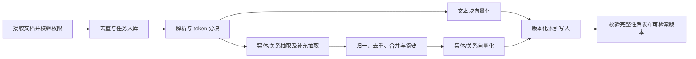

# TjLightRAG 移植步骤说明

## 1. 目标与分析基线

将 HKUDS/LightRAG 的核心算法及平台功能移植到本项目，目标是可追溯、可测试的 Java 实现。运行时采用本项目技术栈，不以启动 Python 服务并代理其接口代替算法移植。

- 上游仓库：https://github.com/HKUDS/LightRAG
- 本次实际获取并阅读的提交：`aaebfe1bb8d55deb6a4304d357a3bf4c92fcd40a`，分析日期：2026-10-26。
- 本工程：JDK 21、Spring Boot 4.1.2、Spring AI 2.0.2、Maven、JPA、Flyway、Lombok、SLF4J；React、TypeScript、Vite、Tailwind CSS、pnpm、中英文国际化。
- 唯一必需持久化服务：PostgreSQL 18 + pgvector。图结构存 PostgreSQL 普通表，不要求 Neo4j、Apache AGE、Redis 或独立向量数据库。
- 本文仅是源码分析和实施方案，未实施 RAG 功能、数据库升级或模型调用，也未执行上游测试。现有登录功能继续作为平台入口。

上游 main 会持续变化。实施时以此 SHA 为基线；升级上游须重新记录差异，不直接跟随 main。下列“上游行为”来自本次读取代码；“目标设计”及接口、表名为本项目计划，不代表已有实现或兼容承诺。

## 2. 已读取的源码与移植映射

| 上游源码 / 入口 | 从代码确认的职责 | Java 移植落点（计划） |
| --- | --- | --- |
| [base.py](https://github.com/HKUDS/LightRAG/blob/aaebfe1bb8d55deb6a4304d357a3bf4c92fcd40a/lightrag/base.py)：QueryParam、BaseKVStorage、BaseVectorStorage、BaseGraphStorage、DocStatusStorage | 六种查询模式及四类存储契约；文档状态模型 | `common.rag` 契约与 DTO；`app.rag.storage` 适配器 |
| [lightrag.py](https://github.com/HKUDS/LightRAG/blob/aaebfe1bb8d55deb6a4304d357a3bf4c92fcd40a/lightrag/lightrag.py)：LightRAG、ainsert、aquery_data、aquery_llm、adelete_by_doc_id | 索引/查询编排、上下文与生成分离、删除和来源重建 | `app.rag.service` 应用服务 |
| [pipeline.py](https://github.com/HKUDS/LightRAG/blob/aaebfe1bb8d55deb6a4304d357a3bf4c92fcd40a/lightrag/pipeline.py)：apipeline_enqueue_documents、apipeline_process_enqueue_documents、process_single_document | 文档接收、去重、排队、解析、抽取和状态推进 | `app.rag.ingestion` 持久化任务管线 |
| [chunker/token_size.py](https://github.com/HKUDS/LightRAG/blob/aaebfe1bb8d55deb6a4304d357a3bf4c92fcd40a/lightrag/chunker/token_size.py)：chunking_by_token_size | 固定 token 滑窗、重叠、分隔符、原文位置映射 | `app.rag.chunk` 分块策略和 tokenizer 适配器 |
| [operate.py](https://github.com/HKUDS/LightRAG/blob/aaebfe1bb8d55deb6a4304d357a3bf4c92fcd40a/lightrag/operate.py)：extract_entities、_merge_nodes_then_upsert、_merge_edges_then_upsert | 抽取、补充抽取、名称归一、描述摘要、来源合并、节点/边写入 | `app.rag.extraction`、`app.rag.graph` |
| operate.py：extract_keywords_only、_perform_kg_search、_get_node_data、_get_edge_data | 高/低层关键词、实体/关系检索及图扩展 | `app.rag.retrieval` |
| operate.py：_apply_token_truncation、_merge_all_chunks、_build_context_str、naive_query | 图上下文预算、轮询合并、可选重排、引用、纯向量查询 | `app.rag.context`、`app.rag.query` |
| [prompt.py](https://github.com/HKUDS/LightRAG/blob/aaebfe1bb8d55deb6a4304d357a3bf4c92fcd40a/lightrag/prompt.py)、[utils.py](https://github.com/HKUDS/LightRAG/blob/aaebfe1bb8d55deb6a4304d357a3bf4c92fcd40a/lightrag/utils.py) | 抽取/关键词/摘要/回答模板；缓存、token、引用等公共逻辑 | 版本化资源模板和可测试的算法工具 |
| [kg/postgres_impl.py](https://github.com/HKUDS/LightRAG/blob/aaebfe1bb8d55deb6a4304d357a3bf4c92fcd40a/lightrag/kg/postgres_impl.py)：PGKVStorage、PGVectorStorage、PGDocStatusStorage | PostgreSQL 文档、分块、缓存、三类向量及状态存储；pgvector 距离和索引处理 | JPA 仓库 + 原生 SQL 向量仓库 |
| [kg/pgtable_impl.py](https://github.com/HKUDS/LightRAG/blob/aaebfe1bb8d55deb6a4304d357a3bf4c92fcd40a/lightrag/kg/pgtable_impl.py)：PGTableGraphStorage | 节点/边普通表、workspace/namespace 隔离、JSONB 属性和批量图操作 | PostgreSQL 节点/关系表与批量图访问 |
| [api/routers](https://github.com/HKUDS/LightRAG/blob/aaebfe1bb8d55deb6a4304d357a3bf4c92fcd40a/lightrag/api/routers/query_routes.py)：query_routes、document_routes、graph_routes | 查询、流式回答、文档管理、图谱浏览及编辑 | Spring MVC REST/SSE 和对应前端页面 |
| [rerank.py](https://github.com/HKUDS/LightRAG/blob/aaebfe1bb8d55deb6a4304d357a3bf4c92fcd40a/lightrag/rerank.py)、parser/、chunker/、evaluation/、lightrag_webui/ | 重排、文件解析、多种分块、评估与界面 | 按阶段选择性移植；界面按本项目重建 |

上游 MIT 许可证允许移植，但复制、翻译或改写源码和提示词时，必须保留其版权声明和许可文本。实施第一阶段将上游 LICENSE 原文放入第三方许可文件，并记录每个移植类/模板的源文件、函数、SHA、改写点及对应测试；本文件只描述方案，没有复制算法实现。

## 3. 应保留的算法行为

### 3.1 索引链路



1. 文档接收与处理分离，保存输入摘要、来源、配置版本、处理状态和错误，不把长耗时索引绑定在上传 HTTP 请求中。
2. 固定 token 分块先移植上游默认策略，保留顺序、重叠、分隔符语义与来源位置。校验 `0 <= overlap < chunkSize`。不可用字符串长度冒充 token 数；中文、emoji、UTF-8 边界需要专门用例。
3. 上游文档 ID 根据是否提供来源等条件生成，不能概括成“全部按正文 MD5 去重”。本项目业务 ID 采用 UUID；另存内容指纹及来源键，并记录与上游 ID 策略的差异。块内容相同不代表文档来源相同。
4. 抽取包含实体名、类型、描述，以及关系端点、描述和关键词；当前默认模板要求实体行 4 个字段、关系行 5 个字段，关系权重按解析/合并规则产生，不能擅自要求模型多输出一个权重字段。保留补充抽取（gleaning）及有界重试。空记录、坏输出、超长记录不能直接进入图谱。
5. 先复现上游默认分隔符输出的解析行为；结构化 JSON 是上游已有可选路径，后续可通过 Spring AI 结构化输出接入，须使用独立测试比较，不直接宣称两者完全等价。
6. 节点合并不仅是 UPSERT：还包含类型归并、描述去重、摘要和来源合并。关系需要规范化端点、合并来源与权重，并处理端点缺失。
7. 上游多处把关系作为无向关系，对端点排序后去重。首期保留该语义，禁止把 A—B 与 B—A 算作两条边；Java 端须明确 Unicode 码点排序规则，不能未经验证直接以 UTF-16 `String.compareTo` 替代 Python 字符串排序。
8. 为文本块、实体和关系分别生成向量；只实现块向量不足以称为 LightRAG 核心移植。

### 3.2 查询链路

| 模式 | 上游行为及本项目计划 |
| --- | --- |
| `naive` | 直接检索文本块向量，完成去重、可选重排、token 预算与回答；先用于建立基准 |
| `local` | 使用低层关键词召回实体向量，批量取节点、度数及关联边，再回溯文本块 |
| `global` | 使用高层关键词召回关系向量，取关系及其端点实体，再回溯文本块；不等同于扫描整个图 |
| `hybrid` | 合并 local 与 global 图检索结果，不额外启动 mix 的直接块向量召回分支 |
| `mix` | hybrid 图检索 + 查询原文的文本块向量检索，是上游 QueryParam 默认模式 |
| `bypass` | 不检索知识库，直接调用模型；后置为诊断功能，界面明确无知识库引用 |

关键顺序以 operate.py 为准：

1. 关键词提取分别返回高层主题词和低层实体词；已提供的关键词、解析失败及空关键词分支应独立测试。
2. 按模式批量生成必要的查询 embedding，避免无意义地重复请求。
3. local 的实体保持向量相似顺序，相关边使用 degree/rank 与 weight 排序；global 的关系保持向量检索顺序。不能统一替换成任意综合评分。
4. 来源块选择先保留上游默认 `kg_chunk_pick_method=VECTOR`、分组配额和边界行为，另覆盖 weighted polling 及回退路径；单实体/单关系仅需一块时，不能因整数配额为零而错误跳过向量选择。local/global 的实体和关系结果先轮询合并并去重。来源块来自向量、实体、关系三路，`_merge_all_chunks` 按该顺序轮询合并；不是默认 RRF，也不是简单拼接后全局排序。
5. 先裁剪实体/关系预算，再选择来源块；在 `_build_context_str` 中计算系统提示、图上下文、问题及保留空间对块预算的影响，经 `process_chunks_unified` 进行可选重排和最终块截断，再生成引用。
6. 保留“只返回上下文/检索数据”“只返回提示词”和实际生成路径的可比性。预算不足不得截出无来源引用，回答中的引用必须能回到原文。
7. 回答模板要求只依据上下文、证据不足时明确无法回答、使用问题语言并提供可追溯引用；模板版本与引用输出格式一起测试。
8. 上游 conversation_history 用于模型上下文，不直接参与检索。若未来加入查询改写，作为显式新增功能和差异项，不隐式改变移植行为。

## 4. PostgreSQL 18 + pgvector 存储方案

### 4.1 存储职责与约束

上游 PostgreSQL 中的 `PGGraphStorage` 使用 Apache AGE；本项目参考独立的 `PGTableGraphStorage` 路径，避免把“存储使用 PostgreSQL”误认为必须部署 AGE。

- 文档、图谱、关联、状态、缓存、任务、向量均在 PostgreSQL；首期不引入第二个业务数据库。
- 原文文件可放在同一 PostgreSQL 的独立二进制附件表，设置上传上限；解析文本与块正文仍独立存储。大文件外置对象存储作为后续明确的架构变更，首期不依赖本地容器目录保存唯一副本。
- 一切知识库数据包含 `knowledge_base_id`，关联使用包含知识库标识的复合约束，防止跨库连接。该隔离是本平台新增设计，对应上游 workspace/namespace 概念，不代表其完整多租户权限模型已移植。
- 元数据与标准 CRUD 使用 JPA；pgvector 的距离查询、批量 UPSERT、邻接查询使用专用仓库的参数化原生 SQL/JDBC，并参与同一 Spring 事务。不得在 Controller 拼接 SQL。
- Flyway 管理结构，JPA 保持 `ddl-auto: validate`。保留已经执行的 V1，新增版本迁移；SQL 关键字大写、标识符小写，全部表/字段提供 COMMENT。

### 4.2 建议数据模型（实施阶段细化）

| 表/表组 | 关键内容与约束 |
| --- | --- |
| `rag_knowledge_base`、`rag_knowledge_base_member` | 知识库、权限、当前有效索引版本/配置 |
| `rag_document`、`rag_document_revision`、`rag_document_blob` | 逻辑文档、不可变修订、原始输入、内容指纹及来源；原文访问受权限限制 |
| `rag_chunk`、`rag_document_chunk` | 块正文、token 数；文档修订到块的多对多关联、顺序与来源区间，支持跨文档共享相同块 |
| `rag_entity`、`rag_relation` | 规范实体名、类型、描述；规范端点对、关系摘要、关键词、权重；索引版本与知识库隔离 |
| `rag_extraction_result`、`rag_entity_chunk`、`rag_relation_chunk` | 每块/抽取版本的结构化结果及贡献；完整来源关联，支持删除后从剩余贡献重建 |
| `rag_chunk_embedding`、`rag_entity_embedding`、`rag_relation_embedding` | 三种向量、对象标识、模型空间及索引版本；严禁只建立一个混合语义的向量集合 |
| `rag_index_generation`、`rag_embedding_space` | 模型标识、维度、归一化、距离度量、配置/提示词版本；构建与发布状态 |
| `rag_ingestion_job`、`rag_job_event` | 状态、阶段、租约、重试次数、取消请求、检查点、错误摘要 |
| `rag_llm_cache` | 按用途隔离的抽取/关键词/摘要/回答缓存，包含知识库、索引版本、模型和提示词版本 |
| `rag_query_trace` | 请求模式、召回与截断数量、引用、模型耗时与 token 用量；不默认记录完整敏感提示词 |

来源关联必须保存完整集合，不能只保留拼接字符串或截断后的 `source_id`。删除文档时不能级联删除其他文档仍引用的共享块、实体或关系。

### 4.3 向量落地步骤

1. 选择并验证支持 PostgreSQL 18 的 pgvector 发行镜像/构建方式，固定实际版本和镜像摘要。现有 `postgres:18` 镜像不能假定包含 vector 扩展；单独验证扩展安装、升级、备份和恢复。
2. 迁移账户执行 `CREATE EXTENSION IF NOT EXISTS vector`，应用账户仅授予所需 DML 权限。启动验证 `pg_extension` 版本及向量写入/查询，不能只看数据库端口可连接。
3. 首期每个部署固定一个 embedding 维度 D，创建 `VECTOR(D)` 列；模型确定后才生成相应 Flyway 迁移，不能默认所有模型都是 1536 维。校验实际输出维度、非有限值、空向量和零范数向量。
4. 首期采用 cosine：SQL `<=>` 返回距离，越小越相似；对外相似度按 `1 - distance` 解释，阈值做明确转换。查询使用绑定参数及显式 vector 类型，不把距离误当相似度。
5. 先用精确检索验证算法与阈值，再为三种向量建立 HNSW / `vector_cosine_ops` 索引。验证选定扩展版本的维度限制；超限必须更换模型或单独评估 halfvec 及精度差异，不能靠建索引失败后静默降级。
6. 所有召回过滤知识库、可见文档/有效索引版本。ANN 在过滤后可能不足 topK，测试不同知识库规模与选择性，按扩展能力评估 iterative scan 或精确检索回退，并记录查询计划与召回率。
7. 模型、tokenizer、抽取模板变化创建新索引代，不覆盖旧代；全量回填和验证后原子切换当前代。相同维度但不同模型也不能混检。更换维度需新表/结构迁移，后续多维度共存另行设计。
8. Spring AI 负责 `ChatModel`、`EmbeddingModel` 等模型适配；pgvector 适配器的 schema 初始化由 Flyway 统一管理。是否使用 Spring AI PgVectorStore 须先验证三类集合、过滤和批量能力，不强行把自定义查询藏进通用 Advisor。

## 5. Java 与前端结构规划

保留 `common`、`app`、`bootstart` 三模块，不提前拆成微服务。

```text
backend/common/src/main/java/com/trs/common/rag/
  model/          查询参数、检索结果、引用、状态 DTO（Lombok）
  port/           Tokenizer、ModelGateway、GraphStore、VectorStore 等契约
backend/app/src/main/java/com/trs/app/rag/
  ingestion/      文档任务与阶段编排
  chunk/          分块算法和来源映射
  extraction/     抽取解析、gleaning、归一
  graph/          合并、来源重建和图访问
  retrieval/      六模式路由及实体/关系/块召回
  context/        去重、轮询、重排、预算和引用
  model/          Spring AI 模型适配、限流及重试
  persistence/    JPA 实体与原生 SQL 仓库
  api/            REST、SSE、校验和权限
backend/bootstart/src/main/resources/
  db/migration/   增量迁移
  prompts/        带版本号的模板及上游来源说明
frontend/src/features/
  knowledge-base/ documents/ query/ graph/ settings/
```

Spring AI 调用按抽取、关键词、摘要、回答、embedding、rerank 分角色配置。模型密钥只经安全配置注入，日志不输出；未选择真实供应商前采用测试替身。上线验收仍须补做真实模型调用，不能用替身通过声称 AI 问答已完成。

前端继续遵循 DESIGN.md、Tailwind 与中英文切换；模型密钥不发到浏览器。新增功能前先写 JUnit Jupiter / Vitest + jsdom 测试。类与公共方法注释包含当前系统用户名的 author；JavaBean 使用 Lombok。

## 6. 分阶段实施顺序与退出条件

所有阶段都先生成测试，再实现功能；后续阶段依赖前一阶段验收通过。这里的顺序不是工期承诺。

### 实施步骤总览

下表与本节阶段 0—7 一一对应，作为执行与验收清单；详细要求以各阶段正文为准。当前为方案状态，表格不表示功能已经完成。

| 步骤 / 阶段 | 前置条件 | 主要实施内容 | 交付物 | 验收标准 |
| --- | --- | --- | --- | --- |
| 0：移植契约与对照基线 | 固定上游提交及本项目技术栈 | 阅读源码与测试，保存许可和来源映射；准备中英文 golden 样本，先写对照测试 | 第三方许可、来源台账、差异规则、固定样本及测试骨架 | 核心算法均有来源、预期结果和差异判定规则 |
| 1：存储与知识库边界 | 阶段 0 验收通过 | 验证 PostgreSQL 18 + pgvector；增量 Flyway 迁移，建立 JPA/原生仓库、三类向量和知识库权限 | 数据模型、存储适配器、知识库 REST、数据库配置与集成测试 | 空库和 V1 升级通过；三类向量可写可查；登录数据保留，跨库访问拒绝 |
| 2：文档、任务、解析和分块 | 阶段 1 验收通过 | 定义解析契约，支持 TXT/Markdown 上传与粘贴；保存原文和任务，移植 token 分块，提供重试/取消及来源映射 | 上传与任务 REST、解析/分块器、文档列表和任务详情页 | 重启可恢复、重复输入幂等；中文/emoji、重叠与来源区间正确；长文档不阻塞请求线程 |
| 3：抽取与图谱合并 | 阶段 2 验收通过 | 移植实体/关系抽取、补充抽取、归一、合并、摘要；生成块/实体/关系向量，保存逐块贡献 | 抽取与合并服务、版本化提示词、图谱及向量写入管线 | 固定响应匹配 golden 数据；并发不丢来源、不重复累加权重；通过完整性校验后发布 |
| 4：五种检索模式 | 阶段 3 验收通过 | 依次实现 naive、local、global、hybrid、mix；移植关键词、图扩展、轮询去重、预算与引用 | 检索服务、检索数据接口、算法对照测试 | 各模式候选、排序、截断与引用符合基线；mix 同时使用图和块向量召回 |
| 5：回答、流式与问答界面 | 阶段 4 验收通过；真实模型配置可用 | 接入 Spring AI 回答、可选重排、POST SSE、缓存隔离与取消；构建中英文问答页面 | 生成与流式接口、引用回看、问答页面及前后端测试 | 真实模型完成上传—索引—问答—引用闭环；断开释放资源，流式失败可见 |
| 6：删除、重建和图谱管理 | 阶段 5 验收通过 | 按剩余来源重建共享知识；实现安全删除、索引新代构建/切换/回滚，提供有限邻域浏览 | 删除/重建服务、索引管理接口、图谱浏览页面 | 被删内容不可检索，共享知识保留；失败不破坏当前索引，无悬空边或孤立向量 |
| 7：格式扩展、评估与交付 | 阶段 0—6 核心闭环验收通过 | 分批扩展 PDF/DOCX 和其他分块策略；单独评估 OCR/多模态；验证质量、性能与部署恢复 | 扩展解析器、评估报告、部署/升级/备份恢复说明及能力清单 | 已交付格式通过样本测试；指标满足预先冻结的门槛；容器重建与恢复不丢数据，未实现能力明确列出 |

文档解析专项属于阶段 2 和阶段 7：先完成 TXT/Markdown 的解析与分块闭环，再在阶段 7 扩展 PDF/DOCX。此前讨论的 Tika、flexmark-java、PDFBox、POI 是待源码对照与样本验证的候选技术，尚未在本方案中确定为依赖；不得以选用解析库代替 LightRAG 分块及来源追踪算法的移植。

### 阶段 0：建立移植契约与对照基线

- 保存固定上游 SHA 的许可、来源映射和行为差异表。
- 从上游函数及现有测试提取小型中英文固定样本：原文、token 序列、模型响应、实体/关系、查询关键词、预期候选和引用。
- 模型输出使用录制/手写 fixture；向量提供固定数值；精确检索先用于排除 HNSW 近似误差。
- 在开发用 Python 环境运行选定的上游函数生成 golden 数据，仅用于对照，不作为产品运行依赖。
- 先写 Java 对照测试壳和前端新增导航测试；记录哪些结果要求完全一致、哪些允许浮点误差或有意差异。
- **退出条件**：每个核心算法都有来源、样本、预期和差异规则；许可证已落盘，不能只有一份宽泛任务列表。

### 阶段 1：PostgreSQL + pgvector 与知识库边界

- 先写 Testcontainers PostgreSQL 18 + vector 集成测试：扩展、三类向量、距离排序、阈值、知识库隔离、事务回滚、重复键和非法维度。
- 新增 Flyway 迁移、JPA/原生仓库、知识库管理 REST；修改 dev/prod 和 Compose 指向带 pgvector 的 PostgreSQL 18。
- 校验 FK、唯一键、表/字段 COMMENT 和持久化卷；添加已知向量的精确结果测试。
- **退出条件**：空库迁移和已有 V1 数据库升级都通过；三类向量可写可查，登录数据保留，跨库访问拒绝。

### 阶段 2：文档、任务、解析和分块

- 先测试空内容、重复输入、不同来源同内容、相同块多文档复用、中文/emoji、token 重叠、权限及中断恢复。
- 首批支持纯文本和 Markdown 上传/粘贴；保留格式扩展接口，不在首批就承诺 PDF/OCR 全部可用。
- 创建持久化任务，提供阶段状态、失败原因、有限重试、取消与重跑；首批状态使用上游 pending/parsing/processing/processed/failed，analyzing 留待多模态。
- 前端提供知识库、文档上传、列表与任务详情；状态文案中英文。
- **退出条件**：重启后任务可恢复，重复提交不重复发布索引；正文、块顺序、来源区间可核对。长文档不会阻塞请求线程。

### 阶段 3：实体/关系抽取与图谱合并

- 先测试坏格式、归一、补充抽取上限、正反边合并、类型冲突、描述去重/摘要、来源保留及并发重试幂等。
- 按固定源码行为移植抽取模板与解析器，再移植节点/边合并、摘要与三类向量生成。
- 保存逐块抽取贡献；图谱和向量只有完整性校验通过后才发布到查询版本。
- **退出条件**：固定模型响应下的实体、关系和来源匹配 golden 数据；并发导入同名实体不会丢来源或重复增加权重；真实供应商小样本抽取另行验证。

### 阶段 4：naive 基线，再移植 local/global/hybrid/mix

- 先测试模式路由、双层关键词、向量顺序、节点/边度数排序、轮询去重、三路来源块、token 预算、引用和无结果响应。
- 先打通 naive 用于比较，再依次实现 local、global、hybrid、mix；默认最终切换为 mix。
- 返回可观察的检索数据，不把模型自然语言回答作为算法正确性的唯一判据。
- **退出条件**：固定向量/关键词下四种图检索模式及 naive 的候选、排序、截断与引用符合基线；证明 mix 确实同时使用图和块向量分支。

### 阶段 5：回答、流式输出、缓存和问答界面

- 先测试上下文/提示词预览、无证据回答、引用映射、缓存隔离、超时和流式取消。
- 接入 Spring AI 回答和可选 rerank；无重排模型时明确返回未重排状态。重排异常不能悄悄改变预算或产生越界索引。
- 实现 POST SSE：浏览器使用 fetch 流读取，以便携带现有会话及 CSRF；定义 metadata、delta、references、error、done 事件和取消协议。
- 缓存键包含知识库、当前索引代、模型/提示词/分块版本、查询模式与相关参数；有历史的回答缓存纳入历史与用户作用域，或首期禁用回答缓存。
- 前端提供模式选择、引用回看、加载/错误/取消，保留登录、注销和中英文。
- **退出条件**：真实模型完成上传—索引—问答—引用闭环；断开请求释放模型资源，SSE 中途失败可见且不会伪装完成。

### 阶段 6：删除、重建和图谱管理

- 先测试两个文档共享实体/关系、共享块、删除重试、任务并发、索引重建失败与回滚。
- 删除先使文档不可见；移除该文档贡献后，从剩余贡献重建实体/关系描述、权重与向量，仅清理无引用对象，失效相关缓存。
- 并行索引重建并原子发布新代；保留旧代用于受控回滚。删除和重建采用知识库/索引级锁与版本检查，防止删除后旧任务再次写回。
- 首批图谱界面只做标签搜索、有限邻域浏览、节点/关系详情；编辑、实体合并、关系删除随后逐项实现并同步来源、缓存与向量。
- **退出条件**：删除后检索不到被删内容，同时共享知识仍可检索；重建失败不破坏当前可用索引，无悬空边与孤立向量。

### 阶段 7：文件格式扩展、评估与交付

- 按 parser 与 chunker 的源实现分批扩展 PDF/DOCX、递归字符/语义分块、标题路径。OCR、多模态/VLM、外部解析服务单独验证并记录新增部署依赖。
- 复用上游 evaluation 的思路建立本项目中英文语料；离线测召回和引用，真实模型测回答质量与成本。
- 验证单应用镜像 + PostgreSQL 向量实例的 Compose 冷启动、升级、备份恢复和回滚；容器重建不丢原文及索引。
- **退出条件**：交付版本附源码映射、偏差清单、测试报告、扩展版本、模型配置、已实现/未实现能力列表，不能仅展示一张问答页面。

## 7. 一致性、并发和安全细则

- HTTP 接收事务只保存文档与任务；模型调用不得占用长数据库事务。以短事务、幂等 UPSERT、阶段检查点推进，最终发布索引版本。
- 首期可用 PostgreSQL 任务表 + `FOR UPDATE SKIP LOCKED` 调度；租约续期、超时恢复和 fencing token/版本 CAS 必须共同防止旧 worker 写回。不得把仅靠 JVM 内存锁的任务称为可恢复任务。
- 对同实体/关系的合并按稳定顺序加锁，合并输入按贡献键去重，限制死锁重试；重复执行不得累加同一来源的关系权重。
- 查询固定一次当前索引代，并只读取该代已发布且有权限的对象；失败或半完成的任务不能暴露部分图谱。
- 上传类型/大小、压缩包展开、文档来源路径都要校验；初期不开放任意 URL 抓取。知识库和原文下载都校验成员权限，不接受客户端自报 workspace 作为授权依据。
- 文档内容是不可信模型输入；模板明确区分指令和资料，限制工具权限。提示词防注入不能只依靠一句系统提示。
- 日志仅记录追踪 ID、阶段、统计和脱敏错误；凭据、完整原文、提示词默认不入日志。管理和重试接口沿用现有认证与 CSRF 防护。

## 8. REST 与页面实施清单（本项目计划接口）

以下是目标 API，不是对上游 HTTP 协议的逐字兼容。默认都需要认证与知识库授权；写请求验证 CSRF，分页与图节点数有上限。

| 功能 | 建议接口 | 对应页面/结果 |
| --- | --- | --- |
| 知识库管理 | `/api/knowledge-bases`、`/{kbId}` | 列表、创建、配置 |
| 文档导入/分页/删除 | `/{kbId}/documents`、`/{docId}` | 上传、状态、原文、删除确认 |
| 任务与重试/取消 | `/{kbId}/jobs`、`/{jobId}/retry`、`/{jobId}/cancel` | 阶段、进度和错误摘要 |
| 仅检索/上下文 | `/{kbId}/retrieval` | 模式、候选、分数语义、引用、预算统计 |
| 非流式与流式问答 | `/{kbId}/query`、`/{kbId}/query/stream` | 回答、来源、流式状态 |
| 图谱浏览与搜索 | `/{kbId}/graph`、`/{kbId}/entities`、`/{kbId}/relations` | 有限邻域、详情、来源 |
| 索引重建/状态 | `/{kbId}/indexes/rebuild`、`/{kbId}/indexes` | 模型空间、版本、发布状态 |

表中的 `/{kbId}` 均以 `/api/knowledge-bases` 为父路径。`bypass`、图谱写操作、外部 API 兼容层在相应阶段单独加入，避免一个万能接口隐藏权限差异。

## 9. 测试基线与最终验收

参考上游已有测试的位置，包括：

- `tests/kg/pgtable_impl/test_pgtable_graph_storage.py`、`test_pgtable_smoke.py`：普通表图存储。
- `tests/kg/postgres_impl/test_postgres_delete_set_ids.py`：PostgreSQL 删除集合行为。
- `tests/test_operate_entity_chunk_selection.py`、`test_kg_vector_chunk_quota.py`、`test_operate_vector_context.py`：来源块选择与向量召回。
- `tests/api/routes/test_query_stream_routes.py`、`test_aquery_data_endpoint.py`：流式和检索数据接口。

实施时阅读具体断言再转写 Java/TypeScript 测试，不能仅照搬测试名。固定 fixtures 的算法级输出要求一致；浮点比较设明确误差，排序同分时给出稳定规则。若 tokenizer、标识符、状态模型或协议有意不同，必须记录原因及影响。

| 验证层 | 通过标准 |
| --- | --- |
| 纯算法 | 分块、抽取、合并、排序、去重、预算与引用通过上游固定样本对照 |
| 存储 | 在真实 PostgreSQL 18 + pgvector 上运行，无 H2 替代；精确结果正确，ANN 召回和执行计划可解释 |
| 数据生命周期 | 导入、重复导入、失败恢复、删除、共享来源保留、重建和模型切换均通过 |
| 前端 | Vitest/jsdom 覆盖上传状态、模式选择、SSE 解析/取消、引用、权限错误和中英文；另做真实浏览器闭环 |
| 模型集成 | 对选定供应商实测 embedding、抽取、关键词、摘要和回答，记录版本、耗时、token 和限流行为 |
| 质量与性能 | 在阶段 0 冻结语料、标签和 topK，记录 naive/local/global/hybrid/mix 的 Recall@K、MRR、引用命中率、延迟和成本；设定门槛后再验收，不预先捏造达标数值 |
| 部署 | 单应用镜像、vector 扩展、迁移、持久化卷、HTTPS、备份恢复和冷启动通过；保留可重现命令和报告 |

首个核心可用版本必须完成阶段 0—6 中的文本/Markdown闭环、五种检索模式、三类向量、来源引用、可恢复任务和安全删除。完成 naive 只能称为向量 RAG 基线。格式扩展、图谱编辑和高级功能逐项标注状态，不因延期从清单中消失。

后续候选能力包括自定义知识图谱导入、结构化 JSON 抽取、其他 chunker、rerank、多模态、Ollama 兼容 API、批量运维与上游新增功能。每项在来源映射表登记后进入独立迭代，不承诺首期与上游全部功能完全一致。

## 10. 下一步执行入口

下一编码任务从阶段 0 开始：建立第三方许可与来源台账、固定样本和算法对照测试；随后阶段 1 验证 PostgreSQL 18 + pgvector。到模型集成前确认供应商、模型、维度、tokenizer、上下文窗口与安全凭据配置，这些不阻塞当前文档交付和不依赖模型的测试准备。

所有实现均在 develop 或 feature/* 分支生成，测试通过后先合并 main 再按用户授权推送。此文档不触发编码、建表、模型请求、合并或推送。
