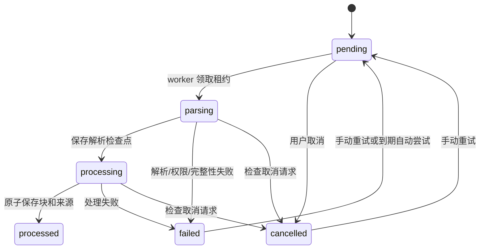

# 阶段 2：文档、任务、解析与分块

## 交付范围

本阶段实现 TXT/Markdown 的上传与粘贴、不可变文档修订、PostgreSQL 原文存储、持久化任务、有界后台 worker、严格 UTF-8 解析、真实 BPE 分块、章节/来源定位及中英文管理页面。

`processed` 在此阶段表示“预处理/分块完成”，前端显示“已分块”。尚未生成实体、关系、embedding 或可查询的 RAG 索引；阶段 3 继续实施抽取与图谱合并，不用本阶段成功代替完整索引成功。

## 技术与上游来源

| 能力 | 本阶段选择 | 来源 / 适配 |
| --- | --- | --- |
| TXT | Java NIO 严格 UTF-8 decoder | 保留 CRLF 和正文；只移除开头一个 UTF-8 BOM，非法编码报错 |
| Markdown | flexmark-java 0.64.8 | 提取标题结构，保持原文；围栏代码块中的 `#` 不视为标题；不执行 HTML、不抓取外部链接 |
| tokenizer | JTokkit 1.1.0，cl100k_base | Maven 内嵌词表 SHA-256 与 tiktoken 官方值完全一致；运行时再次校验，不联网下载词表 |
| 固定 token 窗口 | FixedTokenChunker | 依据 LightRAG `chunker/token_size.py`，固定上游 aaebfe1bb8d55deb6a4304d357a3bf4c92fcd40a，MIT 许可已保留 |
| metadata | JPA StoredRevision + 知识库/成员实体 | 元数据按复合知识库/修订键访问；不可变 JPA 映射防止无意 dirty write |
| 去重/租约/原文/来源批量提交 | 参数化 JDBC | 使用 PostgreSQL UPSERT、SKIP LOCKED 和条件更新，加入同一 Spring 事务 |
| 文件识别边界 | 扩展名白名单 + 字节上限 + 严格正文检查 | 首期仅 TXT/MD/Markdown，不做自动编码猜测、PDF/DOCX/OCR；Tika 等仍是阶段 7 候选 |

JTokkit 自带 cl100k_base 词表的 SHA-256：`223921b76ee99bde995b7ff738513eef100fb51d18c93597a113bcffe865b2a7`。该值来自 tiktoken 0.12.0 官方实现。阶段 0 下载受代理拒绝的问题通过“读取 Maven 已发布资源并比对官方原始哈希”解决；未更改期望哈希，未关闭 TLS/校验。

本阶段明确使用 cl100k_base，不宣称与上游默认模型的所有 tokenizer 配置相同，也不自动推断未来 embedding 模型的编码。literal special token 字符串按普通文本编码。换编码/解析器/分块策略版本后，旧任务拒绝静默换算法，需显式支持旧版本或提交新修订。

## 分块对照与 UTF-8 边界适配

- `legacy(...)` 保留上游固定窗口、显式分隔符和 delimiter-only 路径，使用真实 tiktoken 生成的 **9 个 BPE 案例**对照 token ID、块顺序、内容、来源及超限错误。
- 上游直接切 token 可能切入多字节字符，decode 会产生 U+FFFD，某些块没有可验证的来源区间。生产导入不把这种结果发布成“精确来源”。
- 实际导入策略标识为 `lightrag-fixed-utf8-safe-v1`：沿用固定 token 窗口和重叠思想，窗口末端向内调整到合法 UTF-8 字符边界，下一窗口起点向前对齐合法边界。实际重叠可能略大于期望；不超过最大窗口，不丢非空白字符。
- 对齐后直接从原始解析正文截取内容，按上游空白规则去掉边缘空白，记录对应 **Unicode 码点半开区间** `[sourceStart,sourceEnd)`。不能用 Java/JavaScript UTF-16 下标直接解释该区间。
- 保存全局 tokenStart/tokenEnd 和窗口 token 数（去边缘空白前），因此 token 数不一定等于对最终 trimmed 内容重新编码的长度。
- 默认 chunkSize=512、overlap=64；本阶段要求 size 16..4096，overlap 0..size/2，避免 Unicode 边界调整后不前进；每文档最多 20000 块。达到上限明确失败，不静默截断。
- 当前导入 API 使用整篇固定窗口；库级 `legacy` 分隔符路径已对照验证，UI 不开放分隔符选择。高级/语义分块仍按阶段 7 扩展。
- 章节与有序块通过单次顺序遍历关联，避免逐块重扫标题。章节路径附加到每个来源关联，不加入共享块正文；相同正文可以出现在不同章节/来源位置。

## 数据模型和去重

V1/V2 保持不变。V3 新增 6 张表，并扩展原始块哈希；V4 将共享块外键改为提交时校验，既允许整库级联清理，又禁止遗留悬空来源。新表/字段/约束说明均记录在 PostgreSQL COMMENT 中。

| 存储 | 含义 |
| --- | --- |
| rag_document | 每库逻辑文档，唯一键 `(knowledge_base_id,source_name)`，当前修订指针 |
| rag_document_revision | 不可变原文字节摘要、格式、tokenizer/策略/解析器版本、分块参数；parsed_text 和码点数为解析检查点 |
| rag_document_blob | 原文字节，最多 5 MiB，保存在 PostgreSQL BYTEA，不依赖本地目录 |
| rag_chunk.content_hash | SHA-256 内容标识，唯一键含知识库 ID；数据库 CHECK 验证正文与哈希匹配，防止共享正文被旧写接口改写 |
| rag_document_chunk | 修订到块的多对多关联，保存顺序、token/来源区间及章节；同一块可在同一文档重复出现 |
| rag_ingestion_job | 每修订一个持久化任务，执行用户、状态、attempt 上限、租约、fencing token、取消与重试时间 |
| rag_job_event | 有序脱敏阶段事件，不保存完整正文或异常内容 |

去重规则：同库 + 同逻辑来源 + 同原文字节 + 同格式/分块/版本参数，复用修订和任务，返回 `duplicate=true`，不会重复排队。相同正文但不同来源保留不同文档/原文及来源关联，并共享块；来源内容/参数变化创建新修订，旧修订保持可读。重新提交历史相同内容可将当前指针重新指向该修订，这是显式提交，不自动删除历史版本。

并发共享块写入以 `(knowledge_base_id,content_hash)` 为唯一 UPSERT 仲裁键；新记录候选 ID 使用随机 UUID，冲突返回数据库既有 ID，避免确定性主键与内容唯一约束同时竞争。各事务按内容哈希排序写入共享块，文档来源顺序另行保存。

上传文件名取 basename，只作为显示/去重键，不拼接文件系统路径。文本粘贴可指定逻辑名称；同名被视为同一逻辑文档，应使用不同名称区分不同来源。API 不开放任意 URL 抓取、归档解包或非文本格式解析。

## 状态、恢复和原子性



1. 上传请求只校验输入、计算摘要并保存原文/修订/任务，不在请求线程解析、tokenize 或等待后台完成；返回 HTTP 202。
2. 默认两个 worker、有限本地执行队列；任务源始终是 PostgreSQL。领取使用 `FOR UPDATE SKIP LOCKED`，每次生成新 token。默认租约 60 秒，心跳最多每 2 秒一次。
3. 解析与分块在事务外执行；原文哈希、捕获的 tokenizer/策略/解析器版本在加载时验证。不匹配分别报 `source_integrity`、`unsupported_version`，不消费错误输入。
4. 已保存的 parsed_text 可在 worker 替换后复用；分块未提交的工作重新计算。阶段 0 草案的 `chunks_saved` 恢复点在这里落实为“解析检查点 + 原子块提交”，不暴露部分块写入状态。
5. 块、来源关联和 `processed` 状态在一个短事务提交；先按哈希排序获取共享块写锁，再按文档顺序写关联，减少并发共享块死锁。最终再次校验当前 token/租约；失败全部回滚，旧 worker 不能写回。
6. 每次执行默认最多 3 次自动尝试，失败间隔按已尝试次数递增。非法编码、版本/原文校验、空内容、二进制内容和权限丢失不自动重试；临时处理异常有界重试。失联且耗尽次数的任务转 failed/attempts_exhausted。
7. 手动重试只允许 failed/cancelled，显式重置 attempt 周期，并以当前有权限的请求用户作为执行用户；不会伪造已有成功结果。
8. pending/failed 可立即取消；运行中先持久化 cancel_requested，worker 在阶段/分块边界检查并停止。已取得发布锁的原子提交与取消按锁顺序线性化，不提供强杀解析器线程的承诺。
9. 知识库共享事务锁与整库删除的独占事务锁协调，避免删除与新来源提交交叉；所有写/重试/取消仍检查 OWNER/WRITER，READER 仅查看/下载。

`rag.ingestion.enabled`（默认 true）可暂停本实例 worker；已提交任务保留。其余参数：`concurrency=2`（1..8）、`lease-seconds=60`（10..86400）、`max-attempts=3`（1..10，新任务捕获上限）、`max-chunks=20000`。修改处理版本不是改动旧任务配置的捷径。

## REST 接口

所有路径以 `/api/knowledge-bases/{kbId}` 为父路径，使用既有会话和写请求 CSRF。非成员/跨库对象 404，无写权限 403，参数错误 400，文件过大 413。

| 方法 / 路径 | 输入与输出 |
| --- | --- |
| POST /documents/text | JSON：sourceName、text、format=text/markdown、chunkSize、overlap；202 Submission(documentId,revisionId,jobId,duplicate) |
| POST /documents/upload | multipart file，query chunkSize/overlap；只接受 .txt/.md/.markdown；202 Submission |
| GET /documents?page=0&size=20 | 当前修订列表 PageSlice(items,total,page,size)，含任务状态和块数 |
| GET /documents/{id} | 当前修订元数据 |
| GET /documents/{id}/content | text/plain UTF-8 解析正文；尚未解析为 409 |
| GET /documents/{id}/original | 原文字节附件，下载同样检查成员权限 |
| GET /documents/{id}/chunks?page=0&size=20 | 有序块和精确来源 PageSlice |
| GET /jobs?page=0&size=20 | 任务列表 PageSlice |
| GET /jobs/{id} | 状态、attempt、取消标记、脱敏错误及最近 100 条事件；不返回 lease token |
| POST /jobs/{id}/cancel | 202 最新任务详情 |
| POST /jobs/{id}/retry | 202 最新任务详情 |

content/original/chunks 支持 `revisionId` 查询历史修订，但必须属于该库/文档。分页 size 1..100，page 0..100000。单文件上限 5 MiB，multipart 请求上限 6 MB；JSON 文本在 UTF-8 编码后检查同一原文上限；JSON 请求体（含转义和字段）另限 6 MiB，即使没有 Content-Length 也在 Jackson 解析前拒绝超限。

## 前端

登录后使用知识库侧栏及文档/任务页面，可创建/选择知识库、粘贴、上传、调整窗口、查看状态/事件、取消/重试、下载原文、预览章节和分块。中英文同步覆盖状态和错误；只读成员的写操作禁用，后台仍独立鉴权。

定时刷新任务，切库/卸载时中止旧读取请求，异步响应不写入其他库。源码与块按纯文本渲染，不使用 dangerous HTML；Markdown HTML 不执行。会话过期回到登录；原文、密码及令牌不保存到浏览器持久化存储。

## 验证与重现

```sh
# 按现有开发流程启动向量库并准备运行角色
source docs/scripts/cloud-env.sh
docker compose -f docker/compose.dev.yml up -d --wait
docker compose -f docker/compose.dev.yml exec -T db bash /docker-entrypoint-initdb.d/01-runtime-user.sh
cd backend
mvn -B verify
cd ../frontend
pnpm test
pnpm build
```

真实 BPE 基准重放仅用于开发，需要阶段 0 固定上游检出及 Python 环境；词表来自已下载的 JTokkit jar 并先比对官方哈希：

```sh
/workspace/tools/lightrag-reference-venv/bin/python docs/scripts/generate-bpe-baseline.py \
  --upstream /tmp/LightRAG-reference \
  --vocab-jar /workspace/.m2/repository/com/knuddels/jtokkit/1.1.0/jtokkit-1.1.0.jar \
  --check
```

生成器不改写阶段 0 的受控 tokenizer 语料；9 个真实 BPE 案例保存在独立 bpe-corpus.json。若确需更新，去掉 --check 并审查完整 diff，不能以生成新 expected 代替修复候选实现。

## 本次验收

后端 `mvn -B verify`：87 项通过，0 失败、0 错误、0 跳过；前端 Vitest + jsdom：11 项通过，TypeScript/Vite 生产构建通过。真实 BPE 基准 9 个案例与固定上游重放一致。后端集成测试包括 4 轮双 worker 同内容并发发布和受限初始化脚本权限的空库启动。

完整前后端同镜像已在独立 PostgreSQL 18 + pgvector 空库上冷启动，Flyway V1—V4 成功；经实际 HTTP 验证登录/CSRF、文本与 Markdown 上传、幂等、共享块 ID、14 块有序来源、原文下载及章节。镜像静态 JS/CSS 与本次前端产物一致并可读取；运行 UID 10001，可读取随镜像分发的第三方许可。测试仅使用 fixture-3d，未调用模型。

数据库 Compose 入口新增 `docker/db-entrypoint.sh`：启动时将只读挂载的角色初始化脚本复制至容器内并固定为 0755，再执行官方入口；Compose 显式传入 `postgres` 命令，避免覆盖 entrypoint 时丢失镜像默认命令。已验证宿主脚本 0700 仍可完成初始化，不依赖 Git 检出的 umask；保留原有命名数据卷，现有卷可通过上述幂等脚本补建角色。

已完成真实服务重启实验：worker 暂停时，88,240 字节正文在约 0.11 秒被接收并保存为 pending；重复提交返回同一任务。重启 JVM 并启用 worker 后，两份不同来源的文档各生成 246 个有序块，块 ID 共享、码点区间、CRLF、原文字节和章节均验证一致；非法 UTF-8 转永久失败，取消/手动重试跨重启保留。测试知识库已通过 API 删除，未删除既有数据库卷或用户数据。

单元/集成验证与真实重启实验分开报告；前者包括故障注入的过期租约、配置/原文篡改、半途 SQL 回滚、撤权、并发领取和共享块，不把测试替身当作完整 RAG 质量证明。PDF/DOCX/OCR、模型调用、抽取、向量索引发布与问答仍按后续阶段推进。

最终开发环境也已按更新后的 Compose 重启，保留既有命名数据卷；通过前端代理再次完成登录、上传、异步分块与删除临时知识库的闭环。网页返回 200，未认证知识库接口返回 401。镜像归档已更新至 `docker/images/tjlightrag.tar`（忽略文件），旧归档已另行备份；变更尚未提交或推送。
