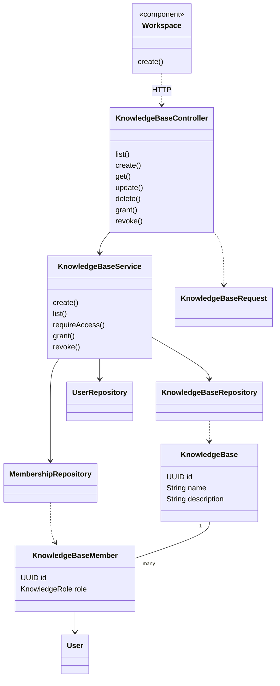
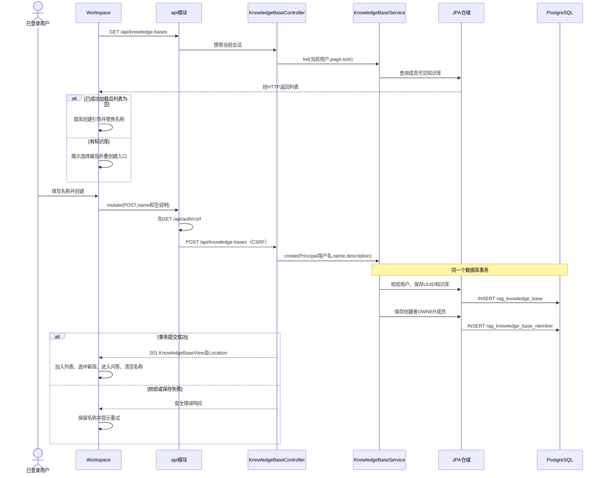

# 创建知识库实现

## 1. 基线与主要实现

代码基线 `d65cef8`，核对日期 2026-11-04。设计见[创建知识库设计](创建知识库设计.md)。

| 文件 | 职责 |
| --- | --- |
| [Workspace](../frontend/src/Workspace.tsx) | 加载知识库、首库引导、共享创建表单、选中与切换 |
| [api](../frontend/src/api.ts) | 会话请求、CSRF 获取及写请求 |
| [KnowledgeBaseController](../backend/app/src/main/java/com/trs/app/rag/KnowledgeBaseController.java) | 创建、列表、元数据和成员 API |
| [KnowledgeBaseRequest](../backend/app/src/main/java/com/trs/app/rag/KnowledgeBaseRequest.java) | 名称及说明校验 |
| [KnowledgeBaseService](../backend/app/src/main/java/com/trs/app/rag/KnowledgeBaseService.java) | 事务创建、OWNER 成员、可见列表及统一权限检查 |
| [KnowledgeBase](../backend/app/src/main/java/com/trs/app/rag/KnowledgeBase.java) | 知识库实体 |
| [KnowledgeBaseMember](../backend/app/src/main/java/com/trs/app/rag/KnowledgeBaseMember.java) | 用户与知识库角色关系 |

## 2. 主要实现类图

## 3. 主接口及关联 API

| 方法与路径 | 行为 |
| --- | --- |
| GET `/api/knowledge-bases?page=0&size=20` | 当前用户可见列表，分页大小 1～100 |
| POST `/api/knowledge-bases` | 创建，返回 201 和 `Location` |
| GET `/api/knowledge-bases/{id}` | 读取有权访问的知识库 |
| PUT `/api/knowledge-bases/{id}` | OWNER 修改名称、说明 |
| DELETE `/api/knowledge-bases/{id}` | OWNER 删除及级联清理 |
| PUT `/api/knowledge-bases/{id}/members/{username}` | OWNER 为已有用户设置 READER/WRITER |
| DELETE `/api/knowledge-bases/{id}/members/{username}` | OWNER 撤销非所有者成员 |

创建请求为 `{"name":"业务知识库","description":""}`，响应 `KnowledgeBaseView` 包括 `id,name,description,role`。当前页面发送的说明固定为空串；上述更新、删除、成员接口不应理解为页面已经有对应操作入口。

## 4. 创建时序图

## 5. 事务、权限与初始数据

`KnowledgeBaseService` 类级 `@Transactional` 使 `create()` 中两次仓储保存处于同一事务。创建者来自 `Principal`，服务端通过 `UserRepository` 查找当前用户，再生成知识库与成员 UUID，不接受调用方传入所有者。

[V2 迁移](../backend/bootstart/src/main/resources/db/migration/V2__knowledge_bases_and_vectors.sql)创建 `rag_knowledge_base`、`rag_knowledge_base_member`。成员的 `(knowledge_base_id,user_id)` 唯一，部分唯一索引约束每库单一 OWNER；后续迁移给知识库增加活动索引指针等字段。创建不会插入文档、模型绑定或索引代。

`requireAccess()` 根据知识库及用户名查找成员，使用共享事务锁配合敏感生命周期操作；写入再检查是否 READER。OWNER 专属接口进一步验证角色。知识库 UUID 是后续文档、索引、图谱、模型绑定和对话的隔离边界。

前端 `loaded` 与列表长度共同决定首库引导，避免网络异常被当成空列表。请求失败保留输入；`busy` 防止重复点击。切换知识库给业务组件不同的 `key`，配合组件清理逻辑隔离状态。

## 6. 当前边界与验证

- 后端列表支持分页；当前 `Workspace` 未提供知识库列表翻页，仅发默认列表请求，因此选择器不是全量知识库管理界面。
- 页面没有描述输入、成员编辑、知识库改名或删除按钮。文档记录后端这些能力，但不声明其已在当前菜单开放。
- 创建接口没有幂等请求键；请求成功但客户端丢失响应时，盲目再次创建可能产生另一知识库，应先刷新列表确认。
- 本次为现状文档，不自动配置模型、注入示例数据或修改系统权限。

前端验证见 [WorkspaceNavigation.test.tsx](../frontend/src/WorkspaceNavigation.test.tsx)和 [Workspace.test.tsx](../frontend/src/Workspace.test.tsx)；服务端知识库及成员隔离还由 [IngestionIntegrationTest](../backend/bootstart/src/test/java/com/trs/rag/storage/IngestionIntegrationTest.java)、[RetrievalIntegrationTest](../backend/bootstart/src/test/java/com/trs/rag/storage/RetrievalIntegrationTest.java)等集成场景覆盖。
