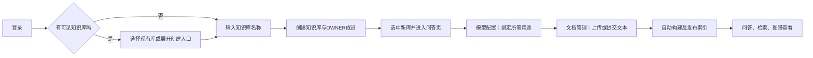

# 创建知识库设计

## 1. 基线与目标

编写日期 2026-11-04，代码基线 `d65cef8`。依据[系统设计](../DESIGN.md)及当前工作区和知识库生命周期代码。对应[创建知识库实现](创建知识库实现.md)。

为已登录用户建立独立的文档、索引、模型用途及对话空间，并自动赋予创建者所有者权限。创建是业务空间初始化，不是自动上传数据、配置模型或构建索引。

## 2. 入口与交互

当前“创建知识库”不是五个业务菜单中的独立内容页，而是两个入口共用同一创建表单：

1. 登录后可见知识库列表成功加载且为空时，优先展示“创建第一个知识库”引导，名称输入框自动聚焦。
2. 已有知识库时，左侧知识库选择区下方的“创建知识库”折叠入口允许继续创建。

不能把知识库列表加载失败当成“没有知识库”；失败时保留错误和刷新入口。创建成功后加入当前列表、选中新知识库、切换到“知识库问答”页面，并清空名称。

## 3. 数据与业务规则

| 内容 | 规则 |
| --- | --- |
| 创建者 | 当前已认证用户，不接受前端指定另一个所有者 |
| 名称 | 必填，最多 100 字符；页面拒绝纯空白，后端去除首尾空白 |
| 说明 | API 支持可选说明，最多 4000 字符；当前页面不显示该字段，提交空串 |
| 标识 | 服务端生成 UUID，名称不是隔离键 |
| 所有者 | 创建事务内同时建立 OWNER 成员记录 |
| 初始索引 | 无活动索引，后续文档流程构建后才可检索 |
| 模型用途 | 初始没有自动绑定；所有者需在模型配置中选择用途 |

知识库本体与所有者成员关系必须原子提交，不能出现知识库创建成功但创建者没有访问权限的中间状态。

## 4. 成员与关联功能

| 角色 | 权限概要 |
| --- | --- |
| OWNER | 知识库元数据、成员授权、用途绑定及文档写操作 |
| WRITER | 文档写操作，以及问答、图谱和检索 |
| READER | 文档读取，以及问答、图谱和检索 |

当前后端还支持更新、删除和成员授权/撤销 API，但本次菜单页面没有提供完整成员管理或知识库编辑、删除界面。成员授权仅面向已有用户，不能通过普通授权接口转移 OWNER。

## 5. 创建后的业务路径

进入问答页不表示已满足回答前置条件；没有索引时应给出明确提示。配置和索引的操作分别见[模型配置设计](模型配置设计.md)、[文档管理设计](文档管理设计.md)。

## 6. 异常与验收

- 创建期间禁用重复提交；创建失败保留用户名称，允许重试。
- 401 进入会话失效流程，403 显示权限提示，网络或服务故障显示请求失败。
- 知识库切换通过当前知识库 ID 驱动各页面重新初始化，取消旧请求、清理对话及文件对话框。
- 验收覆盖首库引导、空白/长度校验、创建事务与 OWNER、失败草稿保留、已有库新增和跨知识库隔离。
