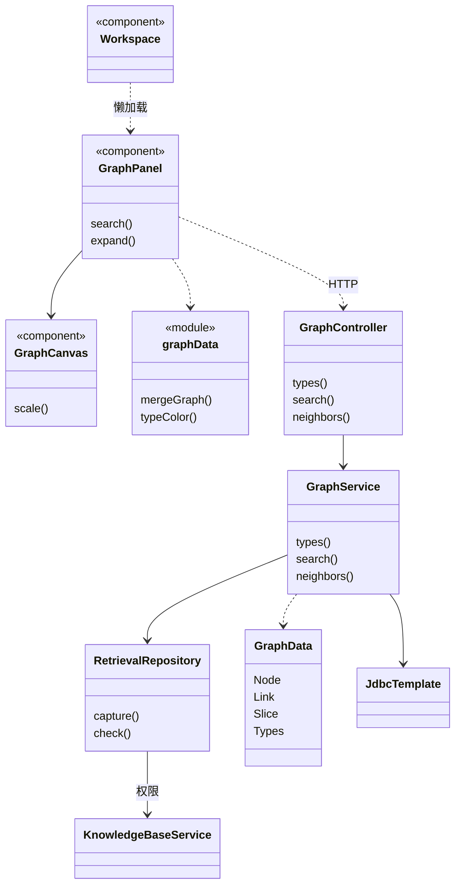
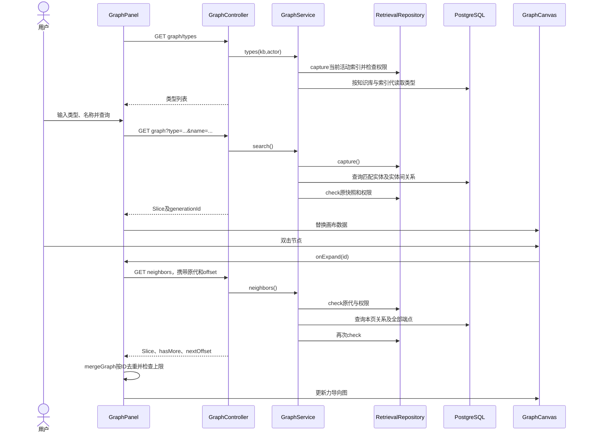

# 图谱查看实现

## 1. 基线与主要文件

代码基线 `d65cef8`，核对日期 2026-11-04；对应[图谱查看设计](图谱查看设计.md)。

| 文件 | 职责 |
| --- | --- |
| [Workspace](../frontend/src/Workspace.tsx) | 菜单注册，使用 `lazy`、`Suspense` 按需加载图谱页面 |
| [GraphPanel](../frontend/src/GraphPanel.tsx) | 类型加载、查询、邻居偏移、取消、错误提示和详情 |
| [GraphCanvas](../frontend/src/GraphCanvas.tsx) | D3 力导向模拟、SVG 绘制、缩放、拖动和展开事件 |
| [graphData](../frontend/src/graphData.ts) | 数据类型、稳定颜色、ID 合并与画布数量限制 |
| [GraphController](../backend/app/src/main/java/com/trs/app/rag/graph/GraphController.java) | 会话认证的只读 HTTP 入口 |
| [GraphService](../backend/app/src/main/java/com/trs/app/rag/graph/GraphService.java) | 捕获索引、SQL 查询、分页和权限复核 |
| [GraphData](../backend/app/src/main/java/com/trs/app/rag/graph/GraphData.java) | `Node`、`Link`、`Slice`、`Types` DTO |

## 2. 主要实现类图

前端函数组件以组件节点表示，`graphData` 是工具模块，不是 Java 类。

## 3. API 与响应结构

前缀为 `/api/knowledge-bases/{kb}/graph`，均为 GET，无模型推理调用。

| 路径 | 参数 | 返回 |
| --- | --- | --- |
| `/types` | 知识库路径参数 | `{generationId,types}` |
| 空路径 | `type=""`、`name=""` | `Slice`，表示新查询结果 |
| `/entities/{id}/neighbors` | 必填 `generationId`；`offset=0`，范围 0～1000000 | `Slice`，包含中心及本页邻接端点 |

`Slice` 字段为 `generationId`、`nodes`、`links`、`hasMore`、`nextOffset`。查询响应的 `hasMore` 表示实体或内部关系被截断，`nextOffset=0`；它不是查询翻页游标。邻居响应的 `hasMore`、`nextOffset` 才用于下一次展开。

`Node.attributes` 保留存储中的原生 JSON 属性映射。`Link.source/target` 使用 UUID，不以实体名称连接。底层数据来自 `rag_index_entity`、`rag_index_relation`；初次查询通过 `rag_knowledge_base.active_generation_id` 关联 `ready` 代。

## 4. 查询及展开时序图

## 5. 关键实现细节

- `search()` 使用参数化 `POSITION(LOWER(?) IN LOWER(name))>0`，类型精确相等；查询多取一条判断是否截断。关系两端都必须属于返回的匹配节点集。
- `neighbors()` 不重取活动代，构造原代 `Snapshot` 并调用 `check()`，按关系 ID 排序读取 `100+1` 条。通过同知识库、同代 UUID 集合补齐端点。
- `GraphService` 使用 15 秒短事务。事务未设置数据库只读标志，因为成员校验需要共享行锁；业务上没有图谱写入。
- D3 使用 `forceSimulation`、`forceLink`、`forceManyBody`、`forceCenter`、`forceCollide`；缩放使用 `zoom`，拖动使用 `drag`。节点展开禁用默认双击缩放。
- `GraphCanvas` 复制输入数据后参与模拟，避免 D3 将关系端点改成对象而污染业务状态；按 ID 复用坐标。清理时停止模拟并移除事件和绘图组。
- `GraphPanel` 维护每个节点的偏移，全部展开后记为 `null`；`mergeGraph()` 拒绝跨代合并和超过 500 节点/1000 关系的更新。
- 前端依赖固定为 `d3 7.9.0`、`@types/d3 7.4.3`，锁文件同步保存。

## 6. 异常与验证

无活动索引使用 `retrieval_no_active_index`；非法筛选或偏移返回 400；无权访问、无效索引或节点按服务端访问检查返回对应非披露状态。401 触发重新登录；展开错误不清空原图。

测试入口：[GraphPanel.test.tsx](../frontend/src/GraphPanel.test.tsx)、[graphData.test.ts](../frontend/src/graphData.test.ts)、[WorkspaceNavigation.test.tsx](../frontend/src/WorkspaceNavigation.test.tsx)及 [RetrievalIntegrationTest](../backend/bootstart/src/test/java/com/trs/rag/storage/RetrievalIntegrationTest.java)中的图谱测试。覆盖字面匹配、同名不同类型、分页、去重、索引代及成员权限隔离。
