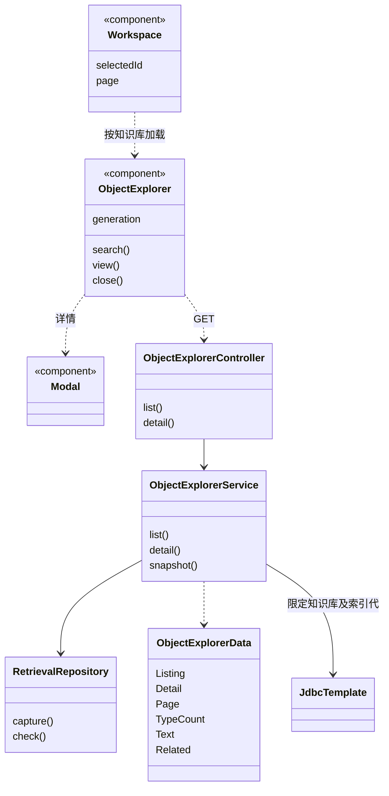
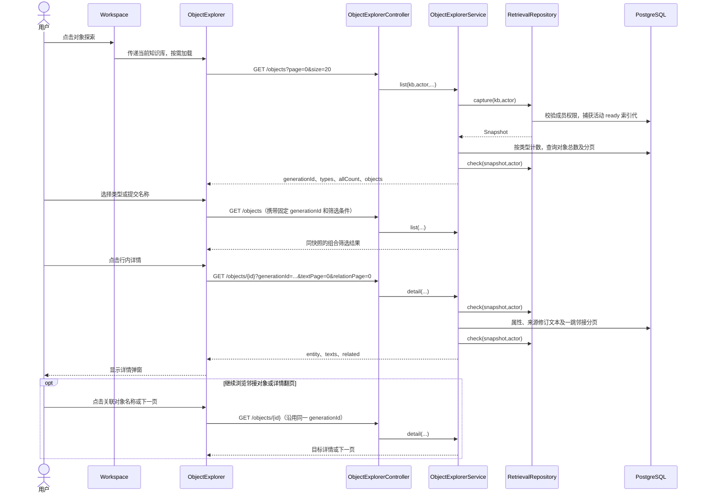

# 对象探索实现

更新日期：2026-11-05。对应方案见[对象探索设计](对象探索设计.md)。

## 1. 实现入口

| 实现单元 | 职责 |
| --- | --- |
| [Workspace](../frontend/src/Workspace.tsx) | 菜单注册、当前知识库传递、按需加载 |
| [ObjectExplorer](../frontend/src/ObjectExplorer.tsx) | 类型计数、名称组合筛选、列表与详情分页、请求取消 |
| [Modal](../frontend/src/Modal.tsx) | 可关闭详情弹窗、Escape、焦点约束及恢复 |
| [ObjectExplorerController](../backend/app/src/main/java/com/trs/app/rag/explorer/ObjectExplorerController.java) | 会话认证后的列表和详情 GET 接口 |
| [ObjectExplorerService](../backend/app/src/main/java/com/trs/app/rag/explorer/ObjectExplorerService.java) | 权限与索引代隔离、聚合计数、来源和邻接查询 |
| [ObjectExplorerData](../backend/app/src/main/java/com/trs/app/rag/explorer/ObjectExplorerData.java) | Listing、TypeCount、Page、Detail、Text、Related 返回投影 |
| [RetrievalRepository](../backend/app/src/main/java/com/trs/app/rag/retrieval/RetrievalRepository.java) | 复用 capture/check，捕获已就绪活动代及重查权限 |

不新增数据库表或迁移；复用索引实体、关系、来源文本块及索引代文档修订数据。

## 2. 主要实现类图

## 3. 接口

所有路径以 `/api/knowledge-bases/{kb}` 为前缀，用户身份来自服务端登录会话。

| 接口 | 参数与结果 |
| --- | --- |
| GET `/objects` | 可选 generationId、type、name、page、size；未指定 generationId 时捕获活动索引。返回 generationId、allCount、types 和 objects 分页 |
| GET `/objects/{id}` | 必填 generationId；可选 textPage、relationPage，默认 0。返回 generationId、entity、texts 分页和 related 分页 |

页码从 0 开始，最大 1000000；列表每页默认 20，服务端允许 1～100，页面提供 20/50/100。详情两类分页每页固定 20。分页返回 `items,total,page,size`，总数以 long 表达。非法分页或过滤长度返回 400；无可用活动代返回 `retrieval_no_active_index`（409）；失效索引或不存在对象返回 404；没有成员权限拒绝访问，未登录返回 401。

## 4. 查询与一致性

- `list()` 首次调用 `RetrievalRepository.capture()`；显式 generationId 时构造 Snapshot 并 `check()`，请求结束前再次校验。短事务沿用已有成员共享锁协议，不设置数据库只读事务，因为权限检查需要 `SELECT FOR SHARE`。业务只执行查询，不调用模型。
- 左侧计数对 `rag_index_entity` 按 entity_type 执行 GROUP BY，allCount 求和，不附加名称条件。右侧使用 entity_type 精确匹配与 `POSITION(LOWER(?) IN LOWER(name))>0`，全部参数绑定，百分号和下划线不会展开为通配符。
- 对象列表按 name、entity_type、id 排序并 LIMIT/OFFSET；列表不装载属性正文，属性在详情读取。实体标识采用既有索引实体 ID，不按名称单独定位对象。
- 详情的实体读取严格限定 knowledge_base_id、generation_id、id。
- 关联文本由实体 source_ids 展开为块 ID，联结 rag_document_chunk、rag_index_document、rag_document、rag_chunk，索引文档联结同时限定知识库、索引代及修订 ID。每个文档块位置单独返回，保留共享块的多文档来源。排序为 document_id、chunk_order、chunk_id。
- 关联对象查询 rag_index_relation 的 source_id 或 target_id，再通过 CASE 选出另一端对象。对象联结限定相同知识库和索引代，返回关系类型及描述；按邻接对象名称、类型、ID 稳定分页。
- 浏览请求固定同一索引代；ready 索引数据在正常发布流程中不可变，分页及各项计数不随活动代切换而混用。刷新才重新捕获活动代。

## 5. 主要时序图

## 6. 前端状态与安全

ObjectExplorer 使用带知识库 key 的内部组件，知识库变更时重置类型、名称、分页和详情。列表请求由 effect 的 AbortController 取消；详情使用独立控制器，在打开其他对象、关闭弹窗或卸载时取消，所有响应提交前检查 signal。generation 用 ref 保存，分页与筛选不改变该值；刷新清除 ref 并回到第一页。

属性、描述和文本块由 React 纯文本渲染，不启用 Markdown 或原始 HTML。属性表兼容当前带 type/value 的数组及旧字符串值；对象、数组等值使用 JSON 序列化展示。弹窗复用已有 Modal，支持键盘关闭和焦点恢复。页面中所有文案提供中英文翻译。

## 7. 验证

- [ObjectExplorer.test.tsx](../frontend/src/ObjectExplorer.test.tsx)：类型计数与组合筛选、列表及详情分页、属性和来源、邻接对象跳转、无活动索引、过期会话、切换知识库迟到响应、不可信内容及英文界面。
- [WorkspaceNavigation.test.tsx](../frontend/src/WorkspaceNavigation.test.tsx)：菜单位置、点击进入及知识库参数传递。
- [RetrievalIntegrationTest](../backend/bootstart/src/test/java/com/trs/rag/storage/RetrievalIntegrationTest.java)：真实 PostgreSQL 中计数、同名不同类型、字面名称匹配、列表分页、属性与来源联结、双向邻接分页、共享文本多文档来源、活动代切换、跨知识库隔离、未授权拒绝和 READER HTTP 访问。
