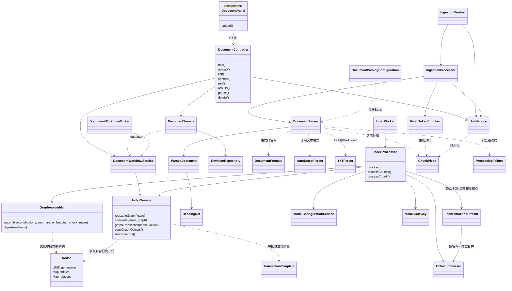
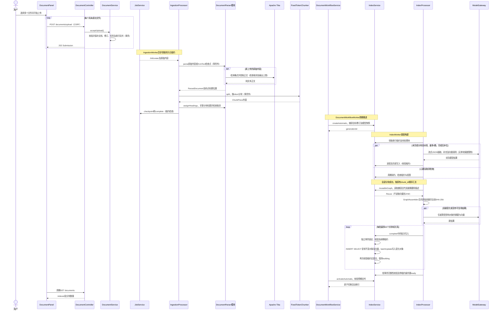

# 文档管理实现

## 1. 基线与代码职责

初始代码基线 `d65cef8`，核对日期 2026-11-04；本文已同步文档解析模块拆分和三路并行分块索引。设计见[文档管理设计](文档管理设计.md)。

2026-11-05 增补按原始贡献比较的图谱增量计算和每批 64 个对象的短事务发布。

| 主要实现 | 职责 |
| --- | --- |
| [DocumentPanel](../frontend/src/DocumentPanel.tsx) | 分页表格、上传队列、文本及查看/删除对话框，2.5 秒轮询列表 |
| [DocumentController](../backend/app/src/main/java/com/trs/app/rag/ingestion/DocumentController.java) | 文档及内部任务 API |
| [DocumentService](../backend/app/src/main/java/com/trs/app/rag/ingestion/DocumentService.java) | 输入校验、修订受理、列表状态投影、解析文本与来源读取 |
| [JobService](../backend/app/src/main/java/com/trs/app/rag/ingestion/JobService.java) | 持久化解析任务、租约、心跳、检查点与完成写入 |
| [IngestionProcessor](../backend/app/src/main/java/com/trs/app/rag/ingestion/IngestionProcessor.java) | 事务外解析、分块及标题关联 |
| [DocumentParser](../backend/document-parser/src/main/java/com/trs/documentparser/DocumentParser.java) | Tika 多格式正文提取、TXT/Markdown 原文兼容及标题关联 |
| [DocumentParsingConfiguration](../backend/app/src/main/java/com/trs/app/rag/ingestion/DocumentParsingConfiguration.java) | 在 app 中注册 DocumentParser Bean |
| [DocumentWorkflowService](../backend/app/src/main/java/com/trs/app/rag/ingestion/DocumentWorkflowService.java) | 行级控制、队列协调、索引创建及自动激活 |
| [IndexService](../backend/app/src/main/java/com/trs/app/rag/index/IndexService.java) | 索引代、构建租约、检查点和发布校验 |
| [IndexProcessor](../backend/app/src/main/java/com/trs/app/rag/index/IndexProcessor.java) | 抽取、补充抽取、图谱组装及向量构建 |

## 2. 主要实现类图

三个 Worker 分工不同：`IngestionWorker` 执行解析任务，`DocumentWorkflowWorker` 推进知识库自动发布状态，`IndexWorker` 调度实际模型索引构建；并非三个重复的任务队列界面。

## 3. 业务接口

以下路径以 `/api/knowledge-bases/{kb}` 为前缀。

| 方法与路径 | 行为 |
| --- | --- |
| GET `/documents?page=0&size=20` | 返回 `PageSlice<DocumentView>`，包含总数、分页及状态 |
| POST `/documents/upload` | multipart 单文件受理，参数 `file,chunkSize,overlap`，202 |
| POST `/documents/text` | JSON 文本受理，202 |
| GET `/documents/{document}/content` | 解析后 UTF-8 纯文本，可指定 `revisionId` |
| POST `/documents/{document}/pause` | 暂停，204 |
| POST `/documents/{document}/run` | 继续或失败重试，204 |
| POST `/documents/{document}/rebuild` | 目标文档重建，204 |
| DELETE `/documents/{document}` | 业务删除并协调剩余索引，204 |

后端还提供单文档、分块、原始文件及 `/jobs` 查询/取消/重试 API，供内部和兼容调用；当前菜单没有独立任务管理页。202 只表示受理成功，不表示文档已经完成索引。

## 4. 上传到索引发布时序图

暂停、删除或撤权可在任一阶段阻止后续发布。模型调用位于处理器中，不在受理、状态推进等短数据库事务中执行。

## 5. 数据与恢复机制

- `rag_document` 保存当前修订和业务控制标志；`rag_document_revision` 保存原始及解析内容；`rag_chunk` 及 `rag_document_chunk` 保存共享块和修订特定位置。
- `rag_ingestion_job` 保存解析任务与租约；`rag_document_index_queue` 保存每个知识库的自动协调进度、目标文档、预期旧代及修订序号。
- `rag_index_generation`、`rag_index_document`、`rag_index_chunk`、实体/关系及三类向量表组成完整可发布索引代。模型执行输入保存在索引快照中。
- 主要迁移包括 V3/V4 文档存储、V5 索引代、V7 自动流程、V8/V10 结构化及按类型实体身份、V11 行级重建范围、V12 模型快照。已执行迁移不原地改写。
- V15 为实体和关系增加可空 `contribution_hash`，保存原始合并贡献与来源块的 SHA-256。旧记录无摘要时不复用模型输出，首次重算后建立基线。
- `DocumentWorkflowService.action()` 先清除旧解析租约或取消旧自动代，再标记行级动作；`run/rebuild` 写入队列的 `document_id`，限制操作范围。
- `advance()` 用知识库行锁和队列修订检查推进；复用兼容的旧贡献。删除时清空活动指针，并保留旧代来源以组装剩余文档。
- `DocumentService` 的状态 SQL 综合暂停、错误、解析状态和活动代成员关系生成 `DocumentView.status`。前端定期刷新，展示的是持久化状态而不是浏览器猜测进度。

## 6. 校验与验证入口

来源名称最多 255 字符；目录路径只能是合法相对路径；单文件 5 MiB，块大小 16～4096，重叠 0～块大小一半。上传支持 TXT、Markdown、PDF、DOC/DOCX、XLS/XLSX、PPT/PPTX、ODT/ODS/ODP、RTF、HTML、CSV，格式不符会失败。粘贴文本仍只接受 TXT/Markdown。

测试见 [DocumentPanel.test.tsx](../frontend/src/DocumentPanel.test.tsx)、[DocumentWorkflowTest](../backend/bootstart/src/test/java/com/trs/rag/model/DocumentWorkflowTest.java)、[IngestionIntegrationTest](../backend/bootstart/src/test/java/com/trs/rag/storage/IngestionIntegrationTest.java)、[ModelIndexIntegrationTest](../backend/bootstart/src/test/java/com/trs/rag/storage/ModelIndexIntegrationTest.java)和 [TextPipelineTest](../backend/bootstart/src/test/java/com/trs/rag/ingestion/TextPipelineTest.java)。

## 7. document-parser 模块迁移

父工程 [backend/pom.xml](../backend/pom.xml) 聚合 `common`、`document-parser`、`app`、`bootstart`；[app/pom.xml](../backend/app/pom.xml) 显式依赖 `com.trs:document-parser:${project.version}`。解析库 flexmark 0.64.8 的直接依赖从 app 移至 [document-parser/pom.xml](../backend/document-parser/pom.xml)，bootstart 通过 app 传递引入解析模块并打入启动包。

迁移后的 Java 包为 `com.trs.documentparser`，包括 `DocumentParser`、`ParsedDocument`、`HeadingRef`、`ChunkPiece`、`ProcessingFailure`。前两个结构分别携带原始解析文本与码点标题记录；`ChunkPiece` 保持原有 token/source 区间和标题字段，是业务分块与解析标题映射的共享契约；错误类仍只携带安全错误码，不包含原文。

`DocumentParser` 移除 Spring `@Component`，由 app 中的 `DocumentParsingConfiguration.documentParser()` 注册 Bean。解析模块可直接 `new DocumentParser()` 使用，不反向依赖 app，也不承担 `JobService` 的持久化、任务租约或 `FixedTokenChunker` 的 token 分块。

`IngestionProcessor` 保持原顺序：读取任务输入 → 新内容 `parse()` / 检查点 `fromText()` → 心跳与解析检查点 → `FixedTokenChunker.split()` → `assignHeadings()` → 带租约检查的完成写入。最初模块拆分未修改 API、SQL、解析器版本或分块策略；后续 Tika 接入扩展了格式约束及解析版本，详见第 9 节。

独立模块的 [DocumentParserTest](../backend/document-parser/src/test/java/com/trs/documentparser/DocumentParserTest.java) 验证 BOM、原文/换行保留、Markdown 码点标题、围栏代码、不合法 UTF-8、安全错误码、标题关联、乱序区间及取消；[DocumentParsingConfigurationTest](../backend/bootstart/src/test/java/com/trs/rag/ingestion/DocumentParsingConfigurationTest.java) 验证唯一 Bean 注册，原有 `TextPipelineTest` 继续验证真实 tokenizer 与解析器的协作。

在 backend 目录可执行 `mvn -pl document-parser -am test` 单独验证解析模块，或执行 `mvn -pl bootstart -am test -Dtest=DocumentParserTest,TextPipelineTest,DocumentParsingConfigurationTest -Dsurefire.failIfNoSpecifiedTests=false` 验证迁移及应用接线。Dockerfile 原有 `COPY backend/ ./` 和父工程构建自动包含新增模块，无需额外复制规则。

2026-11-04 迁移验证：解析模块 6 项、Bean 注册 1 项、原有文本管线 4 项、真实 PostgreSQL 文档接入集成测试 10 项，共 21 项通过，无失败或跳过。集成测试使用本机固定摘要的 PostgreSQL 18.4/pgvector 镜像；Maven package 成功，启动 JAR 的 `BOOT-INF/lib` 包含 `document-parser-0.0.1-SNAPSHOT.jar`。本次未执行全量测试或前端构建。

## 8. 三路并行分块索引

`IndexProcessor.CHUNK_CONCURRENCY=3` 固定单实例当前索引代的分块并发上限。`IndexWorker` 仍以单个调度线程执行一个索引代；新并行发生在该代内部，不改变数据库领取任务及租约规则。

`processChunks()` 的处理步骤如下：

1. 调用 `IndexService.chunks()` 获取按 `chunk_id` 排序的完整列表，反序列化已完成块的抽取贡献，仅把未完成块交给线程池。
2. 创建固定 3 线程的执行器和 `ExecutorCompletionService`，维护最多 3 个在途 Future。任意任务完成后即读取结果并补充下一块，避免一个慢块阻塞其他空闲线程，也避免提前提交全代任务。
3. `processChunk()` 独立构造消息和 JSON 流解析器，执行首次抽取、原有可选补充/纠正、块向量及完成检查点。每块内部顺序保持不变，共享的模型配置为该代不可变快照，不共享可变消息或流解析状态。
4. 完成结果只由协调线程写入结果 Map；全部成功后按原始行顺序构造 `LinkedHashMap<UUID,Extraction>`，交给原有 `GraphAssembler.assemble()`。图谱合并、摘要、图谱向量与发布仍在统一合并阶段执行，不按任务完成顺序累加。

协调线程以最多 1 秒的轮询间隔检查权限和租约，原有 5 秒租约心跳继续运行。块内在调用前后、流回调和检查点写入前检查共享停止标志、线程中断及原租约；流式模型自身仍有空闲期间的检查与取消连接机制。短事务进度及检查点写入继续通过 `IndexService.lock()` 校验租约并加锁，模型调用不占用数据库长事务。

任意块异常会经 `ExecutionException` 解包，保留原有安全错误码；协调线程中断保留中断标记。退出时先设置停止标志、取消所有在途 Future 并 `shutdownNow()`，通过执行器 `close()` 等待工作线程退出，然后才允许外层记录构建失败。暂停或过期租约下的写入仍由数据库 fencing 拒绝；已完成检查点保留，失败路径不会调用图谱合并或 `complete()`。

并发与恢复测试见 [ParallelIndexProcessorTest](../backend/bootstart/src/test/java/com/trs/rag/model/ParallelIndexProcessorTest.java)，覆盖三请求重叠、并发上限、首块较慢时继续补位、确定性合并、已完成块复用、其他块失败时取消、租约失效及协调线程中断。原有 [ModelIndexIntegrationTest](../backend/bootstart/src/test/java/com/trs/rag/storage/ModelIndexIntegrationTest.java) 继续验证真实数据库检查点、取消、重试及完整索引发布。

2026-11-04 并行处理验证：`ParallelIndexProcessorTest` 5 项、`GraphMergeTest` 7 项、`JsonExtractionStreamTest` 14 项、`ModelStreamingTest` 4 项、`ModelIndexIntegrationTest` 37 项，共 67 项通过，无失败或跳过；Maven package 成功。集成测试沿用本机固定摘要的 PostgreSQL/pgvector 镜像，本次未执行全量测试或前端构建。

## 9. Apache Tika 统一解析

`document-parser` 固定依赖 Apache Tika **4.2.0** 的 `tika-core` 和 `tika-parsers-standard-package`；后者在该版本为 POM 聚合包，使用 `<type>pom</type>` 引入标准解析器。版本依据 [Apache 官方下载页](https://tika.apache.org/download.html)。flexmark 0.64.8 继续用于 Markdown 标题和源码位置映射，生成测试样本所需的 `poi-ooxml-lite` 为 test scope。

[DocumentFormats](../backend/document-parser/src/main/java/com/trs/documentparser/DocumentFormats.java) 集中定义扩展名、存储格式和允许的媒体类型。`DocumentService.acceptUpload()` 校验路径、格式和大小，保存原始字节及持久化任务；`IngestionProcessor` 在数据库事务外解析。前端同步扩展选择器和上传校验，多文件和目录沿用原流程。

`DocumentParser.parse()` 每次调用独立创建 Metadata、ParseContext 和输出收集器：

1. TXT/Markdown 先严格验证 UTF-8、空文本和控制字符，再交由 `TXTParser` 提取，忽略解析器补充的排版空白，保留原始换行和 Unicode 内容；Markdown 仍由 flexmark 计算标题层级。
2. 其他格式由 `AutoDetectParser` 检测媒体类型，与上传声明格式比较，再通过 `BodyContentHandler` 收集正文。HTML 不保留标签或脚本正文；PDF/Office 转为文本，不提供页码或单元格级来源坐标。
3. `PagesConfig` 仅启用文本提取并禁用推理；`SkipEmbedded` 禁止递归提取附件。扫描件不会自动 OCR，也不调用模型。
4. 收集文本时检查取消及输出上限，结束后调用 `fromText()`。来源坐标始终指向持久化解析文本，后续 token 分块、三路并行抽取、实体合并和索引代发布沿用原流程。

新修订标记 `tika-4.2.0-source-v1`，受理幂等键包含该版本；新增 V14 迁移扩展 `rag_document_revision.format` 约束及字段注释，不修改既有迁移。`JobService` 同时接受旧 `txt-flexmark-v1`，解析检查点通过 `fromText()` 恢复，已有文本、块和活动索引不被改写。

| 安全错误码 | 含义 |
| --- | --- |
| document_parse_failed | 文件损坏或解析失败 |
| document_format_mismatch | 实际类型与扩展名不符 |
| document_encrypted | 文件加密且未提供密码 |
| empty_document | 没有可索引正文，包括无文本层的扫描件 |
| document_too_large | 输入超过 5 MiB |
| document_text_too_large | 提取正文超过 5,242,880 个 UTF-16 字符 |

原有 `invalid_encoding`、`binary_content`、`unsupported_format` 继续使用，异常不包含正文；前端按错误码展示中文/英文说明。取消沿用任务租约检查，全部解析和分块成功才完成任务。解析为同 JVM 内嵌模式，字符回调取消及大小限制不等同于进程隔离、解析前置阶段硬超时或完整内存上限。

[TikaDocumentParserTest](../backend/document-parser/src/test/java/com/trs/documentparser/TikaDocumentParserTest.java) 使用真实生成的 PDF、DOCX、XLS/XLSX、PPTX，以及 HTML、RTF、CSV 样本，覆盖正文、加密、损坏、格式不符、空文本、大小限制和取消。原文本测试覆盖 BOM、换行、Markdown 和码点来源。`IngestionIntegrationTest` 验证 V14、HTML 上传到解析文本/分块/原始文件读取，以及旧解析版本恢复。前端测试验证多格式上传和解析错误提示。

2026-11-04 Tika 验证：后端定向回归共 71 项通过（解析模块 12、Bean 注册 1、文本管线 4、并行索引 5、文档接入 12、模型索引 37），无失败或跳过；真实 PostgreSQL/pgvector 集成测试通过，Maven package 成功。前端全部 93 项测试及生产构建通过。

## 10. 取消单块抽取数量限制

`JsonExtractionStream` 移除单轮 40 个实体、100 项记录及合并后 80 个实体、200 项记录的计数检查，包括补充和关系纠正合并路径。兼容文本格式的 `ExtractionParser.parse()` 同样移除条数检查；按名称加类型合并实体、保留属性和关系类型、关联来源的算法保持原实现。

运行时 `extract-json-system.txt` 不再要求模型按条数截断，`IndexService.PROMPT_VERSION` 升为 `trs-typed-entity-json-v6`。旧 English 文本模板和 PROVENANCE 的参考上限作为上游冻结测试资料保留，不被运行时 JSON 抽取使用；PROVENANCE 增补当前 JSON 版本和无条数上限的说明。

JSON 总长度仍最多 2,000,000 个 UTF-16 字符，超限使用新错误码 `extraction_size_limit`，与条数无关。原有字段长度、每实体 32 项属性、单个属性值 2000 字符、JSON 深度、实体身份/端点及完整成功结束校验仍生效。保留 GraphAssembler 的全代容量保护（10,000 节点、30,000 边）、分块数限制和查询分页。

前端新增大小超限的中英文提示；持久化的旧 `extraction_record_limit` 仍可展示，并提示用户运行重试。服务需要重启以加载新提示词和类。新代不会复用旧 v5 代的贡献；旧活动代继续服务查询，行级重建若涉及其他旧协议文档，仍执行既有 `index_document_scope_incompatible` 保护，不自动扩大为全库重建。

`JsonExtractionStreamTest` 新增单轮 120 个实体和 240 条关系、补充合并后 240 个实体和 480 条关系、纠正合并、兼容文本格式 120 个实体和 119 条关系及 JSON 大小错误码回归；原有不完整对象不发布、取消及语义校验继续验证。

2026-11-04 验证：先运行新增测试，确认旧代码触发数量上限；修改后 `JsonExtractionStreamTest`、`GraphMergeTest`、`ParallelIndexProcessorTest`、`ModelIndexIntegrationTest`、`DocumentWorkflowTest` 共 68 项通过，无失败或跳过。前端全部 94 项测试及生产构建通过，服务端 Maven package 成功。

## 11. 图谱增量计算与分批发布（2026-11-05）

`IndexProcessor` 在块处理成功后调用 `IndexService.reusableGraph()`，从当前活动代读取基线；删除后活动代停用时，使用队列保留的 `expected_generation_id`。只接受相同知识库且处于 ready 的来源代，严格比较 extract/summary/embedding 快照 ID、提示词、tokenizer、gleaning 和维度。这里只读取对象 ID、贡献摘要及最终描述，不把旧向量传回 JVM。读取前进行带成员共享锁的权限和租约检查，因此该短事务不声明数据库 read-only。

`GraphAssembler.assemble(..., Reuse)` 仍按完整贡献确定名称＋类型身份、无向关系端点、属性与来源集合，但模型计算只针对变化对象。实体摘要包含身份、原始描述集合、属性及来源块；关系摘要包含端点身份、原始描述、关键词、关系类型及来源块，按确定顺序序列化并计算 SHA-256。摘要与兼容旧对象完全一致时复用最终描述，记录复用 ID，不调用摘要或向量模型。删除来源或属性/关系类型变化会使摘要变化，共享实体及关系从剩余原始贡献重新合并；消失的对象不会出现在新代。不同类型的同名实体保持独立。

`Graph` 携带完整对象列表、复用来源代以及实体和关系的复用 ID 集合。`IndexService.complete()` 禁止加入外部事务，通过 `TransactionTemplate(REQUIRES_NEW)` 依次执行初始化、最多 64 个实体一批、最多 64 条关系一批、最终验证等事务。每批先锁定并检查当前租约和成员权限，再续期；写完再次检查并续期，不能复活已过期或取消的执行。

未变化对象及其向量采用限定知识库、来源代和本批 ID 的 `INSERT ... SELECT`，保留摘要、属性、关系类型、权重、来源及向量原值。变化对象使用 JDBC `batchUpdate` 写入对象和向量，向量仍校验维度、有限值和非零范数。所有实体写完后才写关系，保持外键完整性。旧代保持不可变，新代 building 中已提交的部分批次仍不可检索。

最终独立事务检查文档未删除、全部分块完成，以及三类对象/向量数量匹配；将 ready 状态的 UPDATE 同时限定 building、当前令牌、未取消及未过期，随后由原协调流程原子切换活动代。失败保留旧活动代（删除流程仍先停用旧代），重试先清理本代部分图谱及级联向量，再重新分批写入，避免重复记录和权重累积。完整新代仍需复制未变化对象的物理记录，优化的是模型重算及逐条客户端写入次数，不将检索改为跨代混用。

V15 只增加可空列，不改写既有 Flyway 迁移。没有 `contribution_hash` 的历史对象首次重新计算，成功后才可增量复用；不存在兼容来源代时使用全量模型计算和同样的分批发布。

验证入口：`IncrementalGraphTest` 验证零变化时零模型调用、属性变更、删除贡献、同名异类及旧记录降级；`ModelIndexIntegrationTest` 验证单文档运行/重建、数据库内复制向量、增加不同实体的文档、删除共享贡献、中途批次失败不发布、取消 fencing 和清理部分结果后重试。

2026-11-05 验证：相关抽取、图谱、并发、文档流程、模型索引、模型迁移、查询及真实 PostgreSQL 检索回归共 119 项通过，独立迁移回归 4 项通过，合计 123 项无失败或跳过；Maven package 成功。迁移测试同步移除过时的 V6 固定数量断言，并验证 V15 的可空摘要列及字段注释。Windows CRLF 启动脚本通过临时 LF 副本执行迁移测试，仓库脚本未修改；前端未变更。
