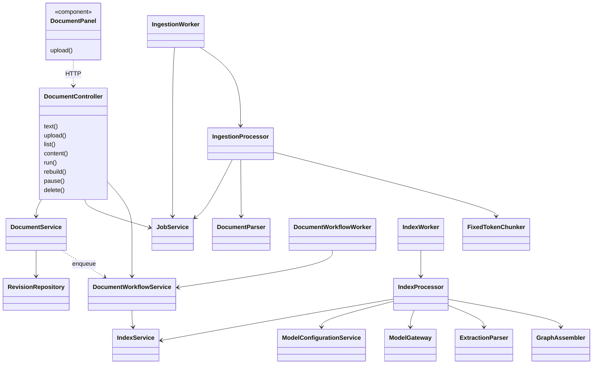
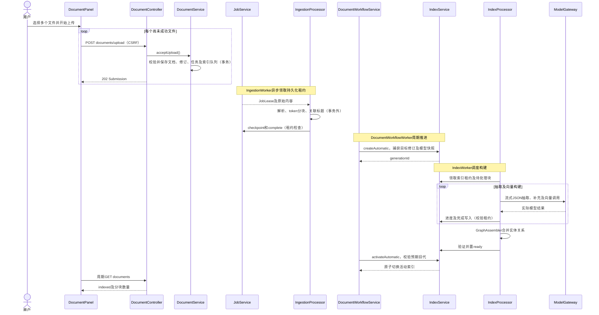

# 文档管理实现

## 1. 基线与代码职责

代码基线 `d65cef8`，核对日期 2026-11-04。设计见[文档管理设计](文档管理设计.md)。

| 主要实现 | 职责 |
| --- | --- |
| [DocumentPanel](../frontend/src/DocumentPanel.tsx) | 分页表格、上传队列、文本及查看/删除对话框，2.5 秒轮询列表 |
| [DocumentController](../backend/app/src/main/java/com/trs/app/rag/ingestion/DocumentController.java) | 文档及内部任务 API |
| [DocumentService](../backend/app/src/main/java/com/trs/app/rag/ingestion/DocumentService.java) | 输入校验、修订受理、列表状态投影、解析文本与来源读取 |
| [JobService](../backend/app/src/main/java/com/trs/app/rag/ingestion/JobService.java) | 持久化解析任务、租约、心跳、检查点与完成写入 |
| [IngestionProcessor](../backend/app/src/main/java/com/trs/app/rag/ingestion/IngestionProcessor.java) | 事务外解析、分块及标题关联 |
| [DocumentWorkflowService](../backend/app/src/main/java/com/trs/app/rag/ingestion/DocumentWorkflowService.java) | 行级控制、队列协调、索引创建及自动激活 |
| [IndexService](../backend/app/src/main/java/com/trs/app/rag/index/IndexService.java) | 索引代、构建租约、检查点和发布校验 |
| [IndexProcessor](../backend/app/src/main/java/com/trs/app/rag/index/IndexProcessor.java) | 抽取、补充抽取、图谱组装及向量构建 |

## 2. 主要实现类图

三个 Worker 分工不同：`IngestionWorker` 执行解析任务，`DocumentWorkflowWorker` 推进知识库自动发布状态，`IndexWorker` 调度实际模型索引构建；并非三个重复的任务队列界面。

## 3. 业务接口

以下路径以 `/api/knowledge-bases/{kb}` 为前缀。

| 方法与路径 | 行为 |
| --- | --- |
| GET `/documents?page=0&size=20` | 返回 `PageSlice<DocumentView>`，包含总数、分页及状态 |
| POST `/documents/upload` | multipart 单文件受理，参数 `file,chunkSize,overlap`，202 |
| POST `/documents/text` | JSON 文本受理，202 |
| GET `/documents/{document}/content` | 解析后 UTF-8 纯文本，可指定 `revisionId` |
| POST `/documents/{document}/pause` | 暂停，204 |
| POST `/documents/{document}/run` | 继续或失败重试，204 |
| POST `/documents/{document}/rebuild` | 目标文档重建，204 |
| DELETE `/documents/{document}` | 业务删除并协调剩余索引，204 |

后端还提供单文档、分块、原始文件及 `/jobs` 查询/取消/重试 API，供内部和兼容调用；当前菜单没有独立任务管理页。202 只表示受理成功，不表示文档已经完成索引。

## 4. 上传到索引发布时序图

暂停、删除或撤权可在任一阶段阻止后续发布。模型调用位于处理器中，不在受理、状态推进等短数据库事务中执行。

## 5. 数据与恢复机制

- `rag_document` 保存当前修订和业务控制标志；`rag_document_revision` 保存原始及解析内容；`rag_chunk` 及 `rag_document_chunk` 保存共享块和修订特定位置。
- `rag_ingestion_job` 保存解析任务与租约；`rag_document_index_queue` 保存每个知识库的自动协调进度、目标文档、预期旧代及修订序号。
- `rag_index_generation`、`rag_index_document`、`rag_index_chunk`、实体/关系及三类向量表组成完整可发布索引代。模型执行输入保存在索引快照中。
- 主要迁移包括 V3/V4 文档存储、V5 索引代、V7 自动流程、V8/V10 结构化及按类型实体身份、V11 行级重建范围、V12 模型快照。已执行迁移不原地改写。
- `DocumentWorkflowService.action()` 先清除旧解析租约或取消旧自动代，再标记行级动作；`run/rebuild` 写入队列的 `document_id`，限制操作范围。
- `advance()` 用知识库行锁和队列修订检查推进；复用兼容的旧贡献。删除时清空活动指针，并保留旧代来源以组装剩余文档。
- `DocumentService` 的状态 SQL 综合暂停、错误、解析状态和活动代成员关系生成 `DocumentView.status`。前端定期刷新，展示的是持久化状态而不是浏览器猜测进度。

## 6. 校验与验证入口

来源名称最多 255 字符；目录路径只能是合法相对路径；单文件 5 MiB，块大小 16～4096，重叠 0～块大小一半。上传格式只接受 TXT/Markdown，PDF 伪装文件也会被拒绝。

测试见 [DocumentPanel.test.tsx](../frontend/src/DocumentPanel.test.tsx)、[DocumentWorkflowTest](../backend/bootstart/src/test/java/com/trs/rag/model/DocumentWorkflowTest.java)、[IngestionIntegrationTest](../backend/bootstart/src/test/java/com/trs/rag/storage/IngestionIntegrationTest.java)、[ModelIndexIntegrationTest](../backend/bootstart/src/test/java/com/trs/rag/storage/ModelIndexIntegrationTest.java)和 [TextPipelineTest](../backend/bootstart/src/test/java/com/trs/rag/ingestion/TextPipelineTest.java)。
