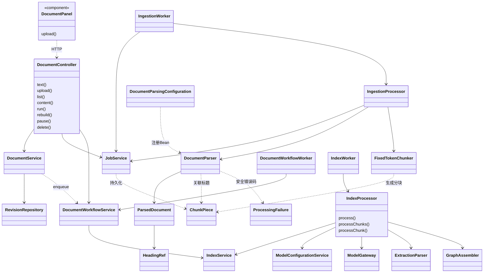
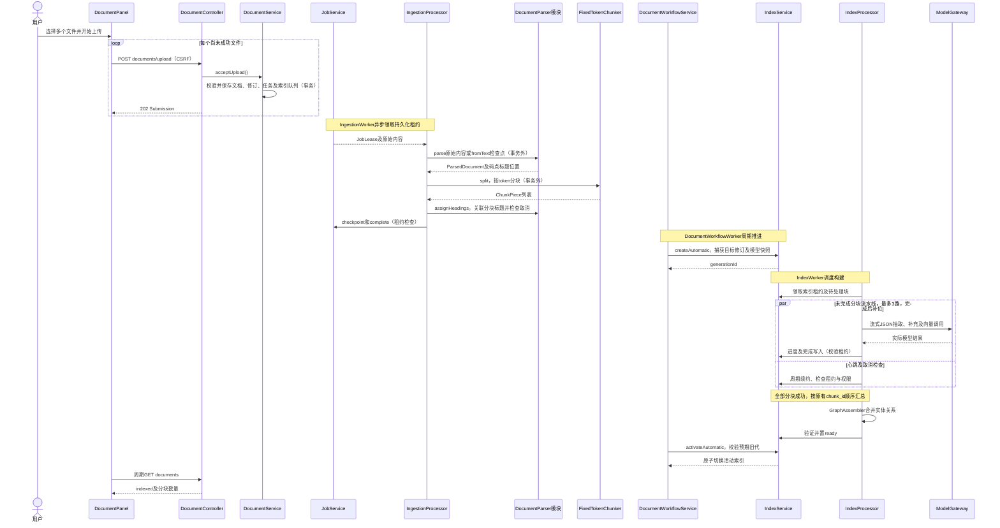

# 文档管理实现

## 1. 基线与代码职责

初始代码基线 `d65cef8`，核对日期 2026-11-04；本文已同步文档解析模块拆分和三路并行分块索引。设计见[文档管理设计](文档管理设计.md)。

| 主要实现 | 职责 |
| --- | --- |
| [DocumentPanel](../frontend/src/DocumentPanel.tsx) | 分页表格、上传队列、文本及查看/删除对话框，2.5 秒轮询列表 |
| [DocumentController](../backend/app/src/main/java/com/trs/app/rag/ingestion/DocumentController.java) | 文档及内部任务 API |
| [DocumentService](../backend/app/src/main/java/com/trs/app/rag/ingestion/DocumentService.java) | 输入校验、修订受理、列表状态投影、解析文本与来源读取 |
| [JobService](../backend/app/src/main/java/com/trs/app/rag/ingestion/JobService.java) | 持久化解析任务、租约、心跳、检查点与完成写入 |
| [IngestionProcessor](../backend/app/src/main/java/com/trs/app/rag/ingestion/IngestionProcessor.java) | 事务外解析、分块及标题关联 |
| [DocumentParser](../backend/document-parser/src/main/java/com/trs/documentparser/DocumentParser.java) | 独立模块的 TXT/Markdown 解码、结构提取与标题关联 |
| [DocumentParsingConfiguration](../backend/app/src/main/java/com/trs/app/rag/ingestion/DocumentParsingConfiguration.java) | 在 app 中注册 DocumentParser Bean |
| [DocumentWorkflowService](../backend/app/src/main/java/com/trs/app/rag/ingestion/DocumentWorkflowService.java) | 行级控制、队列协调、索引创建及自动激活 |
| [IndexService](../backend/app/src/main/java/com/trs/app/rag/index/IndexService.java) | 索引代、构建租约、检查点和发布校验 |
| [IndexProcessor](../backend/app/src/main/java/com/trs/app/rag/index/IndexProcessor.java) | 抽取、补充抽取、图谱组装及向量构建 |

## 2. 主要实现类图

三个 Worker 分工不同：`IngestionWorker` 执行解析任务，`DocumentWorkflowWorker` 推进知识库自动发布状态，`IndexWorker` 调度实际模型索引构建；并非三个重复的任务队列界面。

## 3. 业务接口

以下路径以 `/api/knowledge-bases/{kb}` 为前缀。

| 方法与路径 | 行为 |
| --- | --- |
| GET `/documents?page=0&size=20` | 返回 `PageSlice<DocumentView>`，包含总数、分页及状态 |
| POST `/documents/upload` | multipart 单文件受理，参数 `file,chunkSize,overlap`，202 |
| POST `/documents/text` | JSON 文本受理，202 |
| GET `/documents/{document}/content` | 解析后 UTF-8 纯文本，可指定 `revisionId` |
| POST `/documents/{document}/pause` | 暂停，204 |
| POST `/documents/{document}/run` | 继续或失败重试，204 |
| POST `/documents/{document}/rebuild` | 目标文档重建，204 |
| DELETE `/documents/{document}` | 业务删除并协调剩余索引，204 |

后端还提供单文档、分块、原始文件及 `/jobs` 查询/取消/重试 API，供内部和兼容调用；当前菜单没有独立任务管理页。202 只表示受理成功，不表示文档已经完成索引。

## 4. 上传到索引发布时序图

暂停、删除或撤权可在任一阶段阻止后续发布。模型调用位于处理器中，不在受理、状态推进等短数据库事务中执行。

## 5. 数据与恢复机制

- `rag_document` 保存当前修订和业务控制标志；`rag_document_revision` 保存原始及解析内容；`rag_chunk` 及 `rag_document_chunk` 保存共享块和修订特定位置。
- `rag_ingestion_job` 保存解析任务与租约；`rag_document_index_queue` 保存每个知识库的自动协调进度、目标文档、预期旧代及修订序号。
- `rag_index_generation`、`rag_index_document`、`rag_index_chunk`、实体/关系及三类向量表组成完整可发布索引代。模型执行输入保存在索引快照中。
- 主要迁移包括 V3/V4 文档存储、V5 索引代、V7 自动流程、V8/V10 结构化及按类型实体身份、V11 行级重建范围、V12 模型快照。已执行迁移不原地改写。
- `DocumentWorkflowService.action()` 先清除旧解析租约或取消旧自动代，再标记行级动作；`run/rebuild` 写入队列的 `document_id`，限制操作范围。
- `advance()` 用知识库行锁和队列修订检查推进；复用兼容的旧贡献。删除时清空活动指针，并保留旧代来源以组装剩余文档。
- `DocumentService` 的状态 SQL 综合暂停、错误、解析状态和活动代成员关系生成 `DocumentView.status`。前端定期刷新，展示的是持久化状态而不是浏览器猜测进度。

## 6. 校验与验证入口

来源名称最多 255 字符；目录路径只能是合法相对路径；单文件 5 MiB，块大小 16～4096，重叠 0～块大小一半。上传格式只接受 TXT/Markdown，PDF 伪装文件也会被拒绝。

测试见 [DocumentPanel.test.tsx](../frontend/src/DocumentPanel.test.tsx)、[DocumentWorkflowTest](../backend/bootstart/src/test/java/com/trs/rag/model/DocumentWorkflowTest.java)、[IngestionIntegrationTest](../backend/bootstart/src/test/java/com/trs/rag/storage/IngestionIntegrationTest.java)、[ModelIndexIntegrationTest](../backend/bootstart/src/test/java/com/trs/rag/storage/ModelIndexIntegrationTest.java)和 [TextPipelineTest](../backend/bootstart/src/test/java/com/trs/rag/ingestion/TextPipelineTest.java)。

## 7. document-parser 模块迁移

父工程 [backend/pom.xml](../backend/pom.xml) 聚合 `common`、`document-parser`、`app`、`bootstart`；[app/pom.xml](../backend/app/pom.xml) 显式依赖 `com.trs:document-parser:${project.version}`。解析库 flexmark 0.64.8 的直接依赖从 app 移至 [document-parser/pom.xml](../backend/document-parser/pom.xml)，bootstart 通过 app 传递引入解析模块并打入启动包。

迁移后的 Java 包为 `com.trs.documentparser`，包括 `DocumentParser`、`ParsedDocument`、`HeadingRef`、`ChunkPiece`、`ProcessingFailure`。前两个结构分别携带原始解析文本与码点标题记录；`ChunkPiece` 保持原有 token/source 区间和标题字段，是业务分块与解析标题映射的共享契约；错误类仍只携带安全错误码，不包含原文。

`DocumentParser` 移除 Spring `@Component`，由 app 中的 `DocumentParsingConfiguration.documentParser()` 注册 Bean。解析模块可直接 `new DocumentParser()` 使用，不反向依赖 app，也不承担 `JobService` 的持久化、任务租约或 `FixedTokenChunker` 的 token 分块。

`IngestionProcessor` 保持原顺序：读取任务输入 → 新内容 `parse()` / 检查点 `fromText()` → 心跳与解析检查点 → `FixedTokenChunker.split()` → `assignHeadings()` → 带租约检查的完成写入。模块拆分不修改 API、SQL、解析器版本或分块策略；取消与错误处理路径沿用原实现。

独立模块的 [DocumentParserTest](../backend/document-parser/src/test/java/com/trs/documentparser/DocumentParserTest.java) 验证 BOM、原文/换行保留、Markdown 码点标题、围栏代码、不合法 UTF-8、安全错误码、标题关联、乱序区间及取消；[DocumentParsingConfigurationTest](../backend/bootstart/src/test/java/com/trs/rag/ingestion/DocumentParsingConfigurationTest.java) 验证唯一 Bean 注册，原有 `TextPipelineTest` 继续验证真实 tokenizer 与解析器的协作。

在 backend 目录可执行 `mvn -pl document-parser -am test` 单独验证解析模块，或执行 `mvn -pl bootstart -am test -Dtest=DocumentParserTest,TextPipelineTest,DocumentParsingConfigurationTest -Dsurefire.failIfNoSpecifiedTests=false` 验证迁移及应用接线。Dockerfile 原有 `COPY backend/ ./` 和父工程构建自动包含新增模块，无需额外复制规则。

2026-11-04 迁移验证：解析模块 6 项、Bean 注册 1 项、原有文本管线 4 项、真实 PostgreSQL 文档接入集成测试 10 项，共 21 项通过，无失败或跳过。集成测试使用本机固定摘要的 PostgreSQL 18.4/pgvector 镜像；Maven package 成功，启动 JAR 的 `BOOT-INF/lib` 包含 `document-parser-0.0.1-SNAPSHOT.jar`。本次未执行全量测试或前端构建。

## 8. 三路并行分块索引

`IndexProcessor.CHUNK_CONCURRENCY=3` 固定单实例当前索引代的分块并发上限。`IndexWorker` 仍以单个调度线程执行一个索引代；新并行发生在该代内部，不改变数据库领取任务及租约规则。

`processChunks()` 的处理步骤如下：

1. 调用 `IndexService.chunks()` 获取按 `chunk_id` 排序的完整列表，反序列化已完成块的抽取贡献，仅把未完成块交给线程池。
2. 创建固定 3 线程的执行器和 `ExecutorCompletionService`，维护最多 3 个在途 Future。任意任务完成后即读取结果并补充下一块，避免一个慢块阻塞其他空闲线程，也避免提前提交全代任务。
3. `processChunk()` 独立构造消息和 JSON 流解析器，执行首次抽取、原有可选补充/纠正、块向量及完成检查点。每块内部顺序保持不变，共享的模型配置为该代不可变快照，不共享可变消息或流解析状态。
4. 完成结果只由协调线程写入结果 Map；全部成功后按原始行顺序构造 `LinkedHashMap<UUID,Extraction>`，交给原有 `GraphAssembler.assemble()`。图谱合并、摘要、图谱向量与发布仍在统一合并阶段执行，不按任务完成顺序累加。

协调线程以最多 1 秒的轮询间隔检查权限和租约，原有 5 秒租约心跳继续运行。块内在调用前后、流回调和检查点写入前检查共享停止标志、线程中断及原租约；流式模型自身仍有空闲期间的检查与取消连接机制。短事务进度及检查点写入继续通过 `IndexService.lock()` 校验租约并加锁，模型调用不占用数据库长事务。

任意块异常会经 `ExecutionException` 解包，保留原有安全错误码；协调线程中断保留中断标记。退出时先设置停止标志、取消所有在途 Future 并 `shutdownNow()`，通过执行器 `close()` 等待工作线程退出，然后才允许外层记录构建失败。暂停或过期租约下的写入仍由数据库 fencing 拒绝；已完成检查点保留，失败路径不会调用图谱合并或 `complete()`。

并发与恢复测试见 [ParallelIndexProcessorTest](../backend/bootstart/src/test/java/com/trs/rag/model/ParallelIndexProcessorTest.java)，覆盖三请求重叠、并发上限、首块较慢时继续补位、确定性合并、已完成块复用、其他块失败时取消、租约失效及协调线程中断。原有 [ModelIndexIntegrationTest](../backend/bootstart/src/test/java/com/trs/rag/storage/ModelIndexIntegrationTest.java) 继续验证真实数据库检查点、取消、重试及完整索引发布。

2026-11-04 并行处理验证：`ParallelIndexProcessorTest` 5 项、`GraphMergeTest` 7 项、`JsonExtractionStreamTest` 14 项、`ModelStreamingTest` 4 项、`ModelIndexIntegrationTest` 37 项，共 67 项通过，无失败或跳过；Maven package 成功。集成测试沿用本机固定摘要的 PostgreSQL/pgvector 镜像，本次未执行全量测试或前端构建。
