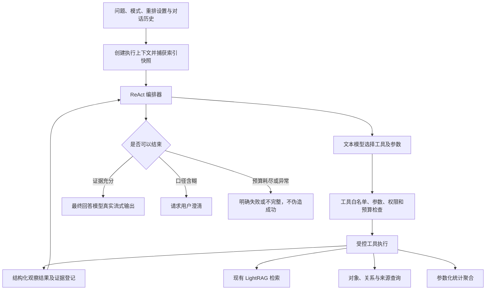
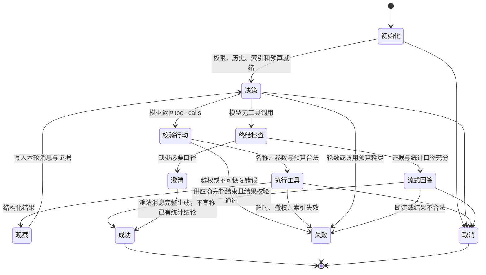

# 智能体设计

## 1. 文档说明

日期：2026-11-06。作者：czhcc。代码基线：`cf659d0`。

本方案已在本轮开发分支落地，实际类、协议、限制及验证见[智能实现](智能实现.md)。基础见[知识库问答设计](知识库问答设计.md)、[知识库问答实现](知识库问答实现.md)、[对象探索设计](对象探索设计.md)。正常回答默认使用智能体，预览仍使用既有检索流程。

工程当前使用 JDK 21、Spring Boot 4.1.2、Spring AI 2.0.2。实现沿用 Spring AI，不引入另一套智能体框架。文本模型测试增加原生工具探测，普通聊天成功不能证明 `tools/tool_calls` 可用；问答首轮不返回真实工具调用时明确失败。

## 2. 目标与范围

在知识库问答上增加单个 ReAct 智能体，统一处理事实检索、对象查询、关系探索、准确计数、分组排名及它们的组合问题。

ReAct 指 Reasoning and Acting，即根据问题和已有观察，交替选择工具、执行工具、观察结果，直到形成有依据的回答或提出澄清问题。它与前端 React 框架无关。

| 能力 | 设计行为 |
| --- | --- |
| 普通知识问答 | 选择知识库检索工具，沿用 LightRAG 五种检索模式和证据引用 |
| 对象统计 | 数据库对完整匹配集合计数，支持类型、名称、属性和一跳关系条件 |
| 分组统计 | 按类型、属性或关联对象分组，返回计数和排名 |
| 关系统计 | 对去重的无向关系记录计数，支持关系类型和端点条件 |
| 混合问题 | 先统计，再查询对象或检索原文，组合回答 |
| 多轮追问 | 用已完成对话理解指代，必要时澄清范围；本轮重新执行统计和检索 |

首版工具全部只读。不提供修改或删除对象、实体消歧合并、运行任意 SQL、任意脚本、文件访问或互联网搜索。统计先实现 COUNT DISTINCT 与分组排序；SUM、AVG、时间序列和任意多跳推理另行设计。

## 3. 总体架构

模型负责问题理解、工具选择和结果解释。后端负责查询执行、统计计算、权限、快照、证据及资源限制。单个智能体可以连续使用不同工具，不需要首版引入多个智能体协作。

## 4. 数据与统计口径

### 4.1. 对象身份

对象指当前索引中的实体。现有系统按规范化名称与类型合并对象，用稳定实体 ID 定位。

“张三”和“张三研究员”可能是两个对象；同名同类型的不同现实人物也可能已被合并。因此“人物对象数”不能直接表述为现实中的准确人数。回答必须说明这是当前已发布索引中、按现有抽取和合并规则统计的对象数。

### 4.2. 全量统计与检索区别

- 统计在指定知识库、指定索引代的完整匹配集合上执行数据库聚合。
- 工具分页或 topK 只影响展示，不能改变聚合的统计范围。
- 向量检索返回的候选数、文本块数和图谱画布节点数不能当成知识库总数。
- 零条结果、查询失败、口径未知分别表达，不能把失败转换成零。
- 统计准确性限定于当前索引数据；抽取遗漏、别名未合并、类型不一致等影响必须说明。

### 4.3. 人物、职业和组织口径

类型是动态抽取结果，不强制只有人、地、物、事、网。用户说“人”时，先读取实际类型；如存在人、人物、person 等多个类型，不自动只计其中一个，应结合元数据确定类型集合，存在歧义则澄清。

“研究人员”不能直接等同于所有人物；必须明确依据对象类型、职务属性或任职关系。“某机构的人”必须明确采用哪种关系，不能仅凭描述相似就纳入精确统计。

### 4.4. 属性和关系语义

- 属性保留名称、类型与原生 JSON 值，允许一个属性名对应多个类型和值。
- 属性条件对值集合采用 EXISTS 语义；多个值匹配仍只计一个对象。
- 属性不存在、类型不匹配及显式 JSON null 分开处理。类型不合法的比较不得隐式转换为有效数值。
- 关系目前为无向关系，端点 UUID 的排序不代表业务方向。可以统计经“任职”关系相连的对象，不能仅由 source/target 判断谁任职于谁。
- 一个关系记录可包含多个关系类型。按类型分组时同一记录可进入多个组，分组数量之和可能大于去重总数。
- 按多值属性或关联对象分组时，一个对象也可进入多个组；每组内部 COUNT DISTINCT，明确采用多重归属口径。
- 未分组统计为精确标量；分组排名的截断必须明确提示，不能把前十组称为全部。

## 5. 执行上下文与通用协议

### 5.1. 服务端上下文

以下内容由服务端注入，不出现在模型可自由填写的工具参数中。

| 字段 | 说明 |
| --- | --- |
| actor、sessionId | 当前登录用户与会话，执行和取消的权限边界 |
| knowledgeBaseId | 用户当前选择的知识库 |
| snapshot | 本轮一次捕获的 ready 索引代及其 embeddingVersion、维度、tokenizer |
| conversationId、requestId | 当前私有对话与请求标识 |
| modelSnapshots | 当前知识库的回答、关键词、重排模型不可变执行参数；向量模型使用索引代快照 |
| deadline、cancelSignal | 总截止时间与取消信号 |
| budgets | 轮数、工具调用次数、token、结果大小、数据库查询限额 |
| evidenceRegistry | 本轮工具结果、统计凭证及原文引用登记表 |

客户端或模型不能覆盖用户、知识库、索引代、模型密钥和系统提示词。所有工具在入口与返回前复核权限和索引可用性。

### 5.2. 工具返回结构

统一返回 `status`、`data`、`evidenceIds`、`warnings`；失败时返回安全的 `errorCode` 和可否重试标志。返回元数据由后端标记知识库及索引代，编排器验证后再交给模型。

列表使用 `items,total,page,size,hasMore`；无法在预算内获得精确 total 时，工具明确失败或标记 total 未知，禁止用已返回条数代替。统计使用 `exact=true/false`、规范化条件、单位、结果与统计凭证。首版不返回近似统计；未完成的聚合不返回 exact=true。

计数在后端使用 long/BIGINT；JSON 中 total、count、groupTotal、totalDistinctObjects 等计数字段统一使用十进制字符串，避免超过 JavaScript 安全整数后丢失精度。page、size 等有界控制参数仍为整数。

大结果只返回预算允许的部分，并携带 `truncated`、下一页信息和证据句柄。截断的是列表内容或排名，不是 COUNT 的输入集合。证据句柄绑定用户、知识库、请求及索引快照，不能跨请求任意复用。

## 6. 内置工具总表

以下工具为计划内的首版工具白名单。英文标识唯一，采用 snake_case，用于模型 tool_calls、工具注册和接口匹配；中文名称用于界面、调用时序和说明文档，不能作为另一个工具标识重复注册。调用跟踪中同时保留英文标识与中文名称。参数细节见下一章。

| 工具名称（英文标识） | 中文名称 | 工具描述 | 主要参数说明 | 结果用途 |
| --- | --- | --- | --- | --- |
| `get_knowledge_schema` | 知识结构查询 | 读取当前快照的对象类型、属性定义线索、关系类型及数量 | section、entityTypes、page、size | 确认类型、字段、关系及统计口径 |
| `search_knowledge_base` | 知识库检索 | 使用现有 LightRAG 算法检索知识库证据 | query、mode、enableRerank、topK、chunkTopK | 事实问答及统计结果的背景解释 |
| `find_objects` | 对象查询 | 按类型、字面名称及属性条件精确筛选对象 | filter、page、size | 找到对象 ID、消除名称歧义 |
| `get_object` | 对象详情 | 按 ID 获取一个对象的完整属性及描述 | objectId | 核查对象信息 |
| `get_object_texts` | 关联文本查询 | 获取对象关联的原始文本块和文档修订来源 | objectId、page、size | 解释、引用和核实对象事实 |
| `get_related_objects` | 关联对象查询 | 分页查询对象的一跳关联对象与关系 | objectId、relationTypes、targetFilter、page、size | 关系探索与统计条件确认 |
| `aggregate_objects` | 对象统计 | 对全量匹配对象去重计数，支持分组及排名 | filter、groupBy、groupPage、groupSize、order | 对象数量、分类分布与排名 |
| `aggregate_relations` | 关系统计 | 对全量匹配的无向关系记录去重计数或按类型分组 | relationTypes、endpointA、endpointB、groupBy、groupPage、groupSize、order | 关系数量及关系类型分布 |
| `read_source` | 原文查看 | 根据本轮工具登记的原文引用回看文本片段 | referenceId、maxChars | 核实出处；不接受任意路径或 URL |
| `read_agent_context` | 上下文回查 | 按本轮随机句柄分段读取已归档工具数据或较早历史 | memoryId、offset、maxChars | 工作摘要不足时恢复细节；历史数据不成为本轮事实 |

## 7. 工具参数详细定义

### 7.1. 通用 ObjectFilter

`filter`、`targetFilter`、`endpointA` 和 `endpointB` 使用以下受控结构。所有条件默认 AND；类型集合和 IN 条件内部为 OR；不支持任意表达式或递归脚本。

| 参数 | 类型 | 必填/默认 | 参数描述与约束 |
| --- | --- | --- | --- |
| objectIds | UUID[] | 否，不限 | 指定对象 ID 集合，最多 100 个，必须属于当前快照 |
| types | string[] | 否，不限 | 类型精确匹配，最多 20 个，每个最长 100 字符 |
| name | string | 否，空 | 名称字面子串，忽略大小写，最长 512 字符；`%`、`_` 不作为通配符 |
| attributes | AttributePredicate[] | 否，空 | 最多 10 个属性条件，要求逐项满足 |
| relatedTo | RelationPredicate | 否，不限 | 最多一层关系存在条件，不能继续嵌套 relatedTo |

AttributePredicate：

| 参数 | 类型 | 必填/默认 | 参数描述与约束 |
| --- | --- | --- | --- |
| name | string | 是 | 属性名称，精确匹配，最长 100 字符 |
| valueType | string | 否，不限 | 属性中记录的类型标签，精确匹配；数值比较另校验 JSON 原生类型 |
| op | enum | 是 | EQ、IN、CONTAINS、GT、GTE、LT、LTE、EXISTS、NOT_EXISTS |
| value | JSON | 按 op | EQ 为原生值精确相等；IN 为最多 20 个候选值；CONTAINS 为字符串字面包含；数值比较仅接受有限 JSON number；存在操作不得带 value |

RelationPredicate：

| 参数 | 类型 | 必填/默认 | 参数描述与约束 |
| --- | --- | --- | --- |
| relationTypes | string[] | 否，不限 | 任意一个关系类型精确匹配，最多 20 个；匹配关系类型数组 |
| objectFilter | ObjectFilter 子集 | 是 | 另一端对象条件，仅允许 objectIds、types、name、attributes，不得嵌套关系条件 |

未知字段、非法操作、超长列表及不匹配的值类型返回参数错误，不自动放宽筛选。

### 7.2. get_knowledge_schema（知识结构查询）

描述：发现实际数据结构，辅助模型选择类型与属性，不能依赖预设的五类实体推断所有数据。

| 参数 | 类型 | 必填/默认 | 参数描述 |
| --- | --- | --- | --- |
| section | enum | 是 | ENTITY_TYPES、ATTRIBUTES、RELATION_TYPES，选择元数据类别 |
| entityTypes | string[] | 否，不限 | 仅查看这些对象类型的属性；ATTRIBUTES 时生效，最多 20 个 |
| page | integer | 否，0 | 从 0 开始的元数据页码 |
| size | integer | 否，50 | 每页 1～100 项 |

返回类型及对象数量、属性名称与类型标签/JSON 值类型、或关系类型及关系记录数。属性元数据只表明字段存在，不把抽样值认定为完整取值域；若提供样例，必须标记为 sample。分页未结束时明确 hasMore。

### 7.3. search_knowledge_base（知识库检索）

描述：检索相关文本、实体及关系，供有原文依据的回答使用；结果为相关候选，不是全库统计。

| 参数 | 类型 | 必填/默认 | 参数描述 |
| --- | --- | --- | --- |
| query | string | 是 | 检索问题或补全后的独立问题，1～8000 字符，还需满足 token 上限 |
| mode | enum | 否，用户设置 | naive、local、global、hybrid、mix；未传沿用问答界面，传入需符合用户允许的模式策略 |
| enableRerank | boolean | 否，用户设置 | 是否使用当前知识库重排配置；用户显式关闭时不得由模型开启 |
| topK | integer | 否，20 | 实体或关系候选数量，1～100，后端可按总预算收紧 |
| chunkTopK | integer | 否，20 | 最终候选文本块上限，1～100，后端可按总预算收紧 |

向量模型、token 预算、重排阈值等由服务端上下文控制。返回证据文本、对象/关系摘要、原文句柄、重排状态及截断标志；多次检索的引用由本轮证据登记表统一编号。

### 7.4. find_objects（对象查询）

描述：从当前快照中筛选对象并返回 ID，不使用向量相似度代替精确属性条件。

| 参数 | 类型 | 必填/默认 | 参数描述 |
| --- | --- | --- | --- |
| filter | ObjectFilter | 否，空 | 见通用过滤条件 |
| page | integer | 否，0 | 从 0 开始，最大 1000000 |
| size | integer | 否，20 | 每页 1～100 项，实际内容还受工具结果预算限制 |

按名称、类型、ID 排序；返回对象 ID、名称、类型、简要描述及精确 total。不得循环翻页后由模型手工计算全库总数。

### 7.5. get_object（对象详情）

描述：读取指定对象的名称、类型、完整合并描述和原生属性值。

| 参数 | 类型 | 必填/默认 | 参数描述 |
| --- | --- | --- | --- |
| objectId | UUID | 是 | 当前快照的实体 ID，不能以名称代替 |

返回对象与对象证据句柄；属性值不宣称拥有逐属性来源，现有系统只有对象/关系到文本块的来源关联。

### 7.6. get_object_texts（关联文本查询）

描述：读取对象关联文本，保留索引代中的文档修订和块位置。

| 参数 | 类型 | 必填/默认 | 参数描述 |
| --- | --- | --- | --- |
| objectId | UUID | 是 | 要查询来源的对象 ID |
| page | integer | 否，0 | 从 0 开始，最大 1000000 |
| size | integer | 否，20 | 每页 1～100 条来源出现记录；返回受 token 预算限制 |

返回文档 ID、修订 ID、块 ID、块序号、来源名称、文本与 referenceId。共享块出现在多个文档时保留各来源；总数的单位为文档块出现记录，不是去重对象数。大文本截断时保留完整来源句柄。

### 7.7. get_related_objects（关联对象查询）

描述：查询与对象直接相连的一跳对象、关系类型和关系描述。

| 参数 | 类型 | 必填/默认 | 参数描述 |
| --- | --- | --- | --- |
| objectId | UUID | 是 | 中心对象 ID |
| relationTypes | string[] | 否，不限 | 关系类型任一匹配，最多 20 个 |
| targetFilter | ObjectFilter 子集 | 否，空 | 邻接对象条件，禁止 relatedTo，限制为一跳 |
| page | integer | 否，0 | 从 0 开始，最大 1000000 |
| size | integer | 否，20 | 每页 1～100 个邻接对象 |

同一邻接对象去重；当前索引一对端点只有一条合并关系记录。按名称、类型、ID 稳定排序，返回对象和关系证据句柄。

### 7.8. aggregate_objects（对象统计）

描述：对完整匹配集合执行 COUNT DISTINCT object_id；可分组，适用于数量、分布、排名问题。

| 参数 | 类型 | 必填/默认 | 参数描述 |
| --- | --- | --- | --- |
| filter | ObjectFilter | 否，空 | 统计对象的纳入条件 |
| groupBy | GroupSpec | 否，NONE | 分组定义，见下表 |
| groupPage | integer | 否，0 | 仅对分组输出分页；不改变统计输入集合 |
| groupSize | integer | 否，20 | 每页 1～100 组 |
| order | enum | 否，COUNT_DESC | COUNT_DESC、COUNT_ASC、KEY_ASC；同数按稳定组键排序 |

GroupSpec：

| 参数 | 类型 | 必填/默认 | 参数描述 |
| --- | --- | --- | --- |
| kind | enum | 是 | NONE、TYPE、ATTRIBUTE、RELATED_OBJECT |
| attributeName | string | ATTRIBUTE 必填 | 用于分组的属性名称；类型和值共同构成组键，不把数字 30 和字符串 "30" 合并 |
| relationTypes | string[] | RELATED_OBJECT 时可选 | 采用哪些关系连接分组对象，最多 20 个，空表示任何关系 |
| targetFilter | ObjectFilter 子集 | RELATED_OBJECT 时可选 | 分组另一端对象的筛选条件，例如机构类型；禁止 relatedTo |
| includeMissing | boolean | 否，true | 属性不存在、无匹配邻接对象时是否建立缺失组；缺失与显式 JSON null 分组不同 |

返回全量去重总数、统计口径、分组结果、分组总数、是否还有更多组、多重归属说明及统计凭证。首版 ATTRIBUTE 仅支持标量值分组；复杂 JSON 数组/对象的属性值分组返回不支持，不自动字符串化冒充业务分类。NONE 时仅允许默认分组分页参数。

### 7.9. aggregate_relations（关系统计）

描述：统计当前快照的合并关系记录，不把 weight 或来源块数量当成关系条数。

| 参数 | 类型 | 必填/默认 | 参数描述 |
| --- | --- | --- | --- |
| relationTypes | string[] | 否，不限 | 关系类型集合，任一匹配 |
| endpointA | ObjectFilter 子集 | 否，空 | 一端对象的类型、名称、属性或 ID 条件，禁止 relatedTo |
| endpointB | ObjectFilter 子集 | 否，空 | 另一端对象条件，禁止 relatedTo |
| groupBy | enum | 否，NONE | NONE 或 RELATION_TYPE |
| groupPage | integer | 否，0 | 分组输出页码，最大 1000000 |
| groupSize | integer | 否，20 | 每页 1～100 组 |
| order | enum | 否，COUNT_DESC | COUNT_DESC、COUNT_ASC、KEY_ASC |

无向匹配条件为 `(source满足A AND target满足B) OR (source满足B AND target满足A)`，以关系 ID 去重，A/B 重叠也不重复计数。分组时只展开已满足 relationTypes 过滤的类型；未指定类型时展开全部类型，空类型单列“未标注”。

### 7.10. read_source（原文查看）

描述：回看本轮合法证据来源。由服务端根据句柄还原完整来源元组，不允许模型指定磁盘路径或其他知识库。

| 参数 | 类型 | 必填/默认 | 参数描述 |
| --- | --- | --- | --- |
| referenceId | string | 是 | 本轮检索或对象/关系工具返回的原文引用句柄 |
| maxChars | integer | 否，4000 | 返回片段的码点上限，范围 256～12000，还受剩余 token 预算限制 |

返回来源文档、修订、文本块和原文片段及截断状态。统计凭证不是原文 referenceId，不能传给本工具。

### 7.11. read_agent_context（上下文回查）

描述：仅在当前请求内读取已归档的原始工具结果或历史问答。不能读取其他轮次、用户、知识库或索引代的档案，不能指定路径、SQL 或数据库 ID。

| 参数 | 类型 | 必填/默认 | 参数描述 |
| --- | --- | --- | --- |
| memoryId | string | 是 | 本轮工具结果或工作检查点提供的随机档案句柄 |
| offset | integer | 否，0 | 按 Unicode 码点计的起始位置，范围 0～2000000 |
| maxChars | integer | 否，1000 | 本段码点数，范围 64～4000，实际还受当前 token 预算收紧 |

返回 content、offset、nextOffset、hasMore、format、authority。content 是不可信序列化文本片段，不保证是完整 JSON；不能把片段当完整统计、把缺失部分当零。继续读取时使用 nextOffset；本工具同样受次数、权限、取消和截止时间限制。回查历史及对该回查结果的再次回查都不能升级为当前事实。

## 8. ReAct 执行机制

### 8.1. 单轮问答状态机

采用原生结构化工具调用，不解析文字格式的 `Thought/Action/Observation`，不要求模型输出内部思考过程。页面只显示服务端生成的简短阶段信息，例如“正在统计对象”“正在检索证据”。

### 8.2. 执行策略

首个工具选择阶段通过协议参数 tool_choice=required 明确要求原生调用，已有真实工具调用后改为 auto。一次普通文本回复不等于“不支持工具”：在总决策次数、时间和 token 限额内最多重试一次，普通草稿只保存在受保护的时序正文中，不作为事实或后续提示输入。仍未得到原生调用则报告“本轮未取得原生工具调用”，不生成无依据回答，也不解析文本中的模拟工具 JSON。调用请求须记录实际 toolChoice，供应商参数错误与普通文本回复分别按真实错误处理。

1. 捕获一次知识库索引和模型配置快照，读取受权限控制的已完成对话历史。
2. 将系统规则、当前问题、历史、工具定义发送给文本模型。
3. 模型返回工具调用后，服务端校验名称、JSON 参数和限额，再执行工具。
4. 把工具请求和对应结果按 tool_call_id 成对加入本轮消息，模型据此选择下一步。
5. 模型不再要求工具时，进行证据与统计口径检查。没有统计工具结果的精确数量不得作为统计答案发布。
6. 证据充分则使用工具禁用的最终回答阶段真实流式生成；条件含糊则生成澄清问题。决策阶段的草稿不作为最终答案直接输出。
7. 只有完整回答并保存成功才发 done；预算耗尽、错误、EOF 和取消不得伪装成成功。

首版同一轮多个工具调用顺序执行，避免依赖不明确和数据库并发放大。成功结果按工具名和规范化参数在本轮内复用，复用时重新检查权限、索引和截止时间，保留当前 tool_call_id 的响应，但不重复检索或追加观察、统计凭证。整批调用均已成功过时立即停止工具循环；重复失败超过两次也停止，错误结果不复用、不作为事实证据。翻页参数不同不算相同调用，但仍受总次数约束。

达到工具或决策次数上限时，若已有检索、对象查询、统计或原文等成功证据，转入独立最终回答，明确未解决范围和证据限制；不得把部分列表当作全集统计。只有 schema 或错误结果时不得强行生成事实回答，分别提示无进展或未取得有效证据。结束原因记录在本轮时序与结果元数据中；不以增加循环上限代替退出机制。

### 8.3. 示例

问题：“哪个机构研究人员最多？它主要研究什么？”

1. `get_knowledge_schema` 确认人物、机构类型，职务属性及任职关系。
2. 若“研究人员”的属性判定或任职关系有歧义，向用户澄清，不能猜测后给出精确排名。
3. `aggregate_objects` 按明确人物条件筛选，并按任职关系关联的机构分组，计数降序。
4. `get_object` 核查首位机构；人数并列时明确并列，不能仅取一条声称唯一第一。
5. `search_knowledge_base` 检索这些机构的研究方向，必要时 `read_source`。
6. 输出统计口径、排名及证据化研究内容；说明多重任职可能使分组之和超过去重人数。

### 8.4. 上下文管理机制

采用三层上下文：原始档案保存完整工具数据与较早历史；工作检查点保存任务查询参数、执行状态、证据预览、对象身份、统计原值和档案句柄；近期窗口保存当前问句与完整的近期调用协议。每次决策和最终生成都先由统一上下文管理器准备视图，再由 token 预算器执行硬校验。

默认输入占有效上下文 65% 时主动整理，目标为 50%，配置为 rag.agent.context.trigger-percent/target-percent。以完整 assistant/tool 响应组和完整历史问答对为单位归档，不能留下孤立调用或响应。对象和关联行去重，长文本、属性与列表使用明确标记的预览，需要时由 read_agent_context 回查。工作检查点是确定性结构化预览，不声称模型语义摘要已保留所有事实；当前问题、固定指令与完整统计不截断。不可压缩的固定输入可能导致达不到目标，不能虚增模型窗口。

历史摘要只提供意图与指代线索，本轮事实仍需来自当前索引代工具；错误、未覆盖范围、截断标记不能转成确定结论。最终生成不再调用工具，所需细节仍未取得时应说明限制。记录 context_compaction 时序、压缩前后 token、归档数量及工作检查点。档案仅属于本次服务端执行，请求结束释放；不引入回答缓存，也不允许跨用户/知识库复用。

## 9. 会话、流式与界面

保留现有私有对话、Markdown、五种检索模式、是否重排、停止生成及历史恢复。智能体属于问答执行方式，不新增独立菜单。问答界面的现有设置作为工具默认值及约束，不静默忽略用户选择。

本轮工具轨迹仅用于执行及解释。后续对话只复用已完成的问题、最终答案及经过校验的范围摘要，不把上一轮工具消息、统计数字和引用直接当成本轮事实。用户追问“这些人”时从范围摘要恢复过滤条件，在本轮新快照重新统计。

界面增加简短执行状态及可折叠统计依据：统计范围、类型、筛选条件、单位、索引快照、完整性和工具结果凭证。统计表格可通过独立 statistics 事件展示后端原始结果，不伪装成模型 delta；最终回答仍转发供应商真实增量。

引用区兼容统计型回答没有文本块的情况：显示统计依据，不能把没有原文块误报为没有依据。用于推导统计条件的原文仍按普通引用展示。

## 10. 每轮调用跟踪与“查看”功能

### 10.1. 功能目标

每轮回答下方提供“查看”操作，用于查看该轮 agent 的真实调用时序、每次工具和模型的请求参数、返回结果、耗时及状态。它是智能体功能的组成部分，与本方案一起待实施，不表示当前问答已经记录调用轨迹。

成功回答、澄清回答以及失败/取消后保留的轮次均可查看已记录的过程。历史对话恢复后仍可查看对应轮次，不能只在浏览器内临时保存日志。尚未启用跟踪的旧轮次显示“该轮未记录调用过程”，超过保留期则显示“调用记录已过期”。

### 10.2. 跟踪范围

| 调用阶段 | 记录内容 |
| --- | --- |
| 请求入口 | 对话与轮次标识、开始时间、知识库和索引快照、用户选择的检索模式及重排设置 |
| ReAct 决策 | 决策轮次、文本模型、最终生效的非敏感请求参数、消息和工具定义、可公开的模型输出及 tool_calls |
| 工具执行 | tool_call_id、工具名称、规范化参数、结构化返回、统计凭证/原文引用、错误和耗时 |
| 工具内部模型 | 检索中的关键词提取、查询向量、重排等模型调用，作为对应工具的子步骤记录，避免只记录决策模型 |
| 最终生成 | 生效的模型配置、提示消息与证据、真实流式输出的聚合内容、首字耗时、结束原因、token 用量 |
| 结束与异常 | 成功、澄清、失败、取消、超时、重试、记录截断或丢失情况；未完成输出标记 partial |

记录的是经过协议解析和脱敏的业务请求/响应，不是无条件保存原始 HTTP 报文。不得记录 API 密钥、Authorization、Cookie、CSRF、会话或租约令牌、数据库密码及内部思维链；模型 reasoning/thinking 专用输出不进入跟踪。工具参数和模型返回中的同类敏感字段也必须处理。

允许在受控跟踪存储中保存问题、提示消息、引用文本和模型可见返回，用于诊断。这些内容不进入普通应用日志、控制台或异常信息；跟踪正文加密存储，查看时按原对话权限读取并以纯文本展示。

### 10.3. 时序界面

点击每轮回答下方的“查看”后打开“本轮调用过程”对话框或抽屉：

1. 顶部展示总耗时、结果状态、模型/工具调用次数、token 用量、索引快照及跟踪完整性。
2. 主区域为按开始顺序排列的纵向时序列表，显示相对时间、调用名称、持续时间、状态，以及父子层级。
3. 按“第几轮决策 → 工具调用 → 工具内部模型 → 下一轮决策 → 最终生成”展开；不伪造模型未实际执行的步骤。
4. 选中一个步骤，分别查看“请求参数”和“返回结果”；结构化内容格式化为 JSON，文本保留换行，可按需分页加载长内容。
5. 流式结果默认聚合展示，保留首字时间、结束时间和供应商完成标志；失败或取消时说明当前只有部分结果。
6. 运行中已出现的轮次也可查看，按需刷新时序；关闭面板停止刷新，不影响问答执行。失败时允许重试加载，不清除回答。

“查看”入口对应本轮 requestId/turnId，不依据当前最后一条消息猜测所属轮次。切换对话或知识库时关闭面板、取消读取，并忽略迟到响应。

### 10.4. 权限、保留与完整性

- 调用记录按用户、知识库、私有对话和轮次绑定；同一知识库的其他成员，包括 OWNER，不因此获得他人对话记录的访问权。
- 模型和工具不能主动调用跟踪读取接口，跟踪正文不自动再次送入下一轮提示词，也不成为知识库事实证据。
- 跟踪正文默认保留 7 天，可配置；删除对话同时清理其跟踪正文和元数据，过期清理不得影响对话回答本身。
- 默认启用跟踪；按步骤和整轮设置正文大小上限，超限明确显示截断标志、原始计数与缺失范围，不能显示为完整记录。
- 记录使用独立、受限的写入流程，不能使模型调用占用数据库长事务；跟踪存储失败不把正确回答伪装成问答失败，但必须显示“跟踪不完整/不可用”。
- 原始引用中包含的业务文本同样受对话权限约束；显示时不执行 HTML，不提供跳转到模型给出的任意 URL 或文件路径。

### 10.5. 验收

验证每轮入口与轨迹准确关联；多个决策、工具及工具内部模型的顺序/层级正确；生效请求参数与实际调用一致；流式、失败、取消和重试均有真实状态；历史恢复可查；越权与敏感信息泄露被阻止；大内容有明确截断和分页；过期、删除、存储故障和关闭面板的行为明确。

## 11. 限额、错误与验收

首版建议默认值：最多 8 次决策模型调用、12 次工具执行，保留一次最终生成机会；整个请求沿用现有 180 秒总超时，每条数据库查询最多 10 秒且不超过剩余时间。所有值作为待实现的应用配置，不覆盖模型配置中的地址、密钥、扩展参数和 token 上限。

需要为工具定义、消息、工具结果及最终答案统一预留上下文预算。列表和来源可以有标记地截断，统计条件、标量数值、错误、单位、组键及完整性标志不可截断丢失。预算不足时停止，不无限压缩后继续推理。

每批调用在执行前为工具结果及最终回答留空间，模型可见列表按完整记录裁剪并提供省略标记与数量；完整原始数据保存在本轮档案及受保护的调用记录，通过本轮句柄回查，不反复塞入后续决策。多个不同对象/关联查询也必须受累计上下文限制，不能只靠相同参数去重。空间将满时，已有证据则以 context_budget 结束研究，最终回答说明未覆盖范围；必要时优先移除最旧完整历史问答对，保留当前问题与统计证据。初始工具定义、必要证据或统计结果自身放不下时仍失败，不虚增模型上下文。

模型“最大输出 token”是上限。每次调用先估算当前完整输入，工具定义计入名称、描述和参数结构，工具响应只计一次；在模型上下文和显式请求预算内预留安全余量，再分配实际输出。工具决策最多分配 2048 token，最终回答使用配置上限与剩余空间的较小值。不得仅因配置的最大输出较大就拒绝本可容纳输入的请求，也不得虚增上下文或改写保存的配置。输入本身过大、剩余输出不足或供应商输出被截断时仍明确失败；调用过程记录本次预算与实际输出参数，便于诊断。

验收覆盖：普通检索、全库对象数、类型集合歧义、属性条件、缺失值、多值属性、关系存在条件、分组并列、多重归属、关系端点交换、同名不同类型、跨知识库越权、活动代切换、无工具支持、循环、超时、取消、断流、统计凭证及多轮指代。

## 12. 参考

- [Spring AI 2.0.2 工具调用文档](https://docs.spring.io/spring-ai/reference/api/tools.html)：框架提供工具定义和调用循环，业务工具由应用实现。
- [智能实现](智能实现.md)：依赖、代码分层、工具适配、受控查询、流式和验证计划。

## 实施对应说明（2026-11-06）

本轮实现采用 AgentAnswerService 内部显式 ReAct 循环、AgentToolRegistry 闭包绑定执行上下文、AgentDataRepository 统一数据查询与统计。设计中的执行器/守卫/查询工具/统计工具和 trace repository 职责合并，不要求逐一建立同名类。参数由 JSON Schema 和逐层白名单 Map 校验；实际响应结构及类图以[智能实现](智能实现.md)为准。

默认开启智能体，预览和显式关闭后的旧流程保留。max-decisions=8、max-tool-calls=12 可配置；同参数成功调用本轮复用，整批重复成功调用结束查询，失败重复最多2次。模型及检索继承180秒总截止时间。统计输出保存精确口径、原生分组键、完整总数和分页状态；数量验证为一致性守卫，不能替代自然语言口径审查或保证抽取数据没有遗漏。

跟踪采用 V16 三表及有界异步写入，正文7天后清空，状态包含未记录/不完整/过期/不可用。当前密钥用途版本为 v1，暂无多版本密钥管理；轮换部署主密钥前需保留旧密钥或接受旧跟踪正文不可解密，不能声称已实现在线多密钥轮换。
