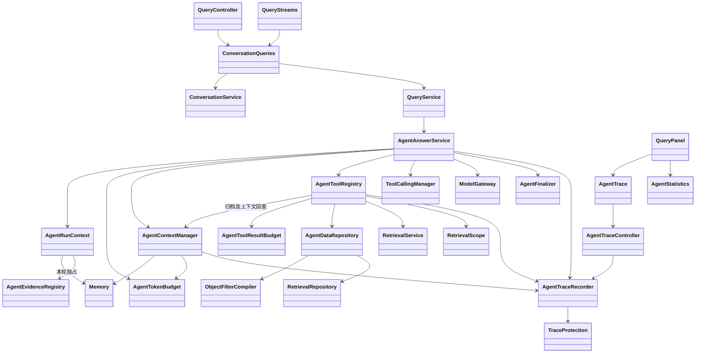
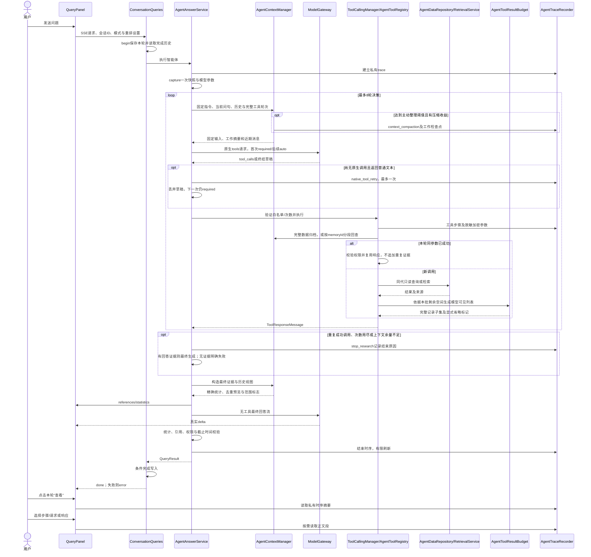

# 智能实现

## 1. 实现范围

2026-11-06，作者 czhcc。对应[智能体设计](智能体设计.md)。本轮在 `feature/agent-design-docs` 实现单智能体 ReAct、十个只读工具、全量统计、固定索引快照、真实流式回答和私有调用跟踪。工程沿用 JDK 21、Spring Boot 4.1.2、Spring AI 2.0.2，没有新增智能体依赖。

正常 `preview=answer` 默认进入智能体；`context/prompt` 预览保持既有固定检索流程。`rag.agent.enabled=false` 可以显式使用原有问答流程，不能将其作为智能体统计失败后的自动回退。

## 2. 组件与主要实现类图

| 实现类 | 职责 |
| --- | --- |
| `QueryService` | 根据预览/回答类型分派，保留原有预览能力 |
| `ConversationQueries` / `ConversationService` | 建立私有轮次、读取完成历史、事务外推理、条件完成及失败保存 |
| `AgentAnswerService` | 请求准入、捕获模型与索引快照、ReAct 循环、上下文预算、最终回答 |
| `AgentTokenBudget` | 逐次估算原生消息与工具定义，分阶段分配实际输出上限 |
| `AgentContextManager` / `Memory` | 请求级原始档案、工作检查点、近期消息、主动压缩及按句柄回查 |
| `AgentToolResultBudget` | 按剩余空间裁剪模型可见列表，保留完整记录、总数与统计口径 |
| `AgentRunContext` | 每轮独立的用户、快照、模型、截止时间、调用预算、证据及 trace 状态 |
| `AgentToolRegistry` | 显式 JSON Schema、中文名称、参数守卫、十个 ToolCallback、检索及重排适配 |
| `ObjectFilterCompiler` | 白名单过滤语言编译为 SQL 模板和绑定值；拒绝任意 SQL |
| `AgentDataRepository` | 完整集合查询、属性及关联过滤、对象/关系统计和分组 |
| `RetrievalScope` / `RetrievalService` | 显式传递快照、父截止时间、关键词模型参数和嵌套模型调用观察器 |
| `AgentEvidenceRegistry` | 统一文档修订引用编号，文本块及多来源去重 |
| `AgentFinalizer` | 完成发布前验证统计数量，不一致时不发布 done |
| `AgentTraceRecorder` | 有界异步写入、时序及正文分离、私有权限读取、保留期清理 |
| `TraceProtection` | 递归脱敏、隐藏推理排除、独立用途 AES-GCM 加密 |
| `AgentTraceController` | 按私有对话和回答轮次读取摘要/正文段 |
| `AgentTrace.tsx` / `AgentStatistics.tsx` | 逐轮“查看”、时序明细、按需正文加载和统计依据 |

设计中的 ReActExecutor、GuardedToolCallback、AgentQueryTools、AgentStatisticsTools 等职责分别合并在 `AgentAnswerService`、`AgentToolRegistry`、`AgentDataRepository`；跟踪 repository 职责合并在 `AgentTraceRecorder`。没有注册任意 Spring Bean 方法，也没有全局或 ThreadLocal 用户上下文。参数使用受控 Map 和 JSON Schema，并由服务端逐层验证，不声称已有另一套强类型 DTO 类。

## 3. ReAct 执行机制

1. 从已创建的对话轮次建立 trace；捕获一次 `RetrievalRepository.capture(kb,actor)`，读取回答、重排、关键词模型参数。
2. 将 ConversationService 返回的近期已完成历史交给 AgentContextManager，按预算保留近期原文、归档并预览较早问答。上一轮筛选条件可辅助理解指代，旧数量与旧引用不能作为本轮证据。
3. 建立十个原生工具定义，每轮先经上下文管理再调用 `ModelGateway.decide`。使用 `OpenAiChatModel` 和显式 `ToolCallingManager`，不同时启用自动工具循环。
4. 首次取得工具调用前显式发送 tool_choice=required；得到真实调用后使用 auto，允许模型正常结束研究。若最初返回普通文本，丢弃草稿并最多重试一次，重试也计入总决策次数、截止时间和 token 预算；仍无原生调用时返回 query_agent_native_tools_missing，不能据此断言模型不支持工具。只打印 JSON/Thought/Action 不算原生调用。
5. 检查工具名称、调用 ID、参数大小、整批剩余次数。按供应商给出的顺序逐个执行；Spring AI 保留 assistant 工具调用与 ToolResponseMessage 的 ID 对应关系。
6. 工具回调再次检查权限、索引 ready 状态、总截止时间及取消。结构化参数错误作为 error 观察供模型修正；数据库、模型、权限和取消错误终止本轮，不能转成零。
7. 无进一步工具调用后，丢弃决策草稿，使用本轮有效观察与近期历史构造无工具最终提示词，单独调用真实回答流。
8. 完成后检查权限、截止时间、统计数字与引用。只有通过检查及历史条件写入后，QueryStreams 才发送 done。

循环退出不再把“重复第3次”统一当作总工具上限。`AgentRunContext.successfulTools` 按工具名与规范化参数保存本轮成功响应；混合批次中的重复成功调用经权限与索引检查后返回同一响应，保留当前 toolCallId，trace summary 标记 reused=true，不重复追加 observations/statistics。错误响应不进入复用表，第三次同参数失败抛 query_agent_no_progress。该复用表随请求销毁，不是回答缓存，不能跨轮次、用户、知识库或索引代复用。

`AgentAnswerService` 在执行前识别整批已成功调用，调用 stopResearch 结束查询；工具次数用尽、整批超出剩余次数、上下文空间不足或最后一次决策完成后也走同一退出策略，不执行超额批次。有非 schema 的成功观察时转入无工具最终回答，在提示词中要求说明未解决范围，不得把局部检索视作全量统计；只有 schema 或错误时仍明确失败。结束原因 agentStopReason 为 model_finished、repeated_successful_calls、tool_limit、decision_limit 或 context_budget，stop_research 时序步骤保存原因及是否已有回答证据。最终回答仍需真实完整流和统计一致性验证。

数据工具的参数校验可能被 Spring Repository 包装为 InvalidDataAccessApiUsageException；AgentToolRegistry 仅对直接原因是 IllegalArgumentException 的包装还原参数错误，供模型纠正，真实数据库异常继续终止本轮。

输入消息、完整工具 schema、工具响应历史和预留输出共同计入模型上下文预算；超过预算明确报错，不静默丢弃工具协议消息。单个工具返回最多 120000 UTF-16 字符，最终回答最多 2000000 字符。

工具返回也受输入预算控制：AgentContextManager.resultSpace 根据整理后的请求、供应商实际返回的 assistant/tool_calls 消息估算占用，再留 min(512, 配置输出上限) 的后续输出及 256 协议余量，将剩余空间平分给本批工具，每份再留 256 包装余量，模型可见数据最多 2048 token。分配不足 256 且已有回答证据时以 context_budget 结束查询，无证据则明确失败。完整协议轮次可以被检查点替换，不能单独删除 tool_call 或 tool 响应。

`AgentRunContext.hasAnswerEvidence` 排除仅有 schema 的观察，也排除所有记录均被省略的截断页；未经截断的空匹配结果可以用于说明该筛选无匹配，不能把有省略标记的空页解释成零。回归包含连续关联查询触发 context_budget 后完成回答、超大列表保留省略标记、完整统计不裁剪及空截断页不成为回答证据。

`AgentToolResultBudget.project` 对 items/entities/relations/chunks 删除完整尾部记录，保留引用表、总数、筛选与分页参数，并附 truncated、omittedItems 和 budgetHint；items 有省略时 hasMore=true，不能将空截断页理解为零个匹配。标量和完整单条数据仍放不下时返回明确工具错误，建议缩小页或筛选。aggregate_* 的总数、组键、组值、条件、单位和凭证均不截断，无法容纳时仍失败。模型使用裁剪后的观察，私有 trace 响应分别记录 modelResponse 与 originalData，摘要提供 originalTokens、resultTokens、truncated。最终生成由 AgentContextManager 提前整理证据和历史；不截断当前问题或统计证据。预算失败普通日志仅输出阶段与数字，不输出模型正文。

`AgentTokenBudget.allocate` 在每次模型调用前估算输入：工具定义包含名称、描述及解析后的参数 schema，不把 schema 当作字符串重复转义；工具返回按独立 tool 消息计数，不再同时计入 `getText()`。总限额为模型 contextTokens 与显式请求 maxTotalTokens 的较小值，另留 64 token 安全余量。决策输出上限为 min(配置最大输出, 2048, 剩余空间)，最终回答为 min(配置最大输出, 剩余空间)。剩余空间小于 min(256, 本阶段输出上限) 时仍报 query_budget_too_small。估算使用本系统 tokenizer，供应商实际计数可能不同。

每次分配产生临时 ModelVersion，配置记录保持不变；ModelGateway 收到的 maxTokens 与 trace 请求 parameters 一致。trace 的 tokenBudget 包含 inputTokens、toolTokens、outputTokens、limit、safetyTokens，不在普通日志打印请求正文。统计数据不截断，已完成原生工具轮次按整组归档；若必要输入本身过大，仍终止并标记未完成。

模型地址、名称、密钥及 extraBody 均来自配置，输出 token 使用配置上限内的本次分配，超时受本轮剩余时间约束。决策入口显式重建运行时 OpenAI options，防止空的运行时默认值覆盖已配置的 `chat_template_kwargs.enable_thinking=false` 等扩展参数。

ModelGateway.decide 重建 options 时还必须保留调用方的 toolChoice，避免 required 在 SDK 请求中退回默认 auto。决策 trace 请求记录实际 toolChoice；首轮普通文本后增加 native_tool_retry（重试原生工具选择）步骤，记录重试序号与草稿已丢弃，草稿不进入工作记忆、后续提示或最终回答。配置测试的 supportsTools 使用 required 的无副作用探针，最多两次验证，工具回调始终禁止执行；只验证供应商返回的真实 tool_calls。

### 3.1. 智能体上下文管理

采用确定性的结构化检查点，未增加压缩模型调用。每轮分三层：Memory.archive 保存完整工具结果及被移出的历史；Memory.steps/history/objects 保存工作摘要；Prompt 保留固定指令、当前问句和近期完整消息。状态仅保存在本次 AgentRunContext 中，请求结束即释放，不是跨轮回答缓存；跨轮继续从有权限的已完成对话重建。

输入达到有效上下文的 trigger-percent（默认 65）后，prepareDecision 尝试向 target-percent（默认 50）压缩。有效上下文为配置上下文与显式请求预算的较小值，工具定义同样计入输入。优先整理较早完整工具轮次，再整理较早完整历史问答，空间仍不足时可整理最后一个已完成轮次。原生调用与所有对应响应必须完整匹配，否则整组保持原样。固定指令和当前问句始终保留；只有 token 确实下降才替换 Prompt。不可压缩的固定输入或统计数据可能使目标比例无法达到，最终仍由 AgentTokenBudget 执行硬限制。

工作摘要保留工具名、完整参数、成功/错误状态、memoryId、索引代及数据预览。对象按 ID 去重，关联行按 relationId 与对象 ID 组合去重；非统计文本以 Unicode 码点保留前 240 字，列表预览最多 8 项，属性详情标注在档案中，较早问句/回答分别保留 512/240 码点预览，均注明需要回查。该预览不宣称已包含全部约束或事实。aggregate_* 保留完整原始观察，包括十进制数值、分组、口径、凭证、单位、缺失值标志。历史预览及其嵌套回查始终为 not_current_factual_evidence，不得提升为当前事实。

工具成功响应新增 memoryId，在列表裁剪之前归档完整数据；重复结果通过本轮指纹复用档案。read_agent_context 仅接受当前请求已有随机句柄，返回序列化数据的纯文本片段、nextOffset、hasMore、authority；片段不保证是完整 JSON，更不能据此创造新统计。码点切分不拆表情字符，实际 token 过大时缩小片段。仍执行当前成员、同代 ready、截止时间、取消及总工具次数检查，不允许任意 ID/路径/其他用户档案。每条档案最多 2000000 UTF-16 码元、本轮总计最多 20000000，超过时明确失败。

最终回答也由 prepareFinal 管理：小上下文保留原始观察，较大上下文采用本轮工作检查点、去重证据预览及完整统计，较早历史进入档案；归档为独立快照，不引用可变的工具 Map；没有压缩收益时继续原输入。指令与证据分为独立 system/user 消息，证据始终作为不可信数据。最终阶段不再调用工具，缺少必要细节时必须说明限制。结果 metadata.contextCompactions 记录次数；context_compaction 中文步骤为“整理智能体上下文”，记录阶段、阈值、压缩前后 token、工具轮次、历史问答数、档案数和检查点正文。正文沿用既有加密与权限，不进入普通日志。

## 4. 工具列表与参数

以下均为内置只读工具。完整嵌套参数约束见[智能体设计第七章](智能体设计.md#7-工具参数详细定义)，实际 schema 由 `AgentToolRegistry` 生成。模型不能传入用户、知识库、索引代、密钥、SQL 或文件路径。

| 工具名称 | 中文名称及描述 | 参数说明 | 参数描述 |
| --- | --- | --- | --- |
| `get_knowledge_schema` | 知识结构查询：发现真实类型、属性与关系类型 | section、entityTypes、page、size | section 为 ENTITY_TYPES/ATTRIBUTES/RELATION_TYPES；entityTypes 仅在 ATTRIBUTES 生效；默认页 0、每页 50，最多 100；属性返回名称、所属实体类型、类型标签和 JSON 值类型 |
| `search_knowledge_base` | 知识库检索：复用 LightRAG 五种模式 | query、mode、enableRerank、topK、chunkTopK | query 为 1～8000 字符且有 token 限制；未指定模式沿用用户选择；用户关闭重排时模型不能开启；候选数 1～100 |
| `find_objects` | 对象查询：按名称、类型、属性和一跳关联筛选 | filter、page、size | 使用 ObjectFilter；默认页 0、每页 20，最多 100；total 是完整匹配数量，不是当前页长度 |
| `get_object` | 对象详情：读取属性及描述 | objectId | 当前快照中的 UUID；不连带读取全部文本和邻居 |
| `get_object_texts` | 关联文本查询：读取文档修订来源和文本片段 | objectId、page、size | 按文档修订/块序排序，保留共享块的全部来源；登记原文句柄 referenceId 和回答引用 citationId |
| `get_related_objects` | 关联对象查询：读取无向一跳关联 | objectId、relationTypes、targetFilter、page、size | 中心对象、允许的关系类型及非递归目标筛选；稳定排序分页 |
| `aggregate_objects` | 对象统计：全量去重计数与分组 | filter、groupBy、groupPage、groupSize、order | GroupSpec.kind 为 NONE/TYPE/ATTRIBUTE/RELATED_OBJECT；ATTRIBUTE 需要 attributeName；RELATED_OBJECT 可传关系类型、目标筛选；分组每页最多 100 |
| `aggregate_relations` | 关系统计：去重无向边计数与关系类型分组 | relationTypes、endpointA、endpointB、groupBy、groupPage、groupSize、order | 端点交换匹配；groupBy 为 NONE/RELATION_TYPE；weight 不参与计数，多类型分组仅展示选中的类型 |
| `read_source` | 原文查看：回看本轮已登记来源 | referenceId、maxChars | 仅接受本轮句柄；按完整文档/修订/块元组读取，默认 4000、允许 256～12000 个码点 |
| `read_agent_context` | 上下文回查：读取本轮归档的工具或历史数据 | memoryId、offset、maxChars | memoryId 必填且仅限本轮；offset 默认 0、范围 0～2000000；maxChars 默认 1000、范围 64～4000 码点，实际受预算收紧；用 nextOffset 继续读取 |

ObjectFilter 支持 objectIds（最多100）、types（最多20）、name（字面忽略大小写子串）、attributes（最多10）及 relatedTo（一跳）。属性操作 EQ/IN/CONTAINS/GT/GTE/LT/LTE/EXISTS/NOT_EXISTS；原生数值比较不转换字符串，IN 最多20，存在性操作不得带 value。relatedTo.objectFilter 必填，端点/目标子过滤不允许再嵌套 relatedTo。未知字段或不适用的分组字段会被拒绝。

工具调用与错误均使用结构化 JSON。成功包含 status、generationId、data、memoryId、evidenceIds、warnings。列表包含十进制字符串 total 和 hasMore；统计包含 exact、unit、distinctBy、normalizedFilter、generationId、knowledgeBaseId、evidenceId，以及必要的 multipleMembership/hasMore 标记。

## 5. 统计与一致性

`AgentDataRepository` 在模型调用之外执行 SQL。先按现有共享锁协议检查权限；聚合本身在最长10秒的只读、可重复读短事务中执行纯 SELECT，并用普通 EXISTS 复核成员/ready 状态，避免在只读事务中执行 SELECT FOR SHARE。事务返回后再次按现有权限协议检查。

过滤条件只通过绑定参数进入 SQL；表、别名、操作符、分组与排序均来自代码白名单。属性过滤使用 EXISTS，关联条件使用同代关系 EXISTS，因此不会因属性或关系展开倍增主体行。

完整匹配对象集先确定，再按类型、原生标量属性或关联对象 ID 分组。每组 COUNT DISTINCT 对象 ID；总数从完整主体集计算。分组分页发生在聚合后。属性键包含类型标签、原生 JSON 值和 missing 标记；非标量属性分组返回参数错误，不静默忽略。显式 null 与缺失分组不同。多值属性及多重关联可能让同一对象出现在多个组，禁止直接相加。

关系按无向边 ID 计数，两端条件同时尝试两种排列；多标签分组使用 DISTINCT 边 ID，不能将权重当作数量。COUNT 在服务端使用 long/BIGINT；total、count、groupTotal、totalDistinctObjects 返回十进制字符串，前端不转换 Number。

查询向量始终使用捕获代的 embeddingVersion；关键词模型参数在本轮开始冻结。所有后续检索传入同一 RetrievalScope，不能再次读取活动索引指针。查询中途新代激活不会改变本轮工具范围。

## 6. 证据、历史和回答验证

AgentEvidenceRegistry 为同一文档修订分配稳定引用编号，跨工具及重复检索复用；文本块按 ID 去重并合并来源。对象来源查询同样登记文本证据。read_source 只认本轮登记的来源句柄。

统计依据保存在 `QueryResult.retrieval.metadata.statistics`，成功筛选摘要保存在 metadata.agentScopes。ConversationService 仅从服务端保存的成功轮次读取这些条件，附到模型历史中并要求本轮重查。前端不能提交任意历史或筛选上下文。

AgentFinalizer 在最终输出完整后校验统计数字：十进制数字必须来自统计结果，中文数量表达被拒绝，要求用十进制数字精确引用；不支持自行推导百分比、SUM/AVG 等统计。它是数量一致性守卫，并非对自然语言所有事实的形式化证明。歧义口径通过模型澄清，抽取遗漏与别名问题仍属于知识库数据质量边界。

SSE 保留 metadata/references/delta/done/error，并新增 agent_status、statistics。delta 仅转发供应商真实文本增量；决策草稿、工具 JSON 和隐藏思考不是回答增量。中断、截断、无 stop 的 EOF、权限变化、统计验证失败均保留不完整状态，不发送成功 done。

## 7. 调用跟踪实现

新增 V16，不修改已执行迁移：

| 表 | 内容 |
| --- | --- |
| rag_agent_trace | 对话轮次、固定索引代、状态、记录完整性及开始/更新时间 |
| rag_agent_trace_span | 英文名称、中文名称、父步骤、递增序号、修订号、偏移与耗时、安全摘要 |
| rag_agent_trace_payload | request/response 分段密文、独立认证ID、用途版本 v1、过期时间 |

trace 外键绑定知识库/私有对话/轮次，级联随对话删除；generation_id 不外键引用索引代，以保留历史时序。只有创建私有轮次后才能持久化 trace；无会话的旧同步调用不保存私有跟踪。

决策、工具、关键词模型、向量模型、重排模型、最终回答及验证均创建步骤。工具步骤保存实际 toolCallId；嵌套模型步骤以工具为父步骤。记录配置参数与公开返回，不记录 API 密钥、授权头、会话、CSRF、租约或隐藏推理。最终回答包含首增量耗时与完成原因；供应商提供 usage 时记录，未提供时标明不可用，不估造供应商用量。

TraceProtection 先递归转换/脱敏嵌套结构与工具 JSON 字符串，再按主密钥通过 HMAC-SHA256 派生 `TjLightRAG/agent-trace/v1` 专用 AES 密钥。每段随机 nonce，AES-GCM 认证数据包含用途版本与分段 UUID。没有主密钥时正文捕获失败并标注不完整，问答继续；模型 API 密钥从不作为跟踪密钥。

异步写线程1个、队列256项，单数据库写事务最长3秒。每方向最多2MiB，每轮最多20MiB；每段最多16000个UTF-16码元且不拆代理对，UTF-8小于64KiB；结束最多等待2秒刷新。队列、加密或写库失败只影响完整性。正文默认7天，读取时拒绝过期段，定时清空过期密文并保留摘要和过期标记。进程崩溃残留运行状态在查看时识别为 interrupted。

API 前缀：`/api/knowledge-bases/{kb}/conversations/{conversation}/turns/{turn}`。

- `GET /trace?afterSequence=0&size=100`：最多200条摘要，返回 sequence/revision/parentId 等，不读取完整正文。
- `GET /trace/spans/{span}?side=request|response&part=0`：校验同轮归属后解密一段。

两者均重新验证知识库成员和私有对话所有权，返回 `Cache-Control: no-store`。知识库管理员也不能越权读取其他用户的私有轮次。

## 8. 主要时序

## 9. 前端及模型能力测试

QueryPanel 给实时和历史每轮回答增加“查看”，失败或取消的轮次也可查看。发送后保存真实 requestId，移入历史列表时不再生成 local-ID，确保定位同一轮。切换知识库/对话会关闭查看并取消请求。

AgentTrace 使用 Modal 展示中文名称、英文标识、父子缩进、状态、相对时间和耗时。选中步骤才读取正文，纯文本 pre 呈现，支持方向与分段选择。仅打开时刷新；运行步骤每1.5秒重新读取已有序号，依据修订号观察完成。关闭、切换或卸载取消网络读取。旧轮次未记录、内容过期、不完整和不可用状态分别提示，不使用浏览器持久化正文。

Modal 的可选 closeLabel 在 AgentTrace 中启用粘性标题栏和右上角“关闭”按钮，滚动、加载中、空记录或错误状态均能退出查看。点击或 Esc 通过同一回调卸载查看组件并清理请求，不取消后台问答。

AgentStatistics 展示精确数量、分组、筛选条件及抽取对象统计口径。统计答案无文本块时，不再提示“召回文本块为空”的误导性错误；普通事实问答仍显示原有证据空提示。

模型配置中的文本测试除普通聊天连通性外，额外执行无副作用 connection_probe 原生工具能力探测，返回 toolCallingSupported；模型仅打印工具 JSON 不算成功。能力未验证时提示兼容性问题，问答不会伪造统计或退回向量计数。

## 10. 配置和验证

| 配置/限制 | 默认值 |
| --- | --- |
| rag.agent.enabled | true |
| rag.agent.max-decisions | 8（允许1～16） |
| rag.agent.max-tool-calls | 12（允许1～32） |
| 相同规范化工具参数调用次数 | 2 |
| rag.query.timeout-seconds | 180，检索及模型调用继承剩余时间 |
| 单个统计查询事务 | 最长10秒 |
| 跟踪正文保留期/分段上限 | 7天/小于64KiB |

没有引入模型地址或凭据环境变量。主要测试包括 AgentSafetyTest、AgentFinalizerTest、ModelTransportTest、RetrievalIntegrationTest 中新增的原生协议、全量统计、属性/关系过滤、固定代、隐私、过期及级联删除用例，以及 AgentTrace、AgentStatistics、QueryPanel 前端回归。实际通过数量以本轮执行结果为准。

当前限制：单智能体、顺序工具执行、只读 COUNT/分组能力；统计依赖已抽取数据质量。自然语言口径消歧由模型配合 schema 完成；模型可见列表可以显式省略完整记录，不自动总结替换原生协议；统计数据或必要提示本身放不下时仍明确失败。跟踪密钥用途版本为 v1；部署主密钥轮换需要保留旧密钥或接受旧正文不可解密，尚未提供多版本密钥管理界面。
## 11. 本轮验证记录

2026-11-06：后端各模块最终测试报告合计275项，失败0、错误0；前端112项测试通过，TypeScript与Vite生产构建通过。数据库测试使用本机 PostgreSQL 18 / pgvector 0.8.3 镜像，通过显式测试参数覆盖；默认固定镜像和0.8.7版本断言保持不变，未声称在本机验证了0.8.7镜像。

覆盖空库迁移及旧库升级、原生工具协议、统计/分组/过滤、同代连续检索、真实增量、私有跟踪与加密分段、过期及级联删除、从对话入口完成保存、统计数字不一致保存失败、历史条件辅助追问、取消状态保存以及前端迟到请求取消。SSE取消改为幂等，避免完成回调重复中断工作线程、打断取消状态和跟踪落库。

测试辅助调整：认证测试与存储测试共用镜像覆盖参数，向量扩展版本可显式指定测试期望；新增 .gitattributes 固定 shell 脚本及校验语料为 LF，防止 Windows CRLF 改变语料哈希或导致容器入口脚本失败。生产模型配置和依赖版本不受这些测试参数影响。

本次上下文管理验证：61 项相关后端回归测试通过（包含 PostgreSQL 原生工具回查与连续关联查询）；补充归档快照不可变及残缺协议不拆分两项测试后，上下文管理/预算/工具结果预算共 16 项单元测试通过。仅修改后端及文档，未将本地模拟供应商结果视为真实模型回答质量验收。
