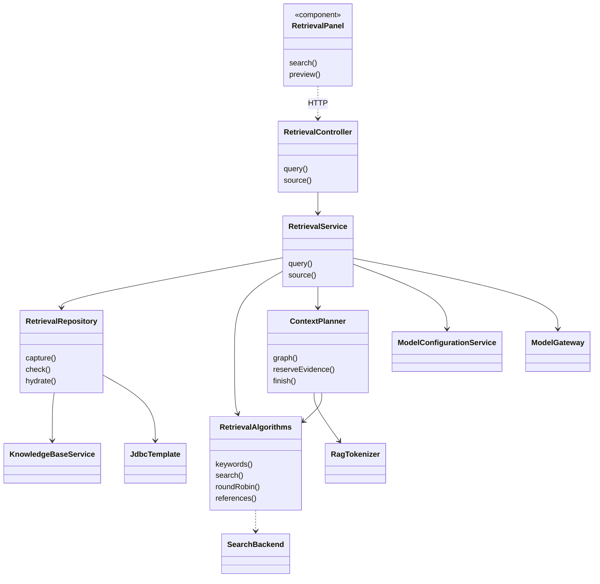
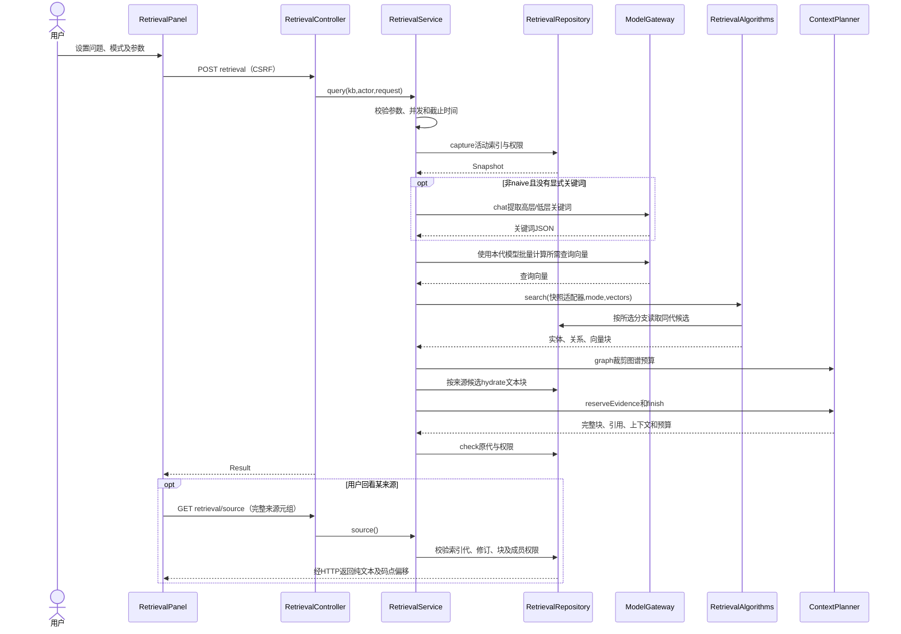

# 检索证据实现

## 1. 基线与实现单元

代码基线 `d65cef8`，核对日期 2026-11-04。设计见[检索证据设计](检索证据设计.md)。

| 单元 | 实现职责 |
| --- | --- |
| [RetrievalPanel](../frontend/src/RetrievalPanel.tsx) | 参数表单、手工关键词、结果及原文回看 |
| [RetrievalController](../backend/app/src/main/java/com/trs/app/rag/retrieval/RetrievalController.java) | 检索 POST 和来源 GET |
| [RetrievalRequest](../backend/app/src/main/java/com/trs/app/rag/retrieval/RetrievalRequest.java) | 参数默认值及 Jakarta Validation 约束 |
| [RetrievalService](../backend/app/src/main/java/com/trs/app/rag/retrieval/RetrievalService.java) | 并发/期限、模型选择、召回和来源编排 |
| [RetrievalRepository](../backend/app/src/main/java/com/trs/app/rag/retrieval/RetrievalRepository.java) | 知识库与索引代限定的 SQL、向量和原文读取 |
| [RetrievalAlgorithms](../backend/app/src/main/java/com/trs/app/rag/retrieval/RetrievalAlgorithms.java) | 关键词归一化、分支执行、融合、来源分配及引用编号 |
| [ContextPlanner](../backend/app/src/main/java/com/trs/app/rag/retrieval/ContextPlanner.java) | 图谱预算、证据预留及最终完整提示词核算 |

## 2. 主要实现类图

`RetrievalService` 创建的 `SearchBackend` 适配对象封装已捕获快照，算法通过它查询实体、关系、文本块及邻接数据，避免算法层自行选择新代。

## 3. 接口与数据契约

| 接口 | 参数/返回 |
| --- | --- |
| POST `/api/knowledge-bases/{kb}/retrieval` | JSON `RetrievalRequest`，返回 `RetrievalData.Result` |
| GET `/api/knowledge-bases/{kb}/retrieval/source` | 必填 `generationId,chunkId,documentId,revisionId,chunkOrder`，返回原文摘录和码点选区 |

POST 使用当前会话与 CSRF；GET 同样复核成员权限。`Result` 中 `generationId`、`embeddingVersion`、`keywordVersion` 为本次捕获值，`entities`、`relations`、`chunks`、`references` 和 `context` 为预算后的结果。`metadata` 包含分支、候选及返回数量、预算、耗时等诊断，不含模型密钥。

底层读取 `rag_index_generation`、`rag_index_entity`、`rag_index_relation`、三类 `rag_index_*_vector`、`rag_index_chunk`、`rag_index_document` 以及文档修订和来源关联表。检索不是对旧 V2 固定向量空间和新代空间的混合查询。

## 4. 检索时序图

## 5. 算法及一致性落点

1. `capture()` 用一次 SQL 取得活动 `ready` 代、embedding 版本和关键词版本。阶段间用 `check()` 复核权限及原代可用性，不切换新代。
2. 自动关键词必须是有效结构；短问题在高低关键词均空时可回退为问题本身的低层关键词。显式关键词跳过提取；重复文本向量输入先去重后批量调用。
3. `RetrievalAlgorithms.search()` 仅运行模式选择的分支，按 ID 确定性融合。实体邻接关系、关系端点及三路来源块继续受快照约束。
4. 来源块选择可用 VECTOR 或 WEIGHT；普通检索调用使用恒等选择器。问答复用带选择器的重载插入重排，页面检索自身不执行重排。
5. `reserveEvidence()` 必要时按关系尾部、实体尾部的顺序裁剪，为能独立容纳的首块留位；`finish()` 重算引用和完整提示词总 token，超出时保留完整前缀，禁止截断半条记录。
6. 原文回看核对完整来源元组；前端使用 `Array.from()` 按码点切片高亮，保留多来源信息。

## 6. 错误与验证

`retrieval_no_active_index`、`retrieval_vector_space_mismatch`、`retrieval_invalid_keywords`、`retrieval_budget_too_small` 等作为安全错误码返回；忙碌可返回 429，非法参数返回 400，模型/存储故障与正常 `empty` 分开处理。

测试见 [RetrievalPanel.test.tsx](../frontend/src/RetrievalPanel.test.tsx)、[RetrievalAlgorithmsTest](../backend/bootstart/src/test/java/com/trs/rag/retrieval/RetrievalAlgorithmsTest.java)、[RetrievalFailureTest](../backend/bootstart/src/test/java/com/trs/rag/retrieval/RetrievalFailureTest.java)和 [RetrievalIntegrationTest](../backend/bootstart/src/test/java/com/trs/rag/storage/RetrievalIntegrationTest.java)。基线及差异说明保存在[阶段 4 文档](migration/STAGE_4.md)。
