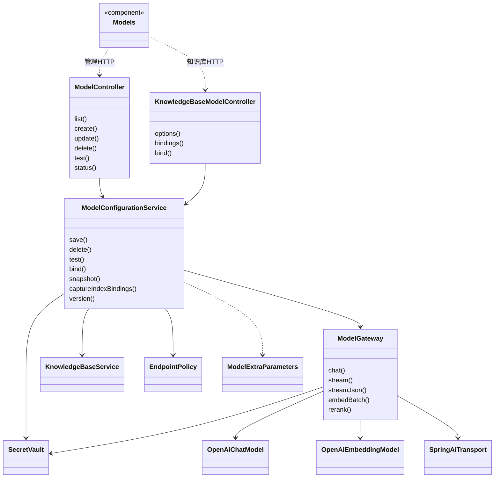
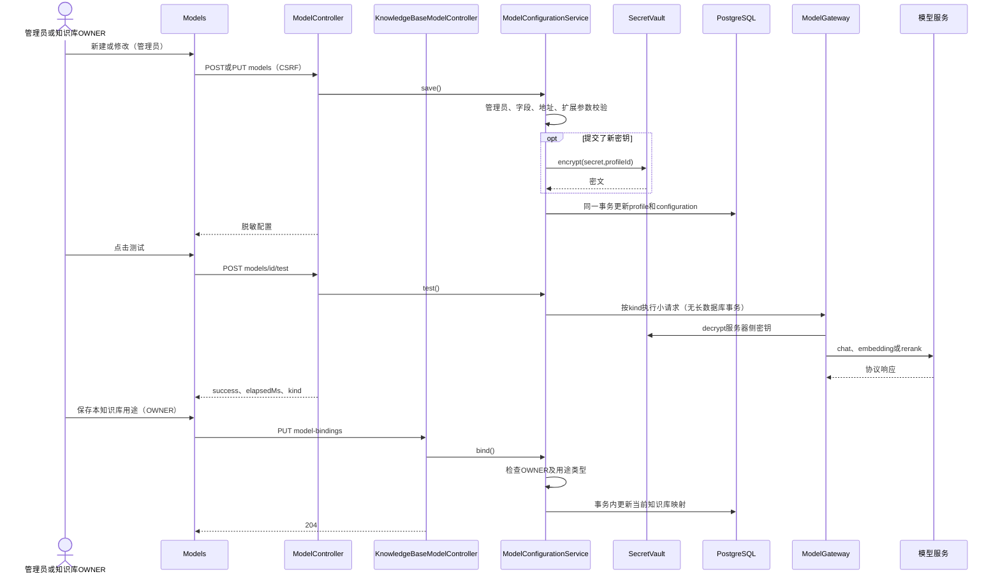

# 模型配置实现

## 1. 基线与主要实现

代码基线 `d65cef8`，核对日期 2026-11-04。对应[模型配置设计](模型配置设计.md)。

| 文件 | 职责 |
| --- | --- |
| [Models](../frontend/src/Models.tsx) | 三类模型列表、配置/绑定对话框、删除及测试反馈 |
| [ModelController](../backend/app/src/main/java/com/trs/app/rag/model/ModelController.java) | 平台管理员模型维护 API |
| [KnowledgeBaseModelController](../backend/app/src/main/java/com/trs/app/rag/model/KnowledgeBaseModelController.java) | 知识库模型选项及用途绑定 API |
| [ModelConfigurationService](../backend/app/src/main/java/com/trs/app/rag/model/ModelConfigurationService.java) | 当前配置 CRUD、用途权限、索引快照和探测 |
| [SecretVault](../backend/app/src/main/java/com/trs/app/rag/model/SecretVault.java) | AES-256-GCM 密钥加解密 |
| [EndpointPolicy](../backend/app/src/main/java/com/trs/app/rag/model/EndpointPolicy.java) | 配置地址合法性检查 |
| [ModelExtraParameters](../backend/app/src/main/java/com/trs/app/rag/model/ModelExtraParameters.java) | 扩展 JSON 限制与不可变深拷贝 |
| [ModelGateway](../backend/app/src/main/java/com/trs/app/rag/model/ModelGateway.java) | Spring AI 文本/向量适配及重排协议调用 |

## 2. 主要实现类图

`ModelVersion` 是服务端模型执行参数 DTO 的沿用类名，不表示界面仍支持配置版本列表。图中展示主要依赖，重排保留受限 HTTP 适配，不声明它也通过 Spring AI 重排类实现。

## 3. API

| 方法与路径 | 功能 |
| --- | --- |
| GET `/api/admin/models` | 脱敏当前配置列表 |
| GET `/api/admin/models/status` | 非敏感部署就绪状态 |
| POST `/api/admin/models` | 新建当前配置 |
| PUT `/api/admin/models/{id}` | 修改当前配置 |
| DELETE `/api/admin/models/{id}` | 删除未绑定配置，204 |
| POST `/api/admin/models/{id}/test` | 探测已保存配置 |
| GET `/api/knowledge-bases/{kb}/model-options` | 成员可见的名称、类型、ID |
| GET `/api/knowledge-bases/{kb}/model-bindings` | 本知识库用途映射 |
| PUT `/api/knowledge-bases/{kb}/model-bindings` | OWNER 更新用途，204 |

维护请求使用 `ModelRequest`，包含名称、类型、地址、模型、密钥、维度、上下文、输出、超时、`clearApiKey` 和 `extraBody`。绑定请求为用途到模型 UUID 的映射，值为 `null` 表示解除该用途；前端提交全部六种用途，服务端按传入条目更新。

## 4. 保存、测试及用途绑定时序图

## 5. 数据、模型调用与安全

| 表 | 作用 |
| --- | --- |
| `rag_model_profile` | 模型身份、名称、类型 |
| `rag_model_configuration` | 每个模型一份可编辑当前配置及加密密钥 |
| `rag_knowledge_base_model_binding` | `(knowledge_base_id,role)` 唯一映射；模型外键阻止删除仍被绑定的配置 |
| `rag_index_model_snapshot` | 索引构建捕获的不可变执行输入，保留旧代查询能力 |

数据转换以 [V12 迁移](../backend/bootstart/src/main/resources/db/migration/V12__knowledge_base_model_settings.sql)为准。`captureIndexBindings()` 为 extract、summary、embedding 捕获或复用参数快照；`version()` 先读当前配置，再读索引快照。关键词和回答使用本知识库当前映射，检索 embedding 固定采用索引代快照。

`ModelGateway` 的文本调用经 `OpenAiChatModel`，向量调用经 `OpenAiEmbeddingModel`；供应商请求由受限传输适配处理。真实流式调用传播增量；索引抽取单独设置 `JSON_OBJECT`，普通回答不设置。重排使用 `/rerank` 协议并校验索引、重复项与有限分数。

密钥保存采用随机 nonce 和模型身份关联数据；主密钥由 `rag.models.master-key` 提供且不写入数据库。编辑留空保留旧密钥，`clearApiKey` 显式清除。`ModelExtraParameters` 限制 16 KiB、深度和节点数量，禁止覆盖 `messages/model/stream/response_format` 等受控字段及凭据。

## 6. 错误与验证

非法字段或用途类型返回 400；非管理员或非 OWNER 返回权限错误；绑定外键冲突返回 409；主密钥缺失为 409；模型连接或协议错误通过安全错误码返回，通常为 502。前端测试按钮显示失败提示，不展示请求正文或密钥。

测试见 [Models.test.tsx](../frontend/src/Models.test.tsx)、[ModelExtraParametersTest](../backend/bootstart/src/test/java/com/trs/rag/model/ModelExtraParametersTest.java)、[ModelTransportTest](../backend/bootstart/src/test/java/com/trs/rag/model/ModelTransportTest.java)、[ModelStreamingTest](../backend/bootstart/src/test/java/com/trs/rag/model/ModelStreamingTest.java)、[ModelDeletionTest](../backend/bootstart/src/test/java/com/trs/rag/model/ModelDeletionTest.java)、[ModelSettingsMigrationTest](../backend/bootstart/src/test/java/com/trs/rag/storage/ModelSettingsMigrationTest.java)。
