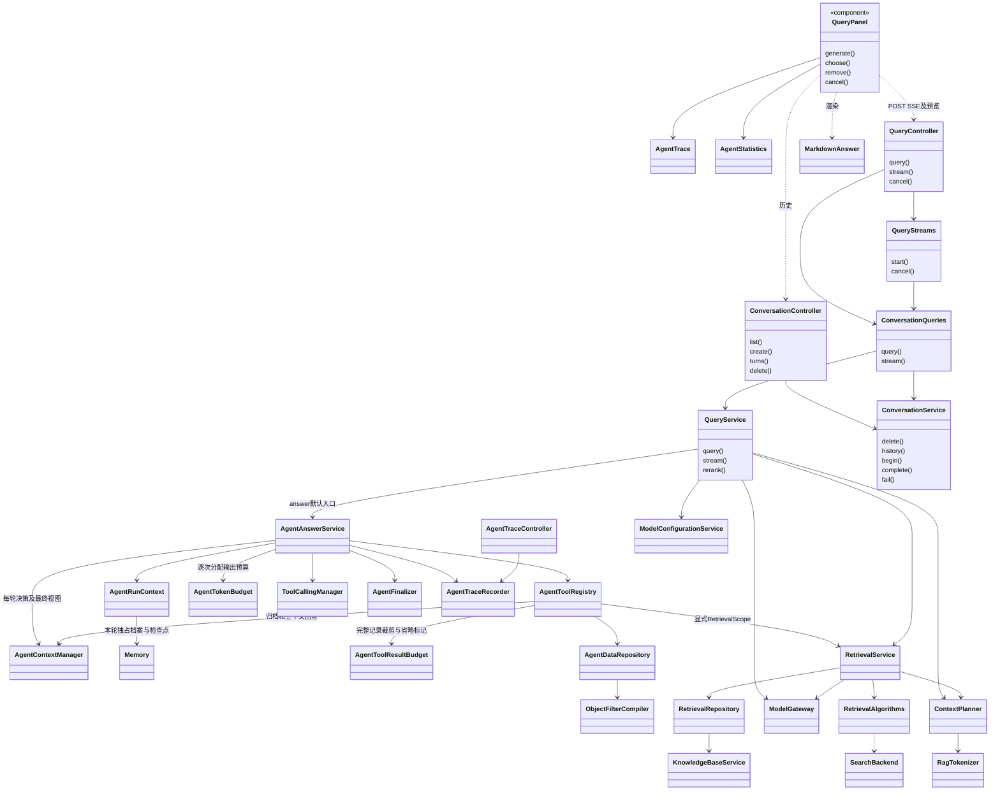
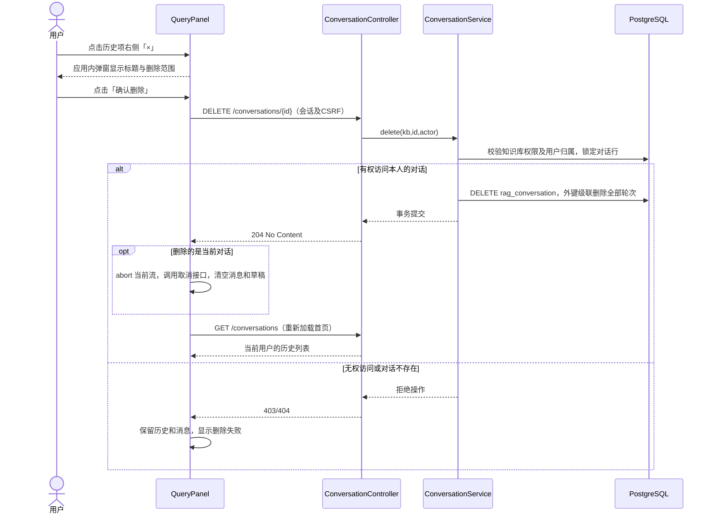
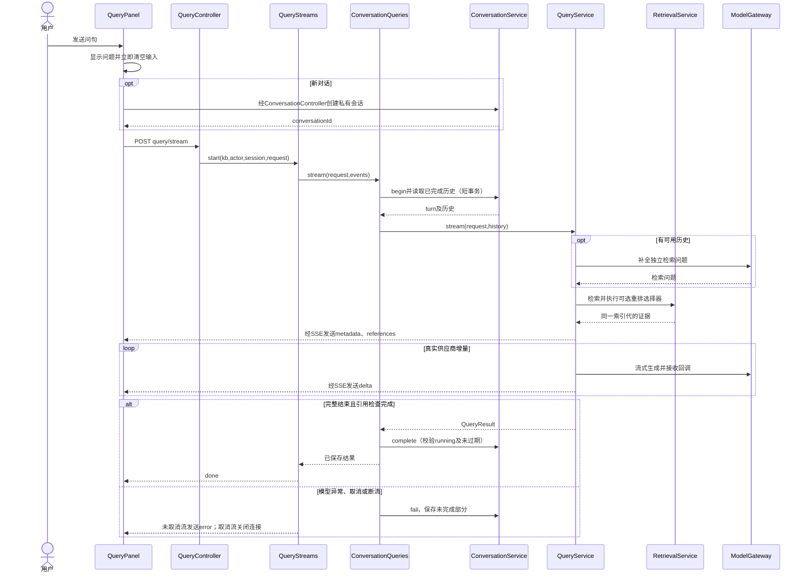
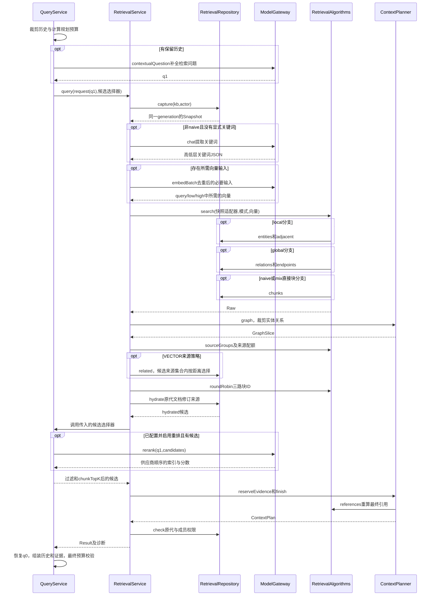
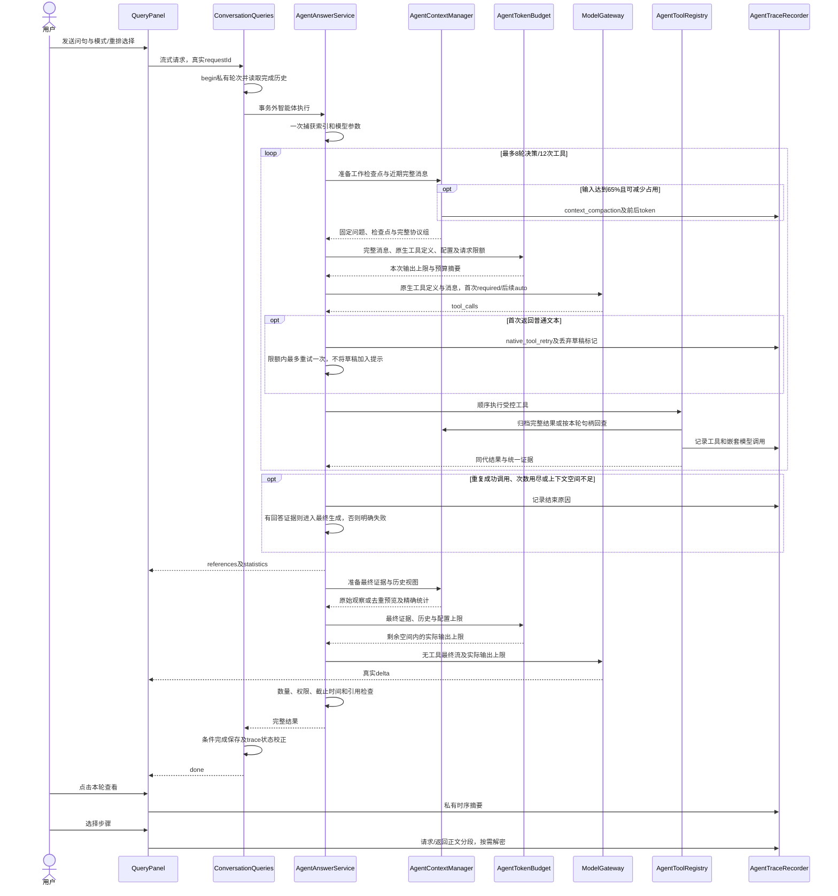

# 知识库问答实现

## 1. 实现基线与代码入口

代码基线 `d65cef8`，核对日期 2026-11-04。设计见[知识库问答设计](知识库问答设计.md)。前端使用 React，服务端使用 Spring MVC SSE；下图中的前端函数组件按组件表示，连线仅展示主要依赖。

2026-11-05 更新：增加对话历史删除入口、私有删除接口、关联轮次清理及回归验证。

2026-11-06 更新：`preview=answer` 默认由 QueryService 分派到 AgentAnswerService；上下文/提示词预览保留原流程。新增实现、工具参数、V16 跟踪表和完整时序见[智能实现](智能实现.md)。下文原有固定问答的编排描述适用于预览或 `rag.agent.enabled=false`；底层五种检索算法仍由智能体检索工具复用。

| 实现单元 | 职责 |
| --- | --- |
| [QueryPanel](../frontend/src/QueryPanel.tsx) | 历史选择、问句草稿、逐轮消息、预览、证据和取消 |
| [queryStream](../frontend/src/queryStream.ts) | POST SSE 读取、事件解析、错误及不完整流校验 |
| [MarkdownAnswer](../frontend/src/MarkdownAnswer.tsx) | 安全的 Markdown/GFM 渲染 |
| [QueryController](../backend/app/src/main/java/com/trs/app/rag/query/QueryController.java) | 同步问答、流式问答、取消入口 |
| [QueryStreams](../backend/app/src/main/java/com/trs/app/rag/query/QueryStreams.java) | 请求注册、心跳、截止时间、取消和终止事件 |
| [ConversationQueries](../backend/app/src/main/java/com/trs/app/rag/query/ConversationQueries.java) | 协调历史事务与事务外模型推理 |
| [ConversationService](../backend/app/src/main/java/com/trs/app/rag/query/ConversationService.java) | 用户私有历史、轮次互斥和有条件完成写入 |
| [QueryService](../backend/app/src/main/java/com/trs/app/rag/query/QueryService.java) | 历史裁剪、追问补全、检索、重排、提示词及引用检查 |

## 2. 主要实现类图



## 3. 接口与持久化

以下路径以 `/api/knowledge-bases/{kb}` 为前缀。请求由服务端会话识别用户，写请求通过 CSRF 校验。

| 方法与路径 | 行为 |
| --- | --- |
| GET `/conversations?page=0` | 当前用户的最近对话，每页最多 50 个 |
| POST `/conversations` | 创建空对话，返回 `id`、`title` |
| DELETE `/conversations/{id}` | 删除当前用户的指定对话及全部轮次，成功返回 204；无访问权或非本人对话不可删除，写请求须通过 CSRF 校验 |
| GET `/conversations/{id}/turns?before={sequence}` | 最近或更早的 50 轮，按时间正序返回 |
| POST `/query/stream` | 接收 `QueryRequest`，返回 `text/event-stream` |
| POST `/query` | 同步回答或 `preview=context/prompt` 预览 |
| POST `/query/{requestId}/cancel` | 同知识库、用户名和 HTTP 会话范围的幂等取消，204 |
| GET `/retrieval/source` | 使用完整来源元组回看原文 |

`QueryRequest` 继承 `RetrievalRequest`，增加 `requestId`、可选 `conversationId`、`preview`、`enableRerank` 和 `minRerankScore`。界面保存对话时先创建会话，再带 `conversationId` 提交。SSE 必须提供随机 UUID 请求号；保存轮次也要求请求号。服务端拒绝客户端历史及未知覆盖字段。

[V13 迁移](../backend/bootstart/src/main/resources/db/migration/V13__conversations.sql)创建 `rag_conversation` 与 `rag_conversation_turn`。轮次保存原始问题、回答、状态、过期时间和结果 JSON；结果包含当轮索引代及来源。`user_id` 决定会话归属，`turn_no` 保证顺序，部分唯一索引限制每个会话只有一条 `running` 记录。

## 4. 流式问答时序图

### 对话删除时序



`QueryPanel.remove()` 使用独立 AbortController 绑定删除及列表刷新，知识库切换或组件卸载时取消并忽略迟到响应。标题按钮和「×」按钮为同一行中的独立按钮，删除不会触发历史选择。「×」在行悬停、行内有焦点或该项正在删除时显示，不支持悬停的设备始终显示；按钮保留含对话标题的中英文无障碍名称。删除期间禁用重复操作及影响当前对话的导航、发送和预览，原有回复可以继续流式显示。成功后首页重新加载，重置 `historyPage`，防止 OFFSET 因记录减少导致下一页漏项。

`ConversationService.delete()` 在短事务中调用 `owned(..., true)` 检查访问权及所有权，使用 `FOR UPDATE OF c` 与 begin/complete/fail 串行化；V13 已有外键 `ON DELETE CASCADE` 清理轮次，无需迁移。模型推理仍在事务外，已删除会话的迟到完成或失败写入会被所有权查询拒绝，不会重建历史。前端删除当前对话成功后复用 `choose("")` 及 `cancel()` 释放当前模型订阅与 HTTP 连接。

验证：`QueryPanel.delete.test.tsx` 覆盖删除当前/其他对话、取消确认、失败保留、知识库切换迟到响应、分页重新加载及运行中取消；`RetrievalIntegrationTest` 覆盖用户/知识库隔离、READER 删除自己的对话、轮次级联删除、迟到写入拒绝及 DELETE 的 CSRF/204/404 行为。

### 问答生成时序



无证据时跳过最终模型生成，发送固定拒答增量并以 `empty` 完成；不是模型错误。用户停止时前端中止读取并调用取消接口，服务端中断工作线程，模型流取消路径释放订阅及连接。

## 5. 关键实现细节

- `ConversationService.begin()` 锁定会话，清理已过期运行状态并检测并发；`complete()` 只有在轮次仍运行且未过期时更新成功。
- `QueryService` 从最近 10 个完整问答对中按预算取历史，先为最大输出和历史预留空间。省略总预算时使用模型上下文配置；内部检索规划最多 64000 token，发送前再次检查实际消息预算。
- `QueryStreams` 的活动请求键包含知识库、用户、HTTP 会话和请求号；注册上限 16，总超时默认 180 秒，心跳每 2 秒执行权限复核。
- `metadata`、`references`、`delta`、`done`、`error`、`heartbeat` 分工明确；只有业务完整结束才发送 `done`。前端 EOF 无 `done` 时显示未完成。
- 问句发送时 `setQuestion("")`，完成回调不再改草稿，避免清掉用户新输入的内容。预览不会清空问句或新增轮次。
- 回答缓存读写禁用。完整历史恢复使用保存的证据，不用当前新索引重写旧轮次。

## 6. 知识库检索算法实现详解

智能体通过 AgentToolRegistry 调用 `RetrievalService.query(kb,actor,request,selector,scope)`，scope 包含本轮 Snapshot、父截止时间、冻结的关键词模型和模型调用观察器。禁止工具重新 capture 活动代。多个工具的原文引用经 AgentEvidenceRegistry 统一编号、按文本块 ID 合并来源；对象来源查询同样登记引用。统计工具走 AgentDataRepository 全量聚合，不走本章向量召回或文本块配额。

### 6.1. 调用分层与数据结构

问答的检索入口是 `QueryService`，核心检索编排由 `RetrievalService` 复用。问答通过 `UnaryOperator<List<Chunk>>` 选择器在最终预算规划前插入重排与数量限制；独立检索页面使用恒等选择器，因此两者共享召回逻辑而不具有完全相同的后处理。

| 实现位置 | 关键方法/结构 | 算法职责 |
| --- | --- | --- |
| [QueryService](../backend/app/src/main/java/com/trs/app/rag/query/QueryService.java) | `recentHistory/contextualQuestion/rerank` | 历史选择、独立问题补全、重排和回答总预算 |
| [RetrievalService](../backend/app/src/main/java/com/trs/app/rag/retrieval/RetrievalService.java) | `query/select` | 模型与快照选择、批量向量、来源块选择、选择器调用和诊断 |
| [RetrievalAlgorithms](../backend/app/src/main/java/com/trs/app/rag/retrieval/RetrievalAlgorithms.java) | `keywords/search/sourceGroups/weightedPolling/quota/roundRobin/references` | 关键词解析、分支、去重、来源配额及引用 |
| [RetrievalRepository](../backend/app/src/main/java/com/trs/app/rag/retrieval/RetrievalRepository.java) | `capture/check/entities/relations/chunks/adjacent/endpoints/related/hydrate` | 权限和同代约束下的 SQL 召回与来源补齐 |
| [ContextPlanner](../backend/app/src/main/java/com/trs/app/rag/retrieval/ContextPlanner.java) | `graph/reserveEvidence/finish/prefix` | 图谱前缀、原文留位、最终精确核算 |
| [RetrievalData](../backend/app/src/main/java/com/trs/app/rag/retrieval/RetrievalData.java) | `Snapshot/Raw/GraphSlice/Chunk/ContextPlan/Result` | 连接各阶段的请求内数据对象 |
| [SearchBackend](../backend/app/src/main/java/com/trs/app/rag/retrieval/SearchBackend.java) | 向量及图谱读取接口 | 由服务层创建封装本次快照的适配对象 |

`Raw` 保存原始实体、关系和直接块候选；`GraphSlice` 保存预算后的实体关系；`Chunk.origins` 保存修订特定来源；`ContextPlan` 保存最终块、引用、上下文和预算；`Result` 是可返回给前端、保存进对话的结果投影。

### 6.2. 多轮问题进入检索前的处理

`ConversationService.history()` 从当前私有会话读取最近 10 个 `success/empty` 轮次，转换为成对的 user/assistant 消息。`recentHistory()` 从最新问答对向前选择，在首个放不下的问答对处停止，不跳过它去挑更早的短消息。保留的内容最终恢复为时间正序。

每对成本为两段文本的 token 数加 16。若最新一对就放不下、且历史预算至少 64，则截取该对的前缀并加 `[history truncated]`；截断边界避免切断 UTF-16 代理对。

有历史时，`contextualQuestion()` 用当前回答模型调用一次 `gateway.chat()`，系统指令只要求补全最终问题。该调用最大输出取 `min(512,配置最大输出)`，提示词要求只返回检索问题；返回必须非空、最多 8000 字符且不超过 2048 token，否则抛出 `query_history_rewrite_failed`。模型调用异常同样向上传播。

`QueryService` 暂时把 `request.query` 设置为补全问题，再调用检索；在 `finally` 中恢复原问题和原预算设置。因此关键词生成、向量召回、来源块相关性及重排使用检索问题，最终回答和对话存储保留原始问句。

### 6.3. 快照捕获与关键词生成

`RetrievalRepository.capture(kb,actor)` 先检查成员权限，再通过一次 SQL 读取活动 `ready` 代及其 `embedding_version`、维度、tokenizer 和关键词模型标识。关键词标识优先取本知识库当前 `keywords` 绑定，否则取该代 `extract_version`。

`RetrievalService` 校验 tokenizer、embedding 类型及维度，之后按下列规则生成关键词：

```text
if mode == naive:
    high = []; low = []
else if highLevelKeywords != null or lowLevelKeywords != null:
    high = clean(highLevelKeywords or [])
    low = clean(lowLevelKeywords or [])
else:
    output = keywordModel.chat(keywordsPrompt(searchQuestion))
    high, low = parseKeywords(output)
    校验结构、每类最多32条、每条最多256字符
    if high为空 and low为空 and searchQuestion码点长度 < 50:
        low = [searchQuestion]
```

`keywords()` 可解析 JSON 文本或围栏 JSON，对文本中的完整 `<think>...</think>` 做清理；关键词值支持数组或字符串，字符串按换行、逗号、分号分隔。解析失败返回无效标记，由服务层报 `retrieval_invalid_keywords`，不会执行短问句空结果回退。

### 6.4. 批量查询向量与精确余弦召回

根据模式和非空关键词构造 `needed`：

| 向量键 | 输入文本 | 生成条件 |
| --- | --- | --- |
| low | 低层关键词以 `, ` 拼接 | local/hybrid/mix，且 low 非空 |
| high | 高层关键词以 `, ` 拼接 | global/hybrid/mix，且 high 非空 |
| query | 补全后的检索问题 | naive/mix；或存在图谱分支、来源策略为 VECTOR 且 `relatedChunkNumber>0` |

先按文本去重，再调用 `ModelGateway.embedBatch()`，最后把返回向量映射回各键。多个用途文本恰好相同时只计算一次。模型来自本代 embedding 快照，输入向量必须维度匹配、元素有限且范数非零。

起始召回使用 PostgreSQL pgvector 余弦距离算子 `<=>`：

```text
distance(q,v) = 1 - dot(q,v) / (norm(q) * norm(v))
score(q,v) = 1 - distance(q,v)
保留条件：distance(q,v) <= 1 - cosineThreshold
排序：distance升序，实体/关系/块ID升序
```

实体、关系分别使用 `topK`，直接块使用 `chunkTopK`。当前路径报告 `vectorStrategy=exact`，读取新代的三类向量表，所有 JOIN 同时包含知识库与索引代条件。这里的余弦 `score` 不会被后面的 `rerank_score` 覆盖。

### 6.5. 五种模式的实际分支与图谱排序

```text
localEntities = []; localEdges = []
globalEntities = []; globalEdges = []; vectorChunks = []

if mode in [local, hybrid, mix] and low非空:
    localEntities = entities(lowVector, topK, cosineThreshold)
    localEdges = adjacent(localEntities)
    localEdges按(rank降序, weight降序, source名称, target名称)排序

if mode in [global, hybrid, mix] and high非空:
    globalEdges = relations(highVector, topK, cosineThreshold)
    globalEntities = endpoints(globalEdges)

if mode in [naive, mix]:
    vectorChunks = chunks(queryVector, chunkTopK, cosineThreshold)

raw.nodes = roundRobin([localEntities,globalEntities], node.id)
raw.edges = roundRobin([localEdges,globalEdges], edge.id)
```

`rank` 是关系两端节点在本代图谱中的度数之和，`weight` 是存储的关系权重。global 初始关系直接保持余弦顺序；`endpoints()` 按关系的首次出现顺序收集端点 ID，缺少端点时判为索引不完整。local 不另行递归扩展所有邻居实体；最终实体列表来自命中实体及 global 关系端点。

`roundRobin()` 按每组第 0 条、第 1 条依次轮询，首次遇到某个 ID 时保留，其后重复跳过。它不计算新的综合相关性分数，后续来源选择也应理解为确定性排序和配额。

### 6.6. 图谱预算与来源块配额

先调用 `planner.graph()`：分别按 `maxEntityTokens`、`maxRelationTokens` 选择序列化完整记录前缀，再把完整系统模板和问题纳入检查。总量超限时先删末尾关系，再删末尾实体。

随后 `select()` 对保留图记录执行来源选择。`sourceGroups()` 先统计来源块出现频次，同一块仅归属最早的组；组内按频次降序，频次相同保留原有顺序。实体来源先处理；关系来源排除已选实体来源块。设有效组数为 `g`，`relatedChunkNumber=m`：

| 选择策略 | 实际算法 |
| --- | --- |
| VECTOR | `m<=0` 或 `g<=0` 返回空，否则配额为 `max(1, floor(m*g/2))`；仅在来源候选集合内按块向量与问题向量距离排序，距离相同时按候选初始位置排序 |
| WEIGHT | 单组取最多 m 条；多组时，第 i 组目标为 `rint(m - i*(m-1)/(g-1))`，i 从 0 开始；采用 half-even 舍入，不足的配额回填给靠前且仍有剩余的组 |

例如 `m=5,g=3` 时，VECTOR 配额为 7；WEIGHT 的三组目标为 5、3、1，实际数量仍受候选长度限制。这解释了 `relatedChunkNumber` 不是最终返回块数。

`related()` 是来源集合内的相关性排序，不再次套用起始召回的余弦阈值；它会检查所有来源块是否都有同代向量，缺失时返回索引不完整，而不是静默漏掉来源。

### 6.7. 三路融合与修订来源补齐

```text
entityChunks = select(graph.nodes.sourceIds, excluded={})
relationChunks = select(graph.edges.sourceIds, excluded=set(entityChunks))
vectorChunks = raw.vectors.ids
merged = roundRobin([vectorChunks,entityChunks,relationChunks], chunkId)
hydrated = repository.hydrate(snapshot,actor,merged,cosineScores)
```

其中 `cosineScores` 来自直接向量分支，纯图谱来源块可以没有直接余弦分数。`hydrate()` 根据 `rag_index_document` 的修订快照读取块全文、来源名称、文档/修订 ID、块序号、码点位置及标题，禁止直接跟随文档最新修订；共享块可补齐多个来源。

最终每块的 `retrievalPaths` 标记它来自 vector、entity、relation 中的哪些已选分支。这个字段表示召回路径，不是模型注意力或答案贡献度。来源补齐始终使用本次快照，不会切换到文档最新修订或新的活动索引代。

### 6.8. 问答选择器：重排、分数过滤和数量截断

`RetrievalService` 在 `hydrate()` 之后调用问答传入的选择器：

```text
selected = hydrated
if 有重排模型 and selected非空:
    selected = QueryService.rerank(model,searchQuestion,selected,chunkTopK,minRerankScore)
selected = selected[0 : min(size,chunkTopK)]
```

`rerank()` 把问题及候选全文交给供应商。它先限制候选不超过 500 条并核算重排模型上下文，再验证每个返回项的候选索引为整数、不重复、不越界，分数是有限数。它按供应商返回顺序保留 `score>=minimum` 的条目，最多 `topK` 条；不自行按分数重新排序。

返回的 `Chunk` 保留原内容、标题、余弦分数和全部 `origins`，仅增加重排分数。模型异常或非法重排结果向上传播，不自动退回未重排结果。没有绑定重排模型则保持融合顺序并返回 `not_configured`。

### 6.9. 预算计算与完整记录保留

以下 `T(x)` 表示 `cl100k_base` 文本 token 估算，均不是供应商账单用量。设：

- `C`：回答模型上下文 token；`O`：该模型最大输出 token。
- `B`：有效问答总预算；省略请求预算时为 C，否则为 `min(请求值,C)`。
- `Hlimit`：历史内容选择预算；`H`：选中历史连同附加指令/开销的实际规划成本。
- `q0`：原始问题；`q1`：补全后的检索问题，无历史时两者相同。

`QueryService` 的计算顺序为：

```text
Hlimit = max(0, min(4096, (B - O - 1024) / 2))    // 整数除法
recent = recentHistory(history,Hlimit)
H = sum(T(message.content) + 8 for message in recent)
if recent非空:
    H += T(HISTORY_INSTRUCTION) + 32

reserve = max(0, O - 1024) + 16
planningBudget = min(64000, B - reserve - H)
planningBudget -= max(0, T(q0) - T(q1))
```

最后一项补偿原始问题比检索问题更长的情况，因为最终回答仍发送原始问题。`planningBudget<1024` 时直接报 `query_budget_too_small`。

`ContextPlanner` 内部仍预留 1024 输出和 16 消息 token：

```text
plannerTotal = T(systemPrompt(context)) + T(q1) + 1024 + 16
要求 plannerTotal <= planningBudget
```

当配置输出小于 1024 时，该规划仍保留 1024，属于保守预留。`reserveEvidence()` 检查选择后的首个块：若已有图谱使它放不下，而空图谱下可放入，则逐条删除末尾关系、实体直到放得下；若首块单独也过大，则不清空图谱，不跳选后面的较小块。

`finish()` 先根据剩余空间选择完整块前缀，再生成引用及完整上下文，必要时继续删除末尾块并重算。`prefix()` 使用二分查找及最终复核选择完整序列化记录。原文留位只调整图谱，不重新执行来源检索或重排。

最后 `QueryService` 检查实际消息：

```text
actual = sum(T(message.content)+8 for message in finalMessages) + 16 + O
要求 actual <= B
finalMessages = [system(模板+本轮证据+可选历史指令), recent..., user(q0)]
```

因此，配置更大的最大输出会减少能容纳的历史及证据空间。实体、关系和块的最终数量不是 Top-K 的直接复制。

### 6.10. 引用重建、空结果与诊断

`references()` 在最终文本块前缀确定后统计来源路径：一个路径在某块出现多次只计一次，按覆盖块数降序编号，同次数保持初次出现顺序。块投影保留 `reference_id`、多来源的 `reference_ids`、`sources`、可选标题和分数。实际系统模板使用最终实体、关系、块及引用，不把已裁掉的块伪装为最终证据。

最终实体、关系和块均为空时，检索状态为 `empty`；只剩图谱时仍可为 `success`，此时引用和文本块列表可以为空。未找到足够证据的固定回答与模型调用失败是不同分支。完成回答后，引用编号集合与实际引用集合比较，返回 `citedReferenceIds/unknownReferenceIds`，不改写供应商回答。

| 响应诊断 | 作用 |
| --- | --- |
| `metadata.branches` | 本轮实际执行的 entities/relations/chunks 分支 |
| `metadata.keywordSource` | 自动模型、短问题回退、显式输入或未使用关键词 |
| `metadata.embeddingCalls/embeddingPurposes` | 查询向量调用及用途 |
| `metadata.counts` | 原始实体关系、图谱预算后数量、各路块数、融合块数、最终块数 |
| `metadata.budget` | 实体、关系、块、上下文、模板及规划总额 |
| `metadata.historyMessages/answerBudget` | 问答层历史消息数和最终消息预算 |
| `rerankStatus`、块的 `rerank_score` | 是否执行重排，以及供应商重排分数 |

定位顺序建议为：先确认活动索引和模型空间，再检查实际分支与关键词，再比较 raw/merged/returned 数量，最后结合重排和预算。`returnedChunks=0` 单独不足以判定是召回失败。

### 6.11. 检索算法专用时序图



此图强调重排选择器在 `RetrievalService` 的执行过程中回调到 `QueryService` 定义的逻辑，并非检索返回后再对已裁剪结果重排。模型推理不处于一个覆盖全链路的数据库事务中。

### 6.12. 资源上限与算法故障边界

| 检查 | 当前上限或行为 |
| --- | --- |
| 检索问题 | 最多 8000 字符、2048 token；超限失败 |
| 图谱邻接扩展 | 最多 2000 条关系；超限 `retrieval_expansion_limit` |
| 图谱来源规模 | 保留图记录的来源 ID 总数最多 50000 |
| 补齐候选 | 最多 2200 个块、5000 个来源出现位置 |
| 重排候选 | 最多 500 个，还须满足重排模型上下文 |
| 期限与权限 | 阶段间复核截止时间及快照权限；模型超时收紧到剩余时间 |

无活动索引不等于空知识匹配；无效关键词不等于空关键词；模型或存储失败不等于 `empty`。这些条件均通过明确错误码失败。图谱数量限制、同代来源验证和最终预算共同限制一轮检索的资源占用。

## 7. 验证与关联资料

前端覆盖见 [QueryPanel.test.tsx](../frontend/src/QueryPanel.test.tsx)、[MarkdownAnswer.test.tsx](../frontend/src/MarkdownAnswer.test.tsx)；后端见 [QueryServiceTest](../backend/bootstart/src/test/java/com/trs/rag/query/QueryServiceTest.java)、[ConversationQueriesTest](../backend/bootstart/src/test/java/com/trs/rag/query/ConversationQueriesTest.java)及 [RetrievalIntegrationTest](../backend/bootstart/src/test/java/com/trs/rag/storage/RetrievalIntegrationTest.java)。这些测试使用固定响应或本地模拟服务，不等于真实供应商回答质量验收。

## 8. 智能体问答与调用查看时序（2026-11-06）



统计结果放在 retrieval.metadata.statistics，服务端确认的筛选条件放在 metadata.agentScopes。只将成功历史条件作为追问线索，当前索引代必须重新查询。AgentStatistics 保持数量为字符串并展示统计口径；纯统计回答没有文本块时不显示误导性召回为空提示。

AgentRunContext 保存仅限本轮的 successfulTools，AgentToolRegistry 按规范化参数复用成功响应并标记 reused，不重复累加观察和统计。整批已成功调用不再执行；AgentAnswerService.stopResearch 记录 stop_research 和 agentStopReason，已有非 schema 证据时转入有范围限制的最终回答。无证据的重复调用返回 query_agent_no_progress，前端提示检查调用过程与筛选条件；总次数用尽且无证据仍失败。参数校验被 Repository 包装时仅还原直接的 IllegalArgumentException，真实存储异常不伪装为空结果。

AgentAnswerService 以 nativeToolsSeen 判断是否已取得真实原生调用；在此之前 toolChoice=required，之后为 auto。首次无调用时丢弃草稿并记录 native_tool_retry，在剩余决策次数内重试一次；再次无调用返回 query_agent_native_tools_missing。QueryPanel 使用独立文案提示本轮协议未满足，不再直接报告模型不兼容；不会发布 done 或把草稿保存为已完成答案。ModelGateway 重建 Spring AI options 时保留 toolChoice，HTTP 回归测试检查实际 tool_choice，同时确认配置 extraBody 不丢失。

AgentContextManager.prepareDecision 在每轮执行前按 trigger-percent=65/target-percent=50 整理上下文，Memory.archive 保存工具裁剪前的数据，steps/history/objects 保存确定性结构化预览，近期消息保留完整协议。原始观察的 memoryId 可交给内置只读工具 read_agent_context，参数为 memoryId、offset（默认0）、maxChars（默认1000，64～4000码点），回包提供 nextOffset/hasMore/authority。工具使用现有成员及同代检查，句柄只能在本轮内查找；历史及嵌套历史回查不能成为事实证据。

prepareFinal 将完整统计保留为结构化观察，其余重复证据按 ID 去重，长文本和属性提供带回查标识的预览。system 指令与不可信证据消息分离；固定问题不裁剪，无法容纳的必要数据仍失败。context_compaction 在原有“查看”界面作为中文“整理智能体上下文”显示，正文和检查点沿用加密及私有读取权限。metadata.contextCompactions 提供次数。覆盖测试包括 AgentContextManagerTest 和 RetrievalIntegrationTest 中的连续关联查询、原生上下文回查。

AgentToolResultBudget 按本批剩余输入空间，将非统计工具的模型可见列表限制在每次 256～2048 token，删除完整尾部记录并标记 truncated/omittedItems，保留总数、引用和筛选条件；aggregate_* 完整保留。trace 响应区分原始 originalData 和模型可见 modelResponse，摘要给出裁剪前后 token 数。AgentAnswerService 在工具返回余量不足或下轮决策超预算且已有证据时以 context_budget 转入最终回答，避免反复扩大协议历史；最终视图统一进行结构化检查点整理，当前问句、精确统计与证据回查标识保留。

`AgentTokenBudget` 在每轮工具决策和最终回答前估算输入，按模型上下文及显式请求预算分配输出。决策输出不超过 2048 token，最终输出不超过配置上限与当前剩余空间的较小值，额外保留 64 token；工具 schema 按对象估算，包含名称、描述，tool 响应不重复计数。分配后的临时 ModelVersion 传入 ModelGateway，实际参数及 tokenBudget 摘要进入私有 trace，保存的模型配置不变。输入本身过大时仍失败，不拆分工具调用与响应，也不删除统计数据来伪装成功。回归覆盖大输出配置（上下文 16000、最大输出 15000）下完整的原生工具统计及流式回答。

AgentTrace 按 kb/conversation/turn 定位。实时回答保存实际 requestId，转入本地历史时继续使用同一ID。界面显示中文工具名、英文标识、父子层级、状态和耗时，正文只在选中步骤后加载且按纯文本呈现。关闭或切换对话/知识库取消请求；仅打开的运行时序定时刷新，完成 span 通过原序号的 revision 更新。

AgentTrace 向 Modal 传入国际化 closeLabel，启用顶部粘性标题栏及右上角“关闭”按钮。按钮在所有查看状态下可用，调用 QueryPanel 提供的关闭回调卸载组件；effect 清理停止轮询、取消摘要及正文读取并恢复打开前的焦点。Modal 原有 Esc 关闭与焦点约束继续生效，其他未传 closeLabel 的弹窗维持既有标题布局。

V16 三张跟踪表随私有轮次级联删除，正文单独脱敏并加密，不进入普通日志。摘要和正文接口都要求当前成员权限与对话所有权，响应 no-store。模型工具不兼容、调用次数上限或统计验证错误均显示具体反馈，不将部分回答当成成功。
SSE取消采用幂等终止标记：显式停止后，完成回调不再重复中断工作线程，确保未完成回答、取消状态及对应trace有机会完成短事务保存。
