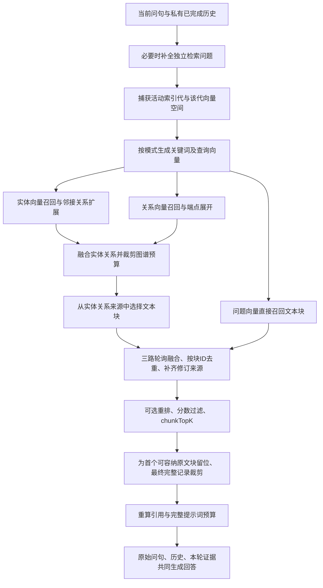

# 知识库问答设计

## 1. 文档基线

- 编写日期：2026-11-04；代码基线：`d65cef8`。
- 依据：[系统设计基线](../DESIGN.md)、[阶段 5 方案](migration/STAGE_5.md)及当前问答代码。
- 对应实现：[知识库问答实现](知识库问答实现.md)。本文描述已实现的设计，不代表新增需求。

## 2. 目标与范围

让知识库成员围绕文档证据进行多轮问答，保留可恢复的私有对话，并能核查每轮回答的原文依据。回答历史用于理解指代、省略和追问，不替代本轮检索证据。

支持五种问答模式、可选重排、真实流式回复、Markdown 渲染、上下文及提示词预览、停止生成和历史恢复。回答缓存禁用；不开放客户端自定义系统提示词或任意历史注入。

## 3. 角色与前置条件

| 使用者或条件 | 规则 |
| --- | --- |
| OWNER、WRITER、READER | 均可在有权访问的知识库内提问 |
| 对话归属 | 同时按用户和知识库隔离，成员不能读取其他成员的对话 |
| 已发布索引 | 当前知识库必须有可用的活动索引 |
| 模型用途 | 必须绑定文本回答模型；向量查询沿用索引代的模型快照 |
| 重排 | 用户选择启用后才尝试；未绑定重排模型时返回明确状态并保持原顺序 |

新建知识库不等于完成上述准备，参见[创建知识库设计](创建知识库设计.md)和[模型配置设计](模型配置设计.md)。

## 4. 页面与交互

1. 进入页面默认是新对话，问句输入框居中；左侧列出当前用户的对话历史标题。
2. 用户点击发送或按 Enter 后，问题立即进入消息区，输入框立即清空并移到底部。Shift + Enter 换行，输入法组合输入不触发发送。
3. 回复按供应商实际增量追加并渲染 Markdown。用户可继续输入下一轮草稿，但当前生成完成前不能重复发送。
4. 问答模式和重排开关位于页面头部；输入区提供发送、预览和生成期间的停止操作。
5. 单击历史标题恢复问题、回答、完成状态和原始证据；新建对话清空当前显示及草稿。
6. 切换知识库、对话或离开页面取消当前请求，迟到结果不能污染新页面。

历史对话每页 50 个，消息每次读取最近或较早的 50 轮。长消息区独立滚动；窄屏历史区移到上方。

## 5. 知识库检索算法设计

### 5.1. 算法目标与输入输出

本功能使用知识图谱与文本块向量协同检索，为回答模型提供本轮可追溯的证据。完整链路为“追问理解 → 捕获索引代 → 关键词/查询向量 → 分支召回 → 图谱扩展 → 来源块选择 → 多路融合 → 可选重排 → 预算裁剪 → 引用重建 → 回答”。

输入包括用户原始问句、服务端选取的已完成历史、问答模式及检索参数。输出包括实体、关系、原文块、引用列表、索引代、实际上下文和诊断信息。最终回答同时接收原始问句和经过裁剪的历史；补全后的问题用于检索，不覆盖用户保存的原始问题。

图中是可选分支总览，实际只执行当前模式和非空关键词允许的分支。

### 5.2. 多轮历史与独立问题补全

1. 只读取当前用户、当前知识库、当前对话的已完成轮次。失败、取消和未完成片段不进入上下文。
2. 最多取最近 10 个问答对，优先保留最近的连续历史，再按时间正序发送；历史选择预算最多约 4096 token，且随上下文余量收缩。
3. 最新一轮本身过长时，可截取带 `[history truncated]` 标记的内容；不把无限历史直接送入模型。
4. 若有保留下来的历史，使用当前回答模型补全一个独立检索问题，保持用户语言和意图，只消解指代、省略，不回答问题或编造事实。
5. 无历史时直接使用原问句。补全调用失败、返回空串或结果超限时明确失败，不能把异常悄悄当成没有证据。

例如，上一轮问“张三在哪个机构任职”，本轮问“他主要研究什么”，补全结果可以是“张三主要研究什么”。这个例子仅说明设计意图，实际补全内容由模型返回。

### 5.3. 索引代与三类向量空间

一次检索单独捕获一个 `active_generation_id`，要求该代为 `ready`。实体向量、关系向量、文本块向量、图谱及文档来源均限定同一知识库和该代。

查询向量使用该代 `embeddingVersion` 对应的执行快照。修改页面中的向量模型绑定不会让旧向量自动变为新空间。关键词使用当前知识库关键词绑定，未绑定时回退到该代的抽取模型；关键词模型与向量模型各自承担不同任务。

查询期间再次检查权限和原代是否可用；新索引发布后，已开始的这轮检索仍保持原代，新一轮请求才捕获新的活动代。

### 5.4. 关键词和查询向量

| 内容 | 用途 |
| --- | --- |
| 低层关键词 | 表达具体人物、机构、地点等细节，用于实体向量召回 |
| 高层关键词 | 表达主题、概念、关系等，用于关系向量召回 |
| 问题本身 | 用于直接块召回，以及 VECTOR 策略的来源块相关性排序 |

非 naive 模式默认调用关键词模型，解析高层、低层关键词 JSON。API 调用方可显式提供关键词跳过提取；高低任一列表被显式提供即进入手工关键词路径，缺失的一侧按空列表处理。当前问答页面只暴露模式与重排等常用控件，手工关键词等高级参数可通过 API 或“检索证据”页面使用。

合法自动结果的两类关键词都为空且问题短于 50 个 Unicode 码点时，可把问题本身作为低层关键词；关键词格式非法仍报错。naive 不执行关键词提取。

根据实际需要，把问题、高层关键词拼接文本、低层关键词拼接文本生成查询向量。相同输入文本先去重，再批量计算；没有相应分支时不额外生成无用向量。

### 5.5. 五种模式与图谱扩展

| 模式 | 起始召回 | 后续扩展与文本来源 |
| --- | --- | --- |
| naive | 问题向量检索文本块 | 不走实体或关系起始召回 |
| local | 低层关键词向量检索实体 | 读取命中实体的邻接关系，再选择保留实体/关系的来源块 |
| global | 高层关键词向量检索关系 | 读取关系两端实体，再选择保留实体/关系的来源块 |
| hybrid | local、global 两路 | 融合两路实体与关系，并选择来源块 |
| mix | local、global、问题向量块召回 | 在图谱来源块之外加入直接向量块，默认模式 |

实体、关系和直接文本块起始召回都使用余弦相似度阈值，取相应 Top-K，并用 ID 处理分数相同的排序。local 的邻接关系按端点度数之和、关系权重、端点名称依次确定顺序；global 的起始关系保持向量相关性顺序，再按关系出现顺序补齐端点。

图谱扩展是从已召回实体读邻接关系、从已召回关系读端点的确定步骤；不是无限递归遍历全图。低层或高层关键词为空时，对应图谱分支不执行。例如，global 没有高层关键词时不会自动改用低层实体分支。

融合实体时按 ID 去重，关系也按 ID 去重。实体的名称、类型、属性和来源关联均保留；同名不同类型不合并，关系端点按 ID 解析。

### 5.6. 来源块选择与多路融合

图谱记录先经过实体、关系预算裁剪，再从保留记录的 `sourceIds` 选择原文块。先选择实体来源，再选关系来源；关系来源选择时排除已经选中的实体来源块。

| 策略 | 规则 |
| --- | --- |
| VECTOR（默认） | 在图谱来源候选集合中，按问题向量与块向量的距离取配额；这里只在已确定来源集合内排序 |
| WEIGHT | 按图记录优先级分配递减配额，结合块出现频次和组顺序选择，并把未用配额回填到仍有候选的组 |

来源块分组先统计出现频次，同一块归属最早出现的组，组内优先放重复关联较多的块。`relatedChunkNumber` 控制配额，不表示最后固定返回这么多块；设为 0 时跳过图谱来源块选择，但 mix/naive 的直接块分支仍可返回文本。

最终按“直接向量块、实体来源块、关系来源块”进行轮询融合，依次从每一路取下一条，按块 ID 首次出现去重。融合后补齐该代文档修订中的全部有效来源，包括文档 ID、修订 ID、块序号、码点位置和标题。

例如三路为 `[A,B]`、`[B,C]`、`[D]`，轮询去重后为 `[A,B,D,C]`。顺序影响未重排时的优先级和预算前缀保留。

### 5.7. 重排、过滤与最终块数量

重排作用于已经补齐来源的候选块，使用检索问题与候选全文；执行顺序是“供应商重排 → 重排分数阈值过滤 → `chunkTopK` → token 预算裁剪”。

- 默认不启用重排；启用但未绑定模型时返回 `not_configured`，保持原融合顺序。
- 有模型但没有候选时返回 `no_candidates`；成功调用返回 `applied`。
- 重排结果保持供应商给出的顺序；不假设该顺序等于本地再次按分数排序。
- 默认最低重排分数 0.5，与默认余弦阈值 0.2 分开使用；重排不会改写原始余弦分数和来源。
- 重排超时、非法索引、重复索引或非法分数明确失败，避免没有提示地改变算法路径。

不启用重排时，仍从融合结果取 `chunkTopK` 前缀，然后执行预算裁剪。`chunkTopK` 是数量上限，不保证每轮能返回同样多的文本块。

### 5.8. 参数、预算与原文证据保留

| 参数 | 默认值 | 实际影响 |
| --- | --- | --- |
| `topK` | 20 | 实体和关系起始向量召回各自的数量上限 |
| `chunkTopK` | 20 | 直接块起始召回上限，也是问答选择器最终数量上限 |
| `cosineThreshold` | 0.2 | 起始实体/关系/块召回的余弦过滤阈值 |
| `relatedChunkNumber` | 5 | 图谱来源块的选择配额参数 |
| `maxEntityTokens` | 6000 | 图谱实体序列化前缀上限 |
| `maxRelationTokens` | 8000 | 图谱关系序列化前缀上限 |
| `enableRerank` | false | 是否尝试使用已绑定重排模型 |
| `minRerankScore` | 0.5 | 重排结果过滤阈值 |

问答省略 `maxTotalTokens` 时，总预算采用回答模型上下文；显式提供时取请求预算与模型上下文的较小值。先预留配置的最大输出、历史及消息开销，内部检索规划最多 64000 token。这里不同于独立检索 API 默认 16000 token 的总规划值。

预算处理分三层：

1. 按实体和关系预算取完整记录前缀，再确保图谱加提示词模板可以放入总预算；超出时先删除关系尾部，再删除实体尾部。
2. 如果选择后的首个文本块在无图谱时能完整放入预算，而当前图谱导致它放不下，则继续按上述顺序裁剪图谱，为该块及其引用留位。若首块本身过大，则保留原图谱，不承诺至少一个块。
3. 选择能放入剩余预算的完整文本块前缀，重算引用和完整模板，必要时删除末尾块；最后再检查真实回答消息、历史和最大输出预留的总量。

预算不会把单个块切成半块来凑数，也不会在首块过大时自动跳到后续较小块。候选为空、重排过滤掉全部候选或预算不足，都可能导致最终块列表为空；实体或关系仍可构成本轮证据。只有图谱与文本块均为空才判定检索 `empty`。

### 5.9. 引用、上下文与可追溯性

引用只根据最终保留的文本块重新生成；按来源路径覆盖的块数分配优先顺序和编号。共享块可以对应多个来源；完整来源元组继续保留，回看时定位到该代修订，而不是自动读取文档最新修订。

回答上下文包含实体（类型、属性、描述）、关系（端点类型、关系类型、描述）、文本块和引用列表。回答模型接收“系统模板及本轮上下文 → 选中历史 → 原始当前问题”的消息序列。历史只帮助理解，不作为事实依据。

生成完成后提取回答中的引用编号，与本轮引用集比对。编号不存在时提示核对；编号存在也不能单独证明回答的事实准确性。

### 5.10. 诊断与效果判断

检索结果保留分支、原始实体/关系数、图谱预算后数量、来源块数、融合块数、最终块数、各阶段 token 及耗时。问答另外返回历史消息数、回答预算和重排状态，用于区分“没有召回”“来源没有关联”“重排淘汰”“预算裁掉”。

例如“融合候选大于 0、最终块为 0”应结合重排状态与预算判断；不能直接归因于上传失败或向量服务没有返回。当前对话页面显示部分状态和证据，更多计数位于响应诊断中，并非全部展示成页面控件。

算法复用[检索证据设计](检索证据设计.md)的同代检索能力。调优应结合具体问题、命中来源和最终提示词验证，单纯增加 Top-K 或最大输出 token 并不保证回答改善；最大输出增加反而会减少输入证据余量。

## 6. 状态与异常

| 状态 | 展示及后续处理 |
| --- | --- |
| running | 正在处理，允许停止 |
| success | 完整成功，回答可进入后续历史上下文 |
| empty | 无足够证据，固定拒答，不调用最终回答生成；该轮可作为已完成历史 |
| failed、cancelled | 明确标记未完成，保留已收到的部分内容，不进入后续历史上下文 |
| interrupted | 历史中运行请求已过期的展示状态，不是数据库新增枚举 |

无活动索引、预算不足、模型失败、权限变化、超时或断流必须显示提示。仅完整成功流程发送 `done`；收到部分文本不等于成功。旧历史中的空证据不会在展示时自动重算。

## 7. 安全与验收要点

- Markdown 支持标题、列表、表格和代码；HTML 转义，危险链接过滤，外部图片仅显示替代文字。
- 原文和问题始终按文本显示；未知引用编号提示核对，不自动关联错误来源。
- 模型调用不占用历史写入的长事务；同一对话一次只允许一个运行轮次，过期请求不能发布成功。
- 验收覆盖立即清空输入、保留新草稿、多轮检索、私有历史、停止/断流、原文定位和预算裁剪。
